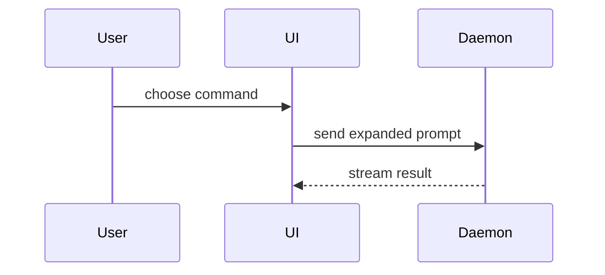

写 PR 正文时使用以下模板：

```markdown
## 概要

<图示、diff 速写或目录树>

## 验证证据

- **变更前：** <截图 / 输出 / 失败的测试运行>
  **变更后：** <截图 / 输出 / 通过的测试运行>

## 合并风险

**可逆性：** <单向门或双向门>

<可选：说明>

**影响半径：** <一词概括>

<可选：合并后可能的连带影响>
```

## 三个段落

不写客套开场，散文保持简短。术语使用 `CONTEXT.md` 里的领域语言。代码、diff、组件树、伪代码中的代码内容保留英文原样，结构性标签一律中文。

### 概要

选能把关键点讲清楚的最小视图。

- 逻辑或算法用伪代码：

```text
on(save)
  if content is unchanged
    return cached result
  write new content
  return fresh result
```

- 运行时控制流用调用树：

```text
submitForm
  createSession
    persistPrompt
    launchAgent
  navigateToSession
```

- UI 结构用组件树，标出要紧的状态与模块边界：

```tsx
<SessionPage>(apps / example / src / routes / session.tsx);
useSessionEvents() < SessionToolbar > <RunSkillButton>(packages / ui);
```

- 文件职责或大范围重构用浅层文件树：

```text
src/
├── commands/       # 解析用户操作
├── sessions/       # 持有会话状态
└── transport/      # 发送 API 请求
```

- 组件交互、控制流或数据流用 Mermaid：



- 重点在「改了什么」且周围结构已存在时用 `diff`，diff 的形态贴合主题。

组件类改动：

```diff
 <SessionPage>
   useSessionEvents()
   <SessionToolbar>
+    <RunSkillButton />
   <SessionTimeline>
+    <SkillResultCard />
```

文件布局类改动：

```diff
 src/
 ├── commands/
+│   └── show-me.ts       # 展开斜杠命令
 ├── sessions/
-└── transport.ts
+└── transport/
+    ├── client.ts
+    └── server.ts
```

调用树或调用栈类改动：

```diff
 submitForm
   createSession
     persistPrompt
+    expandSkillMention
     launchAgent
-  navigateToSession
+  navigateToSession
+    subscribeToEvents
```

状态或控制流类改动：

```diff
 on(save)
-  write content
+  if content is unchanged
+    return cached result
+  write new content
+  invalidate cache
```

- 大部分是新增代码、省略上下文会掩盖归属或顺序、或读者需要一份可复制的目标形态时，整块展示：

```ts
function expandSkill(command: string): string {
  const skillName = command.slice(1);
  return `use the ${skillName} skill`;
}
```

#### 使用要领

每张图放在它支撑的那段短文旁边。只保留回答读者当前问题或解决当前讨论点所需的调用、文件、props、状态与边界。

这些形式可以用一种，也可以几种混用，但不太可能全用上。自行判断，不要堆砌。

### 验证证据

证明改动有效的具体证据，展示变更前与变更后。

截图是最高优先级证据，环境允许且改动可视时优先用。

执行类证据次之：测试结果、控制台输出。用伪代码展示那条原来失败、现在通过的用例。

### 合并风险

说明这是单向门还是双向门。双向门可以走回去，单向门不行。回滚代价低的 PR 风险更低。涉及破坏性操作或难以撤销的决策属于单向门。

影响半径指这个 PR 引入的改动的潜在影响范围，把各种可能都考虑到，例如布局位移、消费方破坏、移动端适配等。
