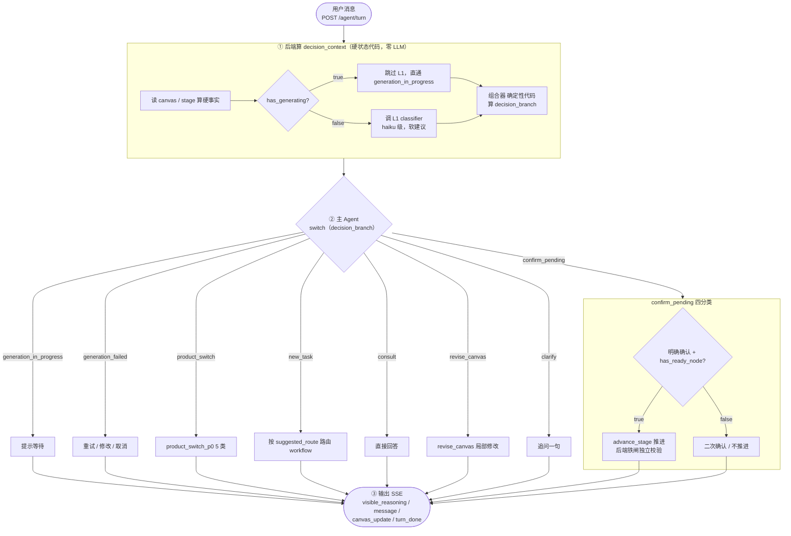
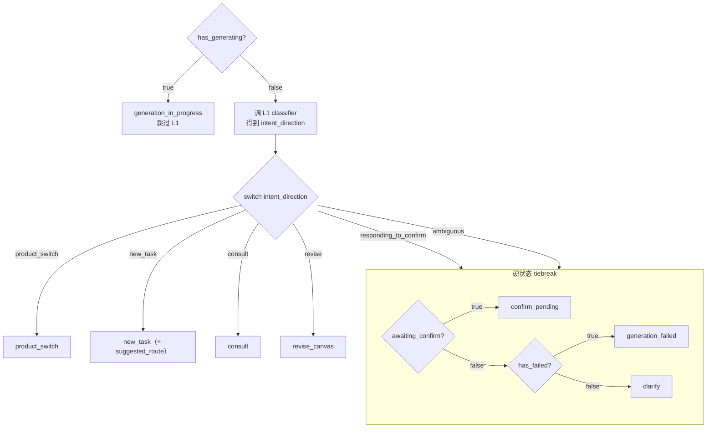

# Decision Layer Rule（判定分层架构）

本规则是主 Agent 判定分层的权威。它把「这一轮 turn 该干什么」拆成三层：硬状态由后端代码算（铁闸，不靠模型）、意图方向由 L1 轻量 classifier 给（软建议）、最终分支由主 Agent 收口（确认门细判 + 调度 + 输出）。

> 设计动机：硬状态判定（多变量结构化分支）是 LLM 弱项，判错率高、难调试；确认门本质是「状态约束」，不该靠模型自觉。于是硬状态下沉后端代码，主 Agent 瘦到「读 `decision_context` → `switch(decision_branch)` → 确认门细判」。

## 一句话规则

后端每轮算好单一 `decision_branch`（+ L1 软建议 + 硬事实）整体喂主 Agent；主 Agent 只做 `switch(decision_branch)` + 确认门四分类 + 调度输出。

## 流程总览（Turn 主流程）



> 后端实现点：① 是后端代码（零 LLM），② 是主 Agent LLM（switch 收口 + 可推翻 L1），`advance_stage` 铁闸在后端独立校验——主 Agent 误判也拦。

## 三层分工

| 层 | 由谁算 | 性质 | 产物 |
|---|---|---|---|
| **硬状态** | 后端代码（零 LLM） | 铁闸，主 Agent 不推翻 | `has_generating` / `has_ready_node` / `has_failed` / `awaiting_confirm` / `pending_workflow` / `current_stage` / `active_product_context` / `previous_product_context` |
| **L1 classifier** | 独立轻量模型（haiku 级） | 软建议，主 Agent 可推翻 | `intent_direction` + 仅 `new_task` 带 `suggested_route` + `route_signals` |
| **主 Agent** | 主 LLM（Director） | 收口 | `switch(decision_branch)` → 确认门四分类 / 调度 worker / 输出 |

> 硬状态是事实，L1 是猜测，主 Agent 是收口。三层不混：代码不猜意图，L1 不写硬状态，主 Agent 不重算硬事实。

## `decision_context` 数据结构

后端每轮 turn 前置算好，整体喂主 Agent。字段权威定义见 `backend_implementation_contract.md`，本文件定义语义。

```text
decision_context:
  # 硬事实（后端代码算，零 LLM）
  has_generating: bool              # 是否有 generating 节点
  has_ready_node: bool              # 当前 stage 是否有 ready/awaiting_confirm 节点
  has_failed: bool                  # 是否有 failed 节点
  awaiting_confirm: bool            # 当前 stage 是否在等确认
  pending_workflow: bool            # 是否有未完成 workflow
  current_stage: stage_ref          # 当前 stage（id + name + status）
  active_product_context: object    # 当前产品方向（见 product_switch_p0.md）
  previous_product_context: object? # 前一个产品方向（无则 null）

  # L1 输出（轻量 classifier，软建议）
  intent_direction: enum            # product_switch / new_task / consult / revise / responding_to_confirm / ambiguous
  suggested_route: enum?            # 仅 new_task 带：lightweight / full_canvas
  route_signals: string[]           # L1 判定用的信号（强/弱），供主 Agent 评估是否推翻

  # 组合结果（后端代码按下方优先级算出，单一值）
  decision_branch: enum             # 见下「decision_branch 枚举」
```

## `decision_branch` 枚举（8）

| branch | 触发 | 主 Agent 动作 |
|---|---|---|
| `generation_in_progress` | `has_generating=true` | 提示等待，不推进，不启新 Job |
| `generation_failed` | tiebreak 命中 `has_failed` | 读 failed node 错误，提供重试 / 修改 / 取消 |
| `product_switch` | L1 `intent_direction=product_switch` | 读 `product_switch_p0.md` 分类处理（5 类） |
| `new_task` | L1 `intent_direction=new_task` | 按 `suggested_route` 路由：lightweight → `direct_generation.md` / `image_generation_prompt.md`；full_canvas → `video_agent_canvas.md` |
| `consult` | L1 `intent_direction=consult` | 直接回答，不启 workflow / GenerationJob |
| `revise_canvas` | L1 `intent_direction=revise` | 读 `rules/revise_canvas.md`（局部修改当前画布，非产品切换） |
| `confirm_pending` | tiebreak 命中 `awaiting_confirm` | 判确认门四分类（见 `confirmation_gate.md`） |
| `clarify` | tiebreak 无硬状态命中 | 问一句澄清目标 |

## 组合器优先级算法（确定性代码，零 LLM）

后端按以下顺序算出单一 `decision_branch`。**全程无 LLM**，可日志、可调试、可复现。

```text
STEP 0（物理最高）：if has_generating  → generation_in_progress   # 连 L1 都不调
STEP 1：            else switch(intent_direction):
                       product_switch → product_switch
                       new_task       → new_task                 # 带 suggested_route
                       consult        → consult
                       revise         → revise_canvas
                       responding_to_confirm | ambiguous → STEP 2
STEP 2（硬状态 tiebreak，仅 responding_to_confirm / ambiguous 进）:
                       if awaiting_confirm → confirm_pending
                       elif has_failed     → generation_failed
                       else                → clarify
```

优先级（决策 19）：`has_generating` 物理最高 → L1 意图优先（`product_switch` > `new_task` > `consult` > `revise` > `responding_to_confirm` > `ambiguous`）→ 硬状态 tiebreak。

### 判定树（可视化）



## L1 classifier 契约

L1 是**独立轻量 classifier**（haiku 级），不是主 Agent 自判。

**输入**：
- 用户当前一句话（`text`）
- 硬事实快照（`has_generating` / `has_failed` / `awaiting_confirm` / `pending_workflow` / `active_product_context` 是否存在 / `previous_product_context` 是否存在）

**输出**：
- `intent_direction`（6 选 1）
- `suggested_route`（**仅** `new_task` 带，`lightweight` / `full_canvas`）
- `route_signals`（判定信号，供主 Agent 评估推翻）

**调用时机**（决策 20）：
- `has_generating=true` → **跳过 L1**，直接 `generation_in_progress`（零成本）。
- 其余情况调 L1。
- 硬状态代码每次 turn 必跑（零成本）；L1 只在硬状态没短路时才调。

**判定信号**（沿用 `generation_route_decision.md`）：
- 强信号（`new_task` + `full_canvas`）：广告 / UGC / 短剧 / 品牌片 / 脚本 / 分镜
- 强信号（`new_task` + `lightweight`）：生成一张图 / X 秒视频 / 单镜头
- `product_switch` 强信号：换产品 / 换主体 / 用前面的产品 / 回到刚才那个
- `revise` 强信号：改一下 / 重做 / 换风格 / 这张不行 / 脚本不对 / 保留这个
- `consult` 强信号：问方法 / 架构 / 规则 / 对比 / 建议
- `responding_to_confirm`：确认 / 满意 / 继续 / 好了 / 下一步 / OK
- 弱信号（歧义）→ `ambiguous`

> L1 判定结果必须进 `visible_reasoning`（决策 11，暴露 + 可推翻），说人话，且在 Job 启动**前**暴露。

## 主 Agent switch 表

主 Agent 读 `decision_context.decision_branch`，按下表收口。**不再自判硬状态、不再做语义分流大段**。

```text
switch(decision_branch):
  generation_in_progress → 提示「还在生成中，等画布完成」，不启新 Job
  generation_failed      → 读 failed node，提供「重试 / 修改 / 取消」
  product_switch         → 读 product_switch_p0.md，按 5 类处理
  new_task               → 按 suggested_route 路由到 lightweight / full_canvas workflow
  consult                → 直接回答，不启 workflow
  revise_canvas          → 读 rules/revise_canvas.md（局部修改当前画布）
  confirm_pending        → 读 confirmation_gate.md，判四分类
  clarify                → 问一句「新建视频 / 修改当前画布 / 选 Skill」
```

## 推翻规则（主 Agent 可推翻 L1 软建议）

L1 是**软建议**，主 Agent 可推翻。推翻时**必须**在 `visible_reasoning` 里说理由。

| 场景 | L1 输出 | 主 Agent 推翻为 | 理由 |
|---|---|---|---|
| 用户说「换背景」但产品没变 | `product_switch` | `revise_canvas` | 产品主体未变，是局部修改 |
| 用户说「重新生成这版」 | `new_task` | `revise_canvas` | 当前画布已有结果，是修改非新建 |
| 用户说「再做一个不同角度」 | `revise` | `new_task` | 明确要新结果，非改旧节点 |

**不可推翻**：`generation_in_progress` / `generation_failed` / `confirm_pending` 三条由后端代码硬状态算出，是铁闸，主 Agent 不推翻（只能在其下做细判，如 confirm_pending 内判四分类）。

## confirm_pending 后端铁闸（决策 20）

`confirm_pending` 分支由 `decision_context` 算出（`awaiting_confirm=true`），主 Agent 只在命中时判确认门四分类。

**铁闸**：`advance_stage` 必须独立校验 `has_ready_node`。即使主 Agent 误判要推进，`advance_stage` 也拦。不靠模型自觉（呼应 `confirmation_gate.md`「确认门是状态约束」）。

- 明确确认 + `has_ready_node=true` → 允许 `advance_stage`
- 弱继续（继续 / 好了 / 下一步）→ 二次确认，不推进
- 修改意图 → 进 `revise_canvas`
- 无 `has_ready_node` → 不推进（铁闸兜底）

## L1/L2 统一（决策 20）

**废除 L2 概念**。原 Full Canvas 内部 Stage 0 的「L2 意图识别」（判新建 / 修改 / 确认 / 切 Skill / 咨询）取消——这些判定现在统一由 turn 前置的 `decision_context.decision_branch` 承担。

- 全场景（轻量编排 + Full Canvas）复用**同一套** `decision_branch`。
- `video_agent_canvas.md` 的 Stage 0 不再是独立意图识别层，改为承接 `decision_context.decision_branch`，路由到对应 stage。
- 主 Agent 入口的 L1 与原 Full Canvas 的 L2 是**同一个 classifier**，不再分两层。

## 相关文档

- `confirmation_gate.md`：确认门四分类（confirm_pending branch 细判）
- `generation_route_decision.md`：L1 路由信号 + 暴露可推翻（决策 11）
- `product_switch_p0.md`：product_switch branch 的 5 类细判
- `backend_implementation_contract.md`：`decision_context` 字段权威定义 + `advance_stage` 铁闸硬约束
- `workers/director_agent.md`：主 Agent `switch(decision_branch)` 落地
