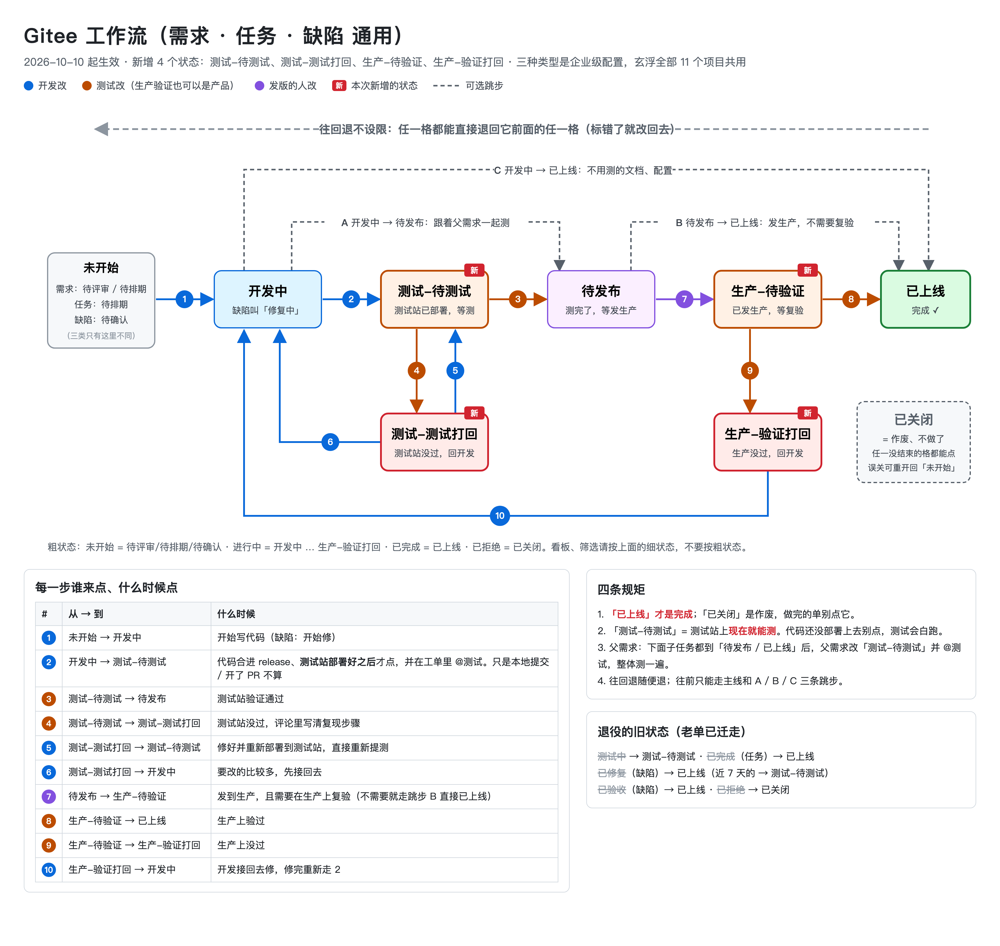

# Gitee 工作流：需求 · 任务 · 缺陷

2026-10-10 起生效。三种类型现在共用一条主线，只有起点不一样。这次新增了 4 个状态：
**测试-待测试、测试-测试打回、生产-待验证、生产-验证打回**。

> 这三种类型是企业级配置，玄浮全部 11 个项目共用。在一个项目里看到的流程，在其他项目里也一样。
> 想改流程先在群里说一声，别单独去改类型设置。

## 一句话版

**代码做到哪一步，就把工单改到哪一格：**

| 代码做到哪一步 | 工单改成 | 谁改 |
| --- | --- | --- |
| 开始写代码 / 开始修 | 开发中（缺陷叫「修复中」） | 开发 |
| 本地提交、开了 PR | **不改**，在工单里评论进度和 PR 链接 | 开发 |
| 合进 release，**测试站已经部署好** | 测试-待测试，并在评论里 @测试 | 开发 |
| 测试站没过 | 测试-测试打回，评论里写清复现步骤 | 测试 |
| 修好并重新部署到测试站 | 测试-待测试（直接重新提测） | 开发 |
| 测试站通过 | 待发布 | 测试 |
| 发生产，需要在生产上复验 | 生产-待验证 | 发版的人 |
| 发生产，不需要复验 | 已上线 | 发版的人 |
| 生产上验过 | 已上线 | 测试 / 产品 |
| 生产上没过 | 生产-验证打回 → 开发接回去改「开发中」 | 测试 / 产品 → 开发 |
| 不做了 | 已关闭 | 负责人 |

## 各个状态是什么意思

| 状态 | 意思 | 粗状态 |
| --- | --- | --- |
| 待评审（只有需求有） | 刚提出来，还没评审 | 未开始 |
| 待排期（需求、任务） | 评审过了，还没排进开发 | 未开始 |
| 待确认（只有缺陷有） | 刚报上来，还没确认是不是 bug | 未开始 |
| 开发中 / 修复中 | 正在写代码 | 进行中 |
| **测试-待测试** 新 | 代码已经在测试站上，测试**现在就能测** | 进行中 |
| **测试-测试打回** 新 | 测试站没过，回到开发手里 | 进行中 |
| 待发布 | 测完了，等发生产 | 进行中 |
| **生产-待验证** 新 | 已经发到生产，等在生产上复验 | 进行中 |
| **生产-验证打回** 新 | 生产上没过，回到开发手里 | 进行中 |
| 已上线 | **做完了**。唯一的「完成」 | 已完成 |
| 已关闭 | **作废、不做了**。不是完成 | 已拒绝 |

## 四条规矩

1. **「已上线」才是完成，「已关闭」是作废。** 做完的单点「已关闭」，统计里就成了没做。
2. **「测试-待测试」= 测试站上现在就能测。** 只是本地提交或开了 PR 时别点，测试会白跑一趟。
3. **父需求最后整体测。** 父需求下面的子任务都到「待发布」或「已上线」后，把父需求改成「测试-待测试」并 @测试。
   子任务如果是跟着父需求一起测的，自己直接从「开发中」改到「待发布」（跳步 A），不用单独提测。
4. **往回退随便退，往前只走主线和三条跳步。** 标错了直接退回去，任一格都能退回它前面的任一格。
   往前的三条跳步：
   - A 开发中 → 待发布：跟着父需求一起测，不单独测
   - B 待发布 → 已上线：发生产了，不需要在生产上复验
   - C 开发中 → 已上线：不用测的文档、配置

   任何还没结束的格都能直接改成「已关闭」；误关了能从「已关闭」重开回起点。

## 退役的旧状态

下面这几个状态已经从类型里拿掉，老单已经整批迁走。在别处（旧文档、旧筛选条件、看板）看到它们，按右边理解：

| 旧状态 | 现在是 |
| --- | --- |
| 测试中（需求） | 测试-待测试 |
| 已完成（任务） | 已上线 |
| 已修复（缺陷） | 已上线；最近 7 天的迁到了测试-待测试 |
| 已验收（缺陷） | 已上线 |
| 已拒绝（需求、缺陷） | 已关闭 |

存过按旧状态筛选的视图，要重新选一次。

## 给 AI 看的版本

Claude、Codex 等 Agent 改工单时读 [gitee-workflow-agent.md](./gitee-workflow-agent.md)：状态 id、
每个开发节点该改成哪一格、哪些格 Agent 不能点。两份讲的是同一套流程，改流程时两份一起改。

## 怎么做的、备份在哪

这次改动是 2026-10-10 用企业拥有者身份通过企业 OpenAPI 改的，改之前三种类型的状态、企业级和项目级工作流画布都备份过。
要回退或复查，找李述。
