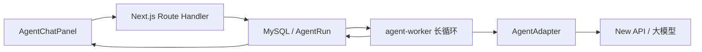
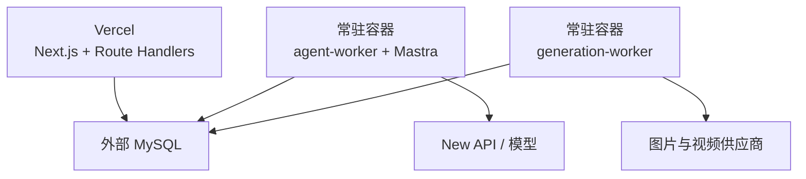
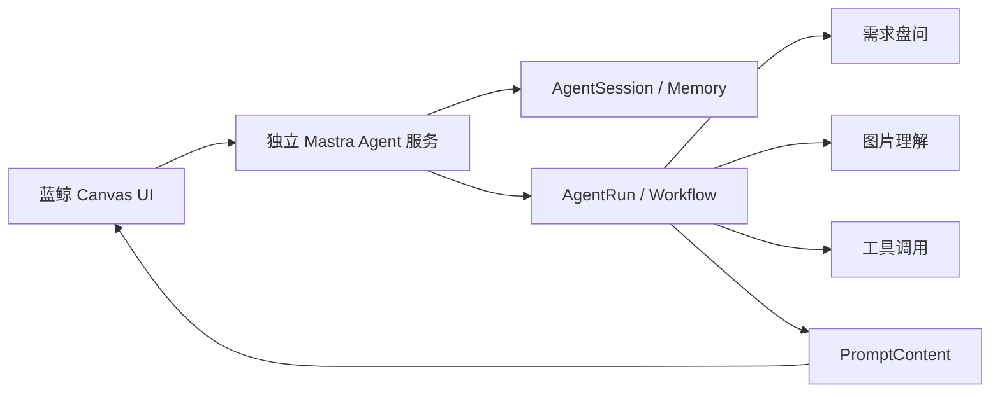
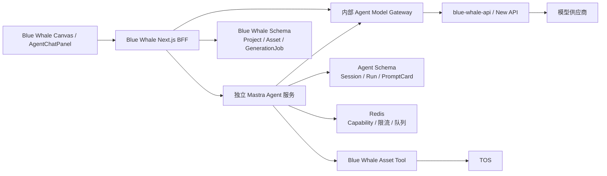

# Mastra 独立 Agent 服务迁移讨论完整对话

## 时间

2026-08-11

## 背景 / 目标

归档 Codex 任务“解释 Mastra 与 Vercel”（任务 ID：`019fee77-bf1e-75d2-91e4-197bcf359c5d`）中，从 Mastra/Vercel 概念解释到独立 Agent 服务迁移设计的完整可见对话，供后续审计、交接和重新核对决策。

## 导出范围

- 按发生顺序导出 54 轮可见对话；
- 保留用户消息、助手正式回复和有意义的进度更新；
- 文件变更只保留路径与动作摘要，不复制工具原始输出；
- 排除系统/开发者隐藏指令、模型内部 reasoning、潜在凭证和被截断的超大工具输出；
- 本文是讨论过程归档，不是权威设计结论；已确认决定以 [Mastra 独立 Agent 服务迁移决策记录](../specs/2026-08-11-mastra-agent-service-decision-log.md) 为准。

## 对话记录

## 第 1 轮

### 用户

Mastra + Vercel  是什么的东西？

### 助手

**Mastra + Vercel** 通常指用这两项技术搭建并上线 AI 应用：

- **Mastra**：TypeScript 的 AI 应用开发框架。主要用来编排 AI Agent、工作流、工具调用、RAG/知识库、记忆与模型接入。可以把它理解成 AI 应用的“后端逻辑与调度层”。
- **Vercel**：云端部署平台，擅长托管 Next.js、前端网站和 Serverless/Edge API。它负责把应用发布到公网、自动构建、提供域名以及运行后端函数。

合起来大致是：

```text
网页 / Next.js
      ↓
Vercel 部署与运行
      ↓
Mastra Agent / 工作流
      ↓
OpenAI 等模型 + 数据库 + 外部工具
```

例如做一个“资料研究助手”：

- Vercel 托管聊天界面和 API
- Mastra 控制 Agent 如何搜索、调用工具、保存记忆及组织回答
- OpenAI 等服务提供底层大模型

简而言之：**Mastra 负责 AI 怎么工作，Vercel 负责应用怎么部署和对外提供服务。**它们不是同一类产品，而是一套常见的开发组合。


## 第 2 轮

### 用户

agent 本体呢 还是要自己开发 还是说 Mastra 就是agent？

### 助手

Mastra **不是一个现成的 Agent 本体**，而是用来开发、组织和运行 Agent 的框架。

可以这样区分：

- **大模型**（GPT、Claude 等）：大脑，负责推理和生成
- **Mastra**：Agent 的运行框架，连接模型、工具、记忆、工作流和知识库
- **你的代码与配置**：定义 Agent 的身份、目标、提示词、工具及行为规则
- **Vercel**：部署和运行整个应用

一个 Mastra Agent 通常要由你定义：

```ts
const agent = new Agent({
  name: "Research Assistant",
  instructions: `
    你是一名研究助手。
    搜集多个来源、交叉验证，并给出引用。
  `,
  model: "openai/gpt-5",
  tools: {
    webSearch,
    readDocument,
    saveReport,
  },
});
```

这里的 `Agent` 类和调用循环由 Mastra 提供；但下面这些通常仍由你开发或配置：

- Agent 要完成什么任务
- 系统提示词和行为边界
- 能调用哪些工具及其实现
- 记忆与知识库如何保存
- 多步骤业务流程
- 权限、异常处理和人工确认
- 网页或聊天界面

所以更准确地说：

> **Mastra 提供 Agent 的“骨架和运行时”，你负责塑造具体的 Agent。**

它可能也有示例、模板和预制集成，能减少大量基础代码，但一般不会开箱即用地理解你的具体业务。


## 第 3 轮

### 用户

你看一下代码里的agent模块，以及说这个 想替换 你看看 怎么替换 以及说 我想快速熟悉这个代码 Mastra + Vercel

### 助手（进度更新）

我先按仓库规则完整读取 `CLAUDE.md`，然后梳理现有 agent 模块的入口、调用链和部署结构，再判断 Mastra + Vercel 能替换哪一层、改造成本多大。为了帮你快速熟悉代码，我也会整理一条最短阅读路径。

### 助手（进度更新）

这次是“代码理解 + 架构替换评估”，我会按仓库的代码情报规则来查，不会直接改代码；先把现状和迁移边界搞清楚。

### 助手（进度更新）

`using-superpowers` 要求在代码探索前选择适用流程；这里我采用 `codebase-design` 来评估模块边界与替换缝隙。当前只读分析，不创建 worktree，也不修改仓库。

### 助手（进度更新）

初步看到了一个很关键的事实：仓库已经把“Agent 本体”拆成两层——`apps/agent-worker` 负责可靠编排与状态推进，`packages/agent-runtime` 只负责模型/工具执行适配。Mastra 最自然的替换点大概率是后者，不是整个 worker；我正在核对接口和持久化约束。

### 助手

看完代码后，结论比较明确：

> **Mastra 可以替换当前的 Agent Runtime 实现，但不应该直接替换整个 `agent-worker`。Vercel 可以承载 Web/业务 API，但不能直接承载现有长循环 Worker。**

## 当前 Agent 到底是什么

这套代码的 Agent 不是一个单独的“Mastra 式 Agent 对象”，而是几层共同组成：



各层职责：

| 模块 | 当前职责 | Mastra 是否替换 |
|---|---|---|
| `AgentChatPanel` | 对话 UI | 不替换 |
| Next.js Route Handler | 接收消息、创建 AgentRun | 不替换 |
| `agent-worker` | 领取任务、lease、崩溃恢复、提交结果 | 建议保留 |
| `AgentAdapter` | 把提示词交给模型，解析模型输出 | **最适合由 Mastra 替换** |
| Prisma/MySQL | 保存消息、Run、任务和幂等状态 | 建议保留 |
| Vercel | 尚未接入 | 可部署 Web/API，不适合长循环 Worker |

现有架构刻意设置了一个很干净的替换缝隙：

```ts
export interface AgentAdapter {
  readonly name: string;
  ready(): Promise<boolean>;
  invoke(request: AgentRequest): Promise<AgentResult>;
}
```

见 [runtime-ports.ts](/Volumes/FORGE/projects/work/blue-whale-ai/packages/core/src/runtime-ports.ts)。

这意味着只要 Mastra 最终仍然输入 `AgentRequest`、输出 `AgentResult`，上面的可靠任务系统基本不需要动。

## 现在的“Agent 本体”在哪里

目前真实 Agent 的核心实现是：

[real-agent-adapter.ts](/Volumes/FORGE/projects/work/blue-whale-ai/packages/agent-runtime/src/real-agent-adapter.ts)

它实际完成的事情很简单：

1. 拼接系统提示词。
2. 注入 Creative Skill。
3. 注入图片/场景卡引用投影。
4. 加入历史消息。
5. 调用 OpenAI 兼容的 New API。
6. 要求模型输出 JSON。
7. 用 Zod 校验。
8. 转成以下四种动作之一：

```text
respond
clarify
cancel
submit_plan
```

所以当前实现更接近：

> **一次受控的结构化 LLM 调用**

它还不是典型的多步自主 Agent：没有开放式工具循环、没有动态规划循环、没有让模型连续自主执行多个工具。

真正复杂且重要的部分在：

- [worker-loop.ts](/Volumes/FORGE/projects/work/blue-whale-ai/apps/agent-worker/src/worker-loop.ts)：领取、lease、心跳、重放、调用记录、提交结果。
- [worker-run-pin.ts](/Volumes/FORGE/projects/work/blue-whale-ai/apps/agent-worker/src/worker-run-pin.ts)：校验模型、提示词资源、Skill、工具授权和预算。
- [startup.ts](/Volumes/FORGE/projects/work/blue-whale-ai/apps/agent-worker/src/startup.ts)：选择 fake/real runtime。
- [agent-run-repo.ts](/Volumes/FORGE/projects/work/blue-whale-ai/packages/persistence/src/agent-run-repo.ts)：AgentRun 持久化入口。

换句话说：

> 现在的 Agent “能力”主要在 adapter；Agent “可靠运行”主要在 worker 和 persistence。

## 推荐怎么替换成 Mastra

最稳妥的方式是新增一个 Mastra Adapter：

```text
AgentAdapter
├── FakeAgentAdapter
├── NewApiAgentAdapter       ← 当前实现
└── MastraAgentAdapter       ← 新增
```

示意代码：

```ts
export function createMastraAgentAdapter(options): AgentAdapter {
  const agent = new Agent({
    name: "blue-whale-agent",
    instructions: "...",
    model: options.model,
    tools: {
      readAsset,
      writePlanCards,
    },
  });

  return {
    name: "mastra-agent-runtime",

    async ready() {
      return true;
    },

    async invoke(request): Promise<AgentResult> {
      const result = await agent.generate(request.prompt, {
        instructions: buildInstructions(request),
        structuredOutput: {
          schema: realAgentResponseSchema,
        },
      });

      return mapMastraResult(result);
    },
  };
}
```

然后把启动配置扩展为：

```text
AGENT_RUNTIME_MODE=fake
AGENT_RUNTIME_MODE=real
AGENT_RUNTIME_MODE=mastra
```

在 [startup.ts](/Volumes/FORGE/projects/work/blue-whale-ai/apps/agent-worker/src/startup.ts) 装配不同 Adapter。

### 第一阶段应该控制范围

建议第一阶段只让 Mastra负责：

- 模型调用
- 结构化输出
- 提示词组合
- `read_asset` 这类只读工具
- `write_plan_cards` 作为“产生候选结果”，而不是直接写数据库

不要一开始就让 Mastra接管：

- AgentRun 状态
- 消息持久化
- lease 和 fencing
- Provider 调用重放
- 用户取消
- RunCommit
- Prisma 数据库写入
- 图片生成副作用
- Canvas/SceneCard 直接写入

原因是当前系统明确规定：模型只能提出动作，产品事实由 Worker/Repository 接纳。若把数据库写工具直接交给 Mastra，会绕过现有幂等、权限和恢复机制。

## Mastra 是否值得换

以当前功能范围看，**Mastra 不是刚需**。

当前 Agent 每轮只允许一次模型调用：

```ts
max_provider_calls === 1
protocol_repair_attempts === 0
```

而且输出严格限制为一个结果。当前约几百行 adapter 已经能完成，直接加入 Mastra 会增加依赖和抽象层，却暂时用不到它最有价值的部分。

当你准备增加下面能力时，Mastra 才更有意义：

- 多步工具调用
- 不同专业 Agent 协作
- RAG/向量检索
- Agent memory
- 可观测的工作流
- 人工确认节点
- 多模型路由
- 长流程状态图

因此我建议：

> **先保留现有 Worker，在 `AgentAdapter` 后面试接 Mastra。不要做“全量重写”。**

这样能用一个配置开关做 A/B 对照，也能随时切回当前实现。

## Vercel 怎么放

仓库当前决策已经说得很直接：

- Next.js Web 和业务 API 在同一应用。
- `agent-worker`、`generation-worker` 是独立 Node 长循环。
- Worker 不能塞进 Next.js 请求生命周期。

参见 [ADR-0059](/Volumes/FORGE/projects/work/blue-whale-ai/docs/adr/0059-business-api-into-nextjs-route-handlers.md)。

因此合理部署是：



也就是：

- **Vercel**：部署 `blue_whale_web`
- **常驻容器/云主机**：部署 `agent-worker`
- **常驻容器/云主机**：部署 `generation-worker`
- 三者连接同一个数据库

不能简单把整个仓库部署到 Vercel，因为 Worker 里存在无限循环、数据库任务领取、心跳续租和独立 HTTP readiness server。这些都需要常驻进程。

如果目标是“全部上 Vercel”，那就不是简单部署，而是要重新设计任务调度，例如改成事件触发、队列消费或定时短执行；改造面会明显大于接入 Mastra。

## 快速熟悉代码的最短路径

按下面顺序读，最快形成整体认识：

1. [ADR-0068](/Volumes/FORGE/projects/work/blue-whale-ai/docs/adr/0068-node-typescript-product-runtime-and-specialized-compute-boundary.md)  
   先理解为什么是 Next.js + 两个独立 Worker。

2. [runtime-ports.ts](/Volumes/FORGE/projects/work/blue-whale-ai/packages/core/src/runtime-ports.ts)  
   看清 `AgentRequest → AgentResult` 和四种 AgentAction。

3. [real-agent-adapter.ts](/Volumes/FORGE/projects/work/blue-whale-ai/packages/agent-runtime/src/real-agent-adapter.ts)  
   看目前“大模型 Agent”实际上做了什么。

4. [worker-run-pin.ts](/Volumes/FORGE/projects/work/blue-whale-ai/apps/agent-worker/src/worker-run-pin.ts)  
   看提示词、模型、Skill、引用和预算如何进入 Agent。

5. [worker-loop.ts](/Volumes/FORGE/projects/work/blue-whale-ai/apps/agent-worker/src/worker-loop.ts)  
   看一次任务如何领取、执行和提交。

6. [index.ts](/Volumes/FORGE/projects/work/blue-whale-ai/apps/agent-worker/src/index.ts)  
   看数据库、runtime 和 worker 如何组装启动。

7. [AgentChatPanel.tsx](/Volumes/FORGE/projects/work/blue-whale-ai/blue_whale_web/app/canvas/_canvas/components/AgentChatPanel.tsx)  
   最后再看用户端交互。

我的总体建议是：

> **Mastra 替换 `NewApiAgentAdapter`，Vercel 替换 Web 的部署平台；不要让 Mastra 替换 AgentRun 领域模型，也不要让 Vercel Serverless 直接替换常驻 Worker。**

这次使用了仓库的 `codebase-design` 规则来寻找替换 seam；现有 `AgentAdapter` 正好是一个已经存在、可安全增加第二个 adapter 的真实 seam。


## 第 4 轮

### 用户

我的意思是全部agent 模块都不用了 都用现成的  Mastra 这个东西不就是agent编排吗？为什么不能替换？

### 助手

对，**Mastra 确实是 Agent 编排框架，技术上可以把现在的 `apps/agent-worker` 和 `packages/agent-runtime` 整套替换掉。**

我上一条强调“不建议直接替换”，不是说做不到，而是：**删掉现有 Agent 模块后，里面承担的业务可靠性能力必须决定保留、迁移还是放弃。Mastra不会自动理解这些蓝鲸业务规则。**

## 可以怎么整体替换

目标架构可以变成：

```text
当前：
Next.js → MySQL AgentRun → agent-worker → AgentAdapter → 模型

替换后：
Next.js → Mastra Agent / Workflow → 模型与工具
                    ↓
              Mastra Storage
```

可以删除或退役：

- `apps/agent-worker`
- `packages/agent-runtime`
- `AgentAdapter`
- worker polling loop
- runtime manifest 的部分机制
- fake/real adapter 装配
- 当前 JSON 协议解析
- 部分 AgentRun worker repository

然后用 Mastra提供：

- `Agent`：角色、提示词、模型和工具
- `Workflow`：对齐需求→询问→确认→出方案
- `Tools`：读取素材、生成计划卡、触发图片/视频生成
- `Memory`：对话历史
- `Storage`：Agent/Workflow 状态
- suspend/resume：等待用户补充或确认
- structured output：输出计划卡
- tracing/evals：观察 Agent 执行过程

## 为什么不是“换个依赖就完成”

当前 `agent-worker` 不只在编排模型，它还做了大量产品级状态控制：

| 现有能力 | Mastra能否直接替代 |
|---|---|
| 提示词和模型调用 | 能 |
| 多步骤 Agent 编排 | 能，而且更合适 |
| 工具调用 | 能 |
| 结构化输出 | 能 |
| 对话记忆 | 能 |
| 等待用户确认后恢复 | 可通过 Workflow suspend/resume |
| AgentRun 产品状态 | 需要重新映射 |
| 数据库 lease/fencing | 不一定需要，但要重新设计并发策略 |
| 重复请求幂等 | 业务侧仍需处理 |
| 用户停止、失败、重试 | 需要接到 Mastra Workflow 状态 |
| PlanMessage/SceneCard 原子写入 | 仍然是蓝鲸业务逻辑 |
| 素材权限二次校验 | 仍然必须自己实现 |
| 生成费用与任务状态 | 仍属于产品领域 |
| 前端 SSE/状态展示 | 需要重新接线 |

所以不是“不能全换”，而是：

> **Mastra 能替换 Agent 的执行与编排基础设施，但不能自动替换蓝鲸自己的产品状态和业务规则。**

这些业务规则可以改写成 Mastra Tools 和 Workflow steps，不必继续保留原来的 worker 代码。

## 如果你的目标是快速上线，我赞成整体替换

从代码看，这个项目目前仍处于上线前阶段，而且现有 Agent 被严格限制为“每轮一次模型调用”。为了可靠性写了不少 worker、lease、pin、commit 代码，架构重量可能超过当前产品阶段。

如果你接受以下变化，整体换 Mastra 是合理的：

- 不兼容旧的在途 AgentRun。
- 不保留当前 worker 的精确崩溃恢复语义。
- Agent 执行状态改由 Mastra Workflow/Storage 管理。
- 蓝鲸数据库只保存最终产品事实。
- 图片/视频生成仍保留独立异步任务，或另外接队列。
- 前端聊天协议可以同步调整。
- 先追求功能跑通，再补生产级幂等与恢复。

## 推荐的新模块划分

```text
blue_whale_web/
  app/api/agent/chat/route.ts       # 对外聊天入口
  app/api/agent/resume/route.ts     # 用户确认/补充后恢复

packages/mastra/
  src/mastra.ts                     # Mastra 实例与 storage
  src/agents/creative-agent.ts      # 创作 Agent
  src/workflows/creative-flow.ts    # 对齐→确认→方案
  src/tools/read-asset.ts           # 读取授权素材
  src/tools/write-plan.ts           # 保存计划
  src/tools/generate-media.ts       # 提交生成任务
```

其中核心 Workflow 大致是：

```text
接收消息
  ↓
读取项目、历史、素材
  ↓
Agent 判断信息是否充分
  ├─ 不充分 → suspend，询问用户
  └─ 充分
       ↓
     生成计划卡
       ↓
     suspend，等待用户确认
       ↓
     写入 PlanMessage / 创建生成任务
```

这样 Mastra 就真的成为整个 Agent 编排中心，而不是只套在旧 Adapter 外面。

## Mastra + Vercel 的两种落地方式

### 方案 A：彻底简化，全部请求式执行

```text
Vercel Next.js Route Handler
        ↓
Mastra Agent / 短 Workflow
        ↓
数据库和模型
```

适合：

- 单次执行时间短
- 主要是聊天和出方案
- 长任务只负责提交到外部生成平台
- 不要求 Agent 在后台持续自主运行

这是最适合“快速上线”的方案。

### 方案 B：Mastra负责长流程

```text
Vercel Web
   ↓
独立 Mastra Server / Mastra Cloud
   ↓
Mastra Workflow + Storage
```

适合：

- 多步骤长时间运行
- suspend/resume
- 后台工具链
- 多 Agent
- 需要更完整的运行记录

不要把不确定时长的 Agent 长流程强塞进普通 Vercel Function。Vercel 可以继续部署 Web，Mastra运行在适合常驻或持久工作流的环境。

## 我的修正结论

你的理解没错：

> **可以把现有 Agent 模块全部废弃，用 Mastra重新实现 Agent 编排。**

真正需要保留的不是现有 Agent 代码，而是下面这些业务语义：

- 谁能读取哪些素材
- 何时询问用户
- 何时需要最终确认
- 计划卡是什么结构
- 如何创建生成任务
- 如何防止重复扣费/重复生成
- 停止、失败和重试在产品上如何呈现

我的推荐是：

> 如果当前还没有正式用户和必须兼容的运行数据，就不要做 `MastraAdapter` 渐进迁移；直接设计新的 Mastra Workflow，替换 `agent-worker + agent-runtime`，同时保留 Prisma 中 Project、Conversation、Asset、PlanMessage、GenerationJob 等产品领域模块。

这会是一次**架构重写**，但可能比继续维护现有自研 Agent 编排更符合你想快速熟悉、快速上线的目标。


## 第 5 轮

### 用户

A B 这两个方案的取舍 我没明白？有什么区别，首先定一个基调，第一现在的agent模块是肯定不要了，肯定是要用这个开源项目来替代

第二 其他我就不懂了 ab方案

第三想做的是就是 蓝鲸画布里面 要兼容agent 就是客户和agent聊完了之后生成一个 类似提示词 任务卡之类的东西，一个卡片，把这个卡片带入到下面的输入框里面，进输出。

当前这个任务的核心就是看看怎么转？第一版本应该就是类似chatgpt？或者codex，主要是文生文，或者是识别图片，然后生文的这种概念，不需要生图


你还有不懂的或者颗粒度没有对齐的，可以使用 matt 的skill girllme with docs 来进行盘问，没有问题了，我们再开始迁移

而且我想把这个agent迁移出来 就是单独一个仓库 不走蓝鲸 agent是单独自己一个服务，只是前端ui集成到了蓝鲸里面

### 助手（进度更新）

收到，基调先锁死：现有 `agent-worker + agent-runtime` 不保留；新 Agent 用 Mastra，独立仓库、独立服务，蓝鲸只集成 UI 和产品结果。你明确要求先对齐再迁移，我现在使用 `grill-with-docs` 盘清服务边界、卡片契约和首版交互；这个流程可能会在关键决策处暂停等你回答，不会先写代码。

### 助手（进度更新）

`grill-with-docs` 指定同时使用 `grilling` 和 `domain-modeling`：前者逐个追问决策，后者把最终术语和架构决定沉淀进文档。现在只进入访谈阶段；等设计获你确认后才会写规格文档，更不会开始迁移。

### 助手

明白了，基调已经确定：

1. 现有 `apps/agent-worker`、`packages/agent-runtime` 整体退役。
2. 新建独立 Agent 仓库和独立服务，使用 Mastra。
3. 蓝鲸只负责嵌入聊天 UI，并消费 Agent 输出。
4. V1 只做文生文、看图生文，不生图。
5. 对话完成后，Agent 输出一张“任务卡/提示词卡”；用户把卡片带入下方输入框，再走蓝鲸原有生成流程。

## A/B 到底有什么区别

我之前的 A/B 讲复杂了。它们真正区别只有一个：

### A：一次 HTTP 请求内完成一轮 Agent 对话

```text
蓝鲸 UI
  → 调用独立 Mastra 服务
  → Mastra 调模型
  → 流式返回文字或任务卡
  → 请求结束
```

特征：

- 和 ChatGPT 普通聊天类似。
- 用户发一条消息，服务立即流式回答。
- 需要看图时，这一轮把图片 URL/文件一起传入。
- Agent 输出普通文本或结构化任务卡。
- 没有请求结束后仍在后台自主执行的任务。
- 不需要 Worker、任务队列、lease、后台轮询。
- 最简单，最适合 V1。

### B：请求结束后，Agent 还在后台继续工作

```text
蓝鲸 UI
  → 创建 Agent 任务
  → 立即返回任务 ID
  → Mastra 后台继续研究、调用工具、执行多步骤流程
  → 蓝鲸轮询或订阅最终结果
```

适用于：

- Agent 要运行几分钟甚至几小时。
- 要搜索几十个网站。
- 要处理大量文件。
- 多个 Agent 分工合作。
- 用户关闭页面后任务仍然继续。
- 执行中需要暂停，数小时后再恢复。
- Agent 自动执行外部副作用。

这就需要持久化 Workflow、队列、后台执行器、恢复和任务状态。

## 对你这个 V1 的判断

我明确推荐 **A**。

你要做的是：

```text
用户聊天
  ↓
Agent 理解文字和图片
  ↓
继续追问或给建议
  ↓
信息充分后输出任务卡
  ↓
用户点击“带入输入框”
  ↓
蓝鲸原有输入框接收卡片内容
  ↓
用户自行触发后续生成
```

这一版不需要 B，因为 Agent 不生图、不在后台执行任务，也不需要离开页面后继续跑。

但 A 不代表 Agent 必须和蓝鲸放在一起。它仍然是独立服务：

```text
┌──────────────────────┐
│ Blue Whale 仓库      │
│                      │
│ Canvas               │
│ AgentChatPanel        │
│ 任务卡 UI             │
│ 带入输入框            │
└──────────┬───────────┘
           │ HTTPS/SSE
           ▼
┌──────────────────────┐
│ 独立 Agent 仓库      │
│                      │
│ Mastra Agent          │
│ 对话接口              │
│ 图片理解              │
│ 任务卡结构化输出      │
│ Conversation/Memory   │
└──────────┬───────────┘
           ▼
        文本模型
```

V1 可以先把独立服务做成一个普通的流式 Mastra HTTP 服务。将来真的出现后台长任务，再增加 B，不需要现在提前建设。

## 现在第一个必须定的决策

当前蓝鲸的正式术语是 `PlanMessage`，它比你说的“任务卡”重很多：包含图片/视频应用类型、生成参数、素材引用、SceneCard 和原子应用规则。

而你描述的新卡片更像一份可编辑的文字产物：

```json
{
  "title": "夏日海边广告",
  "prompt": "一位年轻女性站在日落海边……",
  "negativePrompt": "模糊、低清晰度……",
  "references": []
}
```

它被带入输入框后，用户还可以修改，再自行提交。它并不是现在那种“点击即创建生成任务”的 `PlanMessage`。

我的推荐是：**V1 新建一个更轻的领域概念 `PromptCard`，不要复用现有 `PlanMessage`。**

两者区别：

- `PromptCard`：Agent 生成的可编辑提示词草稿，带入输入框，不直接执行。
- `PlanMessage`：已冻结参数和应用语义的正式计划消息，点击后执行既定业务动作。

第一个问题，一次只问一个：

> 你确认新 Agent 输出的是我上面定义的 **PromptCard——可编辑、带入输入框、不会直接创建任何生成任务**吗？还是你希望卡片点击后立即执行生成？


## 第 6 轮

### 用户

我认为走B 比较好 我是觉得要类似默认自带 类似 matt 里的 这种 grillme 的这种东西 而不是说 随便一句话 生成一个小猫，那么需要知道盘问各种背景，而不是说黑盒，所以说应该是多轮会话后生成一个任务卡？你觉得呢？


这个场景应该是B更加符合吧？

第二我是觉得  这是一个东西的两个形态 比如说第一开始生成出来的是 PromptCard 但是关于参数这些 感觉像是外部又包了一层？类似java里有正常的属性，以及还有对象里又套了个属性的概念，关于agent 生成的应该是里面的对象 应该就是 PromptCard 关于其他参数可以包装一层


你觉得我这两个思路怎么样

### 助手

你的第二个思路是对的；第一个思路里，把“多轮盘问”和“后台任务”混在了一起。

## 1. 多轮盘问不等于方案 B

类似 `grill-me` 的体验完全可以这样运行：

```text
第 1 轮：用户提出模糊目标
Agent：询问用途

第 2 轮：用户回答用途
Agent：询问受众和风格

第 3 轮：用户上传参考图
Agent：分析图片，确认哪些元素要保留

第 4 轮：用户确认
Agent：输出 PromptCard
```

每一轮仍然是：

```text
用户发送消息
→ Mastra读取该 Session 的历史和状态
→ Agent思考并流式回复
→ 本轮请求结束
```

这属于“**有持久状态的交互式 Agent Session**”，不是我之前定义的 B。

B 的关键不是多轮，而是：

> 用户没有继续说话时，Agent 是否还要脱离 HTTP 请求，在后台自主运行。

例如：

- 用户说“研究这十个竞品，半小时后给方案”。
- 页面关掉后 Agent 继续搜索。
- 一次运行内部连续调用很多工具。
- 任务执行十分钟，用户稍后回来查看结果。

你现在描述的默认盘问流程，每一步都在等用户回答。Agent 等待用户时并不需要占用后台 Worker。因此没有必要为它建立后台任务执行器。

我会把之前的 A/B 命名取消，重新定成两个独立维度：

| 维度 | V1 选择 |
|---|---|
| 交互模式 | 多轮引导式会话 |
| 执行模式 | 每轮请求式执行 |
| 状态 | 持久化 Session |
| Agent行为 | 默认先盘问，再产卡 |
| 后台自主任务 | V1 不需要 |
| 图片能力 | 看图并生成文字 |
| 图片生成 | V1 不需要 |

所以你真正想要的是：

> **像 ChatGPT/Codex 一样按轮交互，但默认装载类似 `grill-me` 的引导能力；信息没对齐时不能草率产卡。**

这非常适合 Mastra，也不要求后台 B。Mastra Workflow 可以表达：

```text
理解目标
  ↓
检查信息完整度
  ├── 信息不足 → 生成一个关键问题 → 等用户下一轮回答
  ├── 存在歧义 → 给出选项 → 等用户选择
  └── 信息充分 → 生成 PromptCard
```

这里的“等待用户”是持久化 Session 状态，不是后台进程一直运行。

## 2. 默认能力应该是可配置的“引导策略”

我赞成不要做一个“用户说小猫，就立刻吐一个小猫提示词”的黑盒。

独立 Agent 服务里可以有默认能力：

```text
Creative Brief Agent
├── 目标澄清
├── 使用场景澄清
├── 受众澄清
├── 内容与主体澄清
├── 风格和视觉语言澄清
├── 参考图分析
├── 约束与禁忌澄清
└── PromptCard 生成
```

但这里也要避免机械盘问。比如：

- 用户只说“生成一只小猫”——应该询问用途、风格或画面要求。
- 用户已经给了完整品牌 Brief、尺寸、风格和参考图——不应该再走固定十问。
- 用户明确说“不要问，直接给我一个版本”——可以允许快速产卡，但标明采用了哪些默认假设。
- 一轮只问最关键的问题，避免一次抛出调查问卷。

它应当是“**信息充分度驱动的盘问**”，不是写死的表单步骤。

## 3. PromptCard 内外两层的想法是对的

你说的 Java 对象嵌套非常准确。建议拆成：

```ts
interface PromptCard {
  title: string;
  prompt: PromptContent;
  execution: PromptExecutionOptions;
  metadata: PromptCardMetadata;
}
```

其中 Agent 真正创作的是里面的 `PromptContent`：

```ts
interface PromptContent {
  objective: string;
  positivePrompt: string;
  negativePrompt?: string;
  visualDirection?: {
    subject?: string;
    environment?: string;
    composition?: string;
    lighting?: string;
    color?: string;
    style?: string;
  };
  referenceIntent?: Array<{
    attachmentId: string;
    usage: string;
  }>;
}
```

外面包裹产品和执行属性：

```ts
interface PromptCard {
  id: string;
  version: number;
  status: "draft" | "ready";
  title: string;

  content: PromptContent; // Agent 负责生成

  execution: {
    target: "blue_whale_generation_input";
    modelId?: string;
    aspectRatio?: string;
    count?: number;
  };

  provenance: {
    agentId: string;
    sessionId: string;
    sourceMessageId: string;
    createdAt: string;
  };
}
```

这个分层的价值很大：

- `content` 是 Agent 的创作成果。
- `execution` 是蓝鲸如何使用它。
- `provenance` 是系统身份和来源。
- Agent 不需要知道蓝鲸所有生成参数。
- 蓝鲸可以给同一份 PromptContent 套不同执行参数。
- 未来 Agent 服务接入其他产品时，可以复用 PromptContent。
- 模型不会被允许自行生成 ID、状态、时间和权限字段。

不过我建议再收紧一点：

> 独立 Agent 服务输出 `PromptContent`；蓝鲸接收后创建外层 `PromptCard`。

因为 `modelId`、画面比例、数量、输入框位置等属于蓝鲸产品能力，不属于独立 Agent 的领域。这样独立 Agent 服务不会反过来依赖蓝鲸。

## 当前已经对齐的架构方向

```text
独立 Mastra Agent 服务
  ├── Agent Definition
  ├── 默认 Grilling Skill
  ├── 图片理解
  ├── Session / Memory
  ├── 信息充分度判断
  └── 输出 PromptContent
                  │
                  ▼
蓝鲸
  ├── 包装成 PromptCard
  ├── 添加 ID、版本和来源
  ├── 添加 execution 参数
  ├── 展示卡片
  └── 带入 BottomDock 输入框
```

这个方向比让 Mastra输出完整蓝鲸业务对象更干净，也更符合“Agent 独立仓库、独立服务”的目标。

接下来必须确定一个关键问题：

> **多轮对话历史和盘问状态由谁持久化？**

我的推荐是：**独立 Mastra 服务拥有 AgentSession、消息历史和盘问状态；蓝鲸只保存 `agent_session_id` 以及最终接纳的 PromptCard。**

这样 Agent 服务才真正独立，未来接入其他产品时不依赖蓝鲸的 Conversation 模型。你是否同意这个归属？


## 第 7 轮

### 用户

我的推荐是：**独立 Mastra 服务拥有 AgentSession、消息历史和盘问状态；蓝鲸只保存 agent\_session\_id 以及最终接纳的 PromptCard。**

没有问题 但是你的意思第一版本 先不去调用agent能力？不去考虑什么？自主的去完成一些东西？你再横向对比一下AB方案，我和老板聊完感觉还是B方案是要做的

### 助手

不是。我说“每轮请求式执行”并不代表不用 Agent 能力。它仍然可以自主推理、调用工具、分析图片、判断信息是否充分，只是这些工作要在当前 HTTP 请求时间内完成。

但既然你和老板确认目标是 B，我们就按 **B：持久化后台 Agent Runtime** 定，不再把它降级成普通聊天接口。

## A/B 完整横向对比

| 能力 | A：交互式请求 | B：后台 Agent Runtime |
|---|---|---|
| 多轮对话 | 支持 | 支持 |
| `grill-me` 式盘问 | 支持 | 支持 |
| 文生文 | 支持 | 支持 |
| 看图生文 | 支持 | 支持 |
| 工具调用 | 支持，但受单次请求时间限制 | 支持，可持续多步执行 |
| 页面关闭后继续执行 | 不支持 | 支持 |
| 一次连续调用多个工具 | 有限 | 原生目标 |
| 长时间研究/处理 | 不适合 | 适合 |
| 暂停等待用户 | 保存会话即可 | Workflow suspend/resume |
| 用户回来继续 | 支持 | 支持 |
| 运行进度 | 通常只有流式文本 | 有持久化任务状态 |
| 失败恢复 | 通常整轮重试 | 可以从 Workflow 节点恢复 |
| 取消任务 | 中断当前请求 | 取消持久化运行 |
| 定时或事件触发 | 不适合 | 支持 |
| 多 Agent 协作 | 可以但局促 | 更合适 |
| 部署复杂度 | 低 | 较高 |
| 是否适合普通 Vercel Function | 适合短请求 | 通常不适合直接承载 |
| 产品上限 | ChatGPT 式聊天 | Codex/研究 Agent 式执行 |

## B 方案最终形态



一次交互可能是：

```text
用户：我要做一个咖啡品牌广告
  ↓
创建/推进 AgentRun
  ↓
Agent分析当前信息
  ↓
Agent判断缺少受众和投放渠道
  ↓
Workflow进入 suspended
  ↓
向用户提问
  ↓
用户第二天回来回答
  ↓
恢复原 Workflow
  ↓
Agent分析参考图、调用品牌资料工具
  ↓
形成 PromptContent
  ↓
蓝鲸包装成 PromptCard
```

另外一种真正体现 B 的流程：

```text
用户：根据这些资料帮我完善广告方案
  ↓
AgentRun进入 running
  ↓
页面关闭
  ↓
Agent继续读取资料、分析图片、整理约束
  ↓
生成任务卡或进入 awaiting_input
  ↓
用户稍后回来查看
```

## 第一版会不会限制 Agent 自主能力

不会。V1 可以包含：

- 自主判断是否需要继续盘问。
- 自主决定下一个最关键的问题。
- 自主分析一张或多张参考图。
- 自主读取会话附件。
- 自主整理用户目标、背景和约束。
- 自主调用只读工具。
- 自主判断 PromptContent 是否达到可交付标准。
- 后台继续执行。
- 暂停等待用户。
- 恢复之前的 Workflow。
- 失败重试、任务取消和运行状态查询。
- 最终生成结构化 PromptContent。

V1 暂时不包含的是：

- Agent直接生图。
- Agent直接扣费。
- Agent直接操作蓝鲸 Canvas。
- Agent直接创建蓝鲸 GenerationJob。
- Agent绕过用户确认执行有业务副作用的操作。
- 多 Agent 团队协作——除非你们已经确认首版必须有。

这不是把 Agent 变弱，而是把自主范围限定在“研究、理解、盘问、整理和产卡”，不让它未经确认修改蓝鲸产品事实。

## 独立服务需要拥有的对象

既然确定 B，独立 Agent 服务至少拥有：

```text
AgentDefinition
AgentSkill
AgentSession
AgentMessage
AgentRun
WorkflowState
Attachment
ToolInvocation
PromptContent
```

蓝鲸拥有：

```text
Project
Canvas
AgentIntegration
PromptCard
生成参数
BottomDock
GenerationJob
```

两边通过稳定身份关联：

```text
BlueWhale Project
  └── agent_session_id

PromptCard
  ├── agent_session_id
  ├── agent_run_id
  └── prompt_content
```

## 部署也随之确定

B 方案不应只部署成普通 Vercel Serverless Function。更合理的是：

```text
Vercel
└── 蓝鲸 Next.js / Canvas UI

独立常驻环境
└── Mastra Agent 服务
    ├── HTTP/SSE 接口
    ├── 后台 Worker
    ├── Workflow Runtime
    └── Mastra Storage
```

Mastra 服务可以部署在容器平台、虚拟机或支持持久任务的托管环境。Vercel仍然可以承载蓝鲸 UI，但不能被当作唯一的后台 Agent 执行环境。

## 下一项需要盘清

现在我们已经确定 B，但“自主完成一些东西”仍然需要具体化，否则很容易建设一个完整后台 Runtime，首版却没有任何真正需要后台运行的任务。

我的推荐是，V1 的首个自主后台任务定义为：

> 用户提交目标和附件后，Agent可以在没有用户继续输入的情况下，持续读取附件、分析图片、整理需求，并最终选择“生成 PromptContent”或“暂停并提出一个关键问题”。

问题只有一个：

**除了读取用户消息和上传附件，V1 的 Agent 还必须自主调用哪些外部工具或数据源？**  
我的推荐答案是：首版只提供“读取附件/图片”和“读取蓝鲸传入的 Project 上下文”两个只读工具，暂不加入联网搜索。


## 第 8 轮

### 用户

可以 没有问题 这些工具 后期扩展应该也是好扩展 可以好配置的这个决策没有问题

### 助手

确认：V1 只提供两个只读工具——读取附件/图片、读取蓝鲸传入的 Project 上下文；工具采用注册式配置，后续可以增加联网搜索、知识库或其他业务工具，不改 Agent/Workflow 主干。

下一项决定 B 方案的前后端通信方式。

我的推荐是：

- 蓝鲸发消息后，Agent 服务立即返回 `agent_run_id`。
- 页面打开时，通过 SSE 接收文字、思考状态、工具状态和 PromptContent。
- 页面刷新或断线后，通过 REST 查询 `AgentSession/AgentRun` 快照，再重新连接 SSE。
- 页面关闭不影响后台 AgentRun。
- V1 不使用 Agent 服务主动回调蓝鲸，避免引入 webhook 签名、失败重试和双向状态同步。
- PromptContent 生成完成后，由蓝鲸查询或从 SSE 收到，再包装成 PromptCard。

```text
POST /sessions/{id}/messages
              ↓
       返回 agent_run_id
              ↓
GET /runs/{id}              ← 刷新/恢复
GET /runs/{id}/events       ← SSE 实时事件
POST /runs/{id}/cancel      ← 用户停止
POST /runs/{id}/resume      ← 回答问题后恢复
```

唯一问题：

> 你是否同意采用“**REST 快照 + SSE 实时事件**”，并且由蓝鲸主动读取 Agent 状态，V1 不做 Agent→蓝鲸 webhook 回调？


## 第 9 轮

### 用户

可以 我觉得是最优解了 至少第一遍是这样的？你还有其他的思路吗？对了 这个要考虑到用户隔离吧？一个单独id来区分会不会单薄了？我个人的问题

### 助手

第一版“REST 快照 + SSE”仍然是最优解。其他选择有，但目前都不如它合适：

- WebSocket：双向实时性更强，但重连、网关和扩缩容更复杂；当前主要是服务端向 UI 推流，没必要。
- 纯轮询：实现简单，但流式体验差、请求浪费明显。
- Webhook：适合系统间异步通知，但蓝鲸还得建设验签、幂等和失败重试。
- 消息队列：内部 Worker 可以使用，但不适合作为浏览器集成接口。

## 用户隔离不能只靠一个 ID

你的担心正确。`agent_session_id` 只能标识资源，不能证明调用者有权访问它。

安全模型至少需要这些归属关系：

```text
Tenant
└── User
    └── IntegrationContext
        ├── source = blue-whale
        ├── external_project_id
        └── AgentSession
            ├── AgentMessage
            ├── AgentRun
            ├── Attachment
            └── PromptContent
```

任何读取和写入都不能只执行：

```sql
WHERE session_id = ?
```

而要同时验证归属：

```sql
WHERE tenant_id = ?
  AND user_id = ?
  AND session_id = ?
```

涉及蓝鲸 Project 时再验证：

```sql
AND integration_source = 'blue-whale'
AND external_project_id = ?
```

不过这些不应该全部塞进一个复合 ID。建议：

- `session_id`：不可猜测的资源身份，例如 UUIDv7。
- `tenant_id`：租户隔离。
- `user_id`：最终用户隔离。
- `external_project_id`：蓝鲸 Project 的外部引用。
- `integration_id`：标识来自哪一个接入应用。
- 数据库唯一约束和查询条件负责归属隔离。
- 身份令牌负责证明当前调用者是谁。

即使别人拿到了一个真实的 `session_id`，没有匹配的租户、用户和 Project 权限，也无法读取。

## 我推荐的调用安全结构

浏览器不要直接拿一个 Session ID 去调用独立 Agent 服务。第一版推荐：

```text
浏览器
  ↓ 蓝鲸登录态
蓝鲸 Next.js 后端
  ↓ 短期签名调用凭证
独立 Mastra Agent 服务
```

蓝鲸后端签发或携带短期身份声明：

```json
{
  "iss": "blue-whale",
  "aud": "agent-service",
  "tenant_id": "tenant-123",
  "user_id": "user-456",
  "project_id": "project-789",
  "integration_id": "blue-whale-production",
  "exp": 1786000000
}
```

Agent 服务必须同时验证：

1. 签名是否合法。
2. `issuer` 和 `audience` 是否正确。
3. 是否过期。
4. Tenant/User 是否匹配 Session 的归属。
5. Project 是否匹配 Session 绑定。
6. Attachment 是否也属于同一调用上下文。
7. Run 是否属于该 Session。
8. SSE 连接是否具备相同权限。

这种方式还能保持 Agent 服务独立：将来接入其他产品，只需要增加另一个可信 `integration_id/issuer`，不用依赖蓝鲸数据库。

## 一个需要特别防止的问题

不能允许客户端提交：

```json
{
  "user_id": "随便填",
  "project_id": "随便填"
}
```

然后 Agent 服务相信这些字段。User/Tenant 身份必须来自已验证的服务凭证；请求正文中的 Project ID 只能作为目标声明，再与凭证授权范围交叉验证。

下一项决策：

> 我推荐 V1 的浏览器只访问蓝鲸 Next.js，由蓝鲸后端代理 Agent 的 REST 和 SSE；蓝鲸使用短期 JWT 调用 Agent 服务，浏览器永远不直接持有 Agent 服务凭证。你是否同意？

代价是多一层代理；收益是蓝鲸登录态、用户隔离、Agent 服务地址和服务凭证都不会暴露给浏览器。


## 第 10 轮

### 用户

你看一下当前画布和蓝鲸的网关层 目前应该是有的，我是没太理解你的问题是啥问题？现在是什么样？是否代理说的是目前的网关层？

### 助手（进度更新）

你问得对，我刚才把目标方案说成了抽象架构，没有先对照蓝鲸现状。现在我直接查 Canvas 请求链、登录鉴权和现有 gateway/BFF，确认“代理”是否就是你说的当前网关层，再用现有代码回答，不让你凭空选。

### 助手

你说的“目前网关层”基本就是我说的代理位置，但代码里的命名容易让人误解。

## 蓝鲸现在是什么结构

当前已经没有独立 Java 网关。现在是：

```text
浏览器
  ↓ /api/*
Next.js Route Handlers（BFF/业务后端）
  ├── 校验登录身份
  ├── 校验 User/Project 归属
  ├── 执行业务逻辑
  └── 直接访问 Prisma/MySQL
```

例如 Canvas 发送对话消息：

```text
AgentChatPanel
  ↓
POST /api/projects/{projectId}/conversation/messages
  ↓
withAuthenticatedUser()
  ↓
解析 new-api Bearer Token
  ↓
获得可信 userId
  ↓
handleAcceptConversationMessage(userId, projectId, ...)
  ↓
Prisma
```

对应代码：

- [消息 Route Handler](/Volumes/FORGE/projects/work/blue-whale-ai/blue_whale_web/app/api/projects/[id]/conversation/messages/route.ts)
- [身份认证](/Volumes/FORGE/projects/work/blue-whale-ai/blue_whale_web/lib/auth/authenticated-user.ts)
- [Route 鉴权包装](/Volumes/FORGE/projects/work/blue-whale-ai/blue_whale_web/lib/auth/product-route-auth.ts)
- [浏览器请求封装](/Volumes/FORGE/projects/work/blue-whale-ai/blue_whale_web/lib/api-client.ts)

浏览器目前携带的是 `new-api` 的 `sk-*` Token。Next.js 收到后向账户服务解析身份，得到可信的 `userId`。

## `proxy.ts` 不是反向代理

仓库里的 [proxy.ts](/Volumes/FORGE/projects/work/blue-whale-ai/blue_whale_web/proxy.ts) 名字虽然叫 proxy，但目前只做：

- 生成/透传 `X-Trace-Id`
- 访问日志
- 让请求继续进入对应 Route Handler

它没有把请求转发给其他后端。

[Next 配置](/Volumes/FORGE/projects/work/blue-whale-ai/blue_whale_web/next.config.ts) 也明确写了：

> 当前 `/api/*` 由 Next.js 文件路由直接处理，无 rewrite 代理、无 `GATEWAY_URL`。

所以我刚才说的“由蓝鲸代理 Agent 服务”，准确含义是：

> 在现有 Next.js BFF 层新增 Agent Route Handlers，由这些 Route Handlers 调用独立 Mastra 服务。

不是再建立一个新网关，也不是让现有 `proxy.ts` 自动完成。

## 接入 Mastra 后的请求链

```text
AgentChatPanel
  ↓ 原有 sk-* 登录凭证
蓝鲸 Next.js Route Handler
  ↓ 解析出可信 userId
  ↓ 校验 Project 归属
  ↓ 签发短期 Agent 调用凭证
独立 Mastra 服务
  ↓ 创建/恢复 AgentSession
  ↓ 执行 AgentRun
```

例如蓝鲸新增：

```text
POST /api/projects/{projectId}/agent/sessions
POST /api/projects/{projectId}/agent/sessions/{sessionId}/messages
GET  /api/projects/{projectId}/agent/runs/{runId}
GET  /api/projects/{projectId}/agent/runs/{runId}/events
POST /api/projects/{projectId}/agent/runs/{runId}/cancel
```

这些是浏览器看到的蓝鲸同源地址。

Route Handler 内部再调用：

```text
AGENT_SERVICE_URL/v1/sessions/...
```

因此对前端来说，仍然沿用当前网关/BFF 层，不需要知道 Mastra 服务地址。

## 当前用户隔离已经做到哪一步

当前蓝鲸已经有：

- 可信 `userId`
- Project 归属检查
- Bearer Token 鉴权
- 同源 Next.js BFF
- Project SSE
- `X-Trace-Id`

目前没有明显的多租户 `tenant_id` 领域概念。它主要是：

```text
new-api User
└── Blue Whale Project
```

所以 Agent 服务 V1 不必凭空增加复杂的企业租户体系。可以采用：

```text
integration_id = "blue-whale"
external_user_id = 当前可信 userId
external_project_id = 当前 Project ID
agent_session_id = Agent 服务内部 ID
```

访问校验必须同时满足：

```text
integration_id
+ external_user_id
+ external_project_id
+ agent_session_id
```

这样一个 Session ID 泄露也不能跨用户或跨 Project 读取。

将来蓝鲸增加组织/企业租户，再向 Agent 凭证加入 `tenant_id`，不需要推翻 Session 模型。

## 所以刚才问题的实际答案

是的，我说的就是复用目前的 Next.js 网关/BFF 层：

- 不新增一套浏览器鉴权。
- 不让浏览器直连 Mastra。
- 不把 `sk-*` Token交给 Mastra。
- 蓝鲸 BFF 继续验证用户和 Project。
- BFF 用服务间凭证调用 Mastra。
- SSE 也由现有 BFF 透传。
- `proxy.ts` 继续只做 trace/log，不承担业务转发。

下一项只需要确认身份模型：

> V1 是否采用“`integration_id=blue-whale + 当前 new-api userId + Project ID`”作为 AgentSession 的外部归属，不额外引入 Tenant；未来蓝鲸出现组织/企业租户后再扩展 `tenant_id`？

我的推荐是确认这样做，避免现在发明产品里尚不存在的租户概念。


## 第 11 轮

### 用户

目前没太明白租户和用户的概念的区别是什么？

### 助手

简单说：

- **用户（User）**：具体使用系统的一个人。
- **租户（Tenant）**：共同拥有数据、成员和权限的一个组织空间。

## 举个例子

假设“玄浮科技”购买了蓝鲸，员工小王和小李都在使用：

```text
Tenant：玄浮科技
├── User：小王
├── User：小李
└── User：管理员
```

数据通常归属于租户：

```text
玄浮科技
├── Project A
├── Project B
├── 素材库
└── 成员与权限
```

用户只是租户中的操作人。

同一个用户未来也可能加入多个租户：

```text
User：小王
├── Tenant：玄浮科技
└── Tenant：个人工作区
```

这类似：

- Slack：Workspace 是 Tenant，登录账号是 User。
- GitHub：Organization 是 Tenant，账号是 User。
- 飞书：企业是 Tenant，员工账号是 User。
- ChatGPT：Business Workspace 是 Tenant，成员是 User。

## 蓝鲸当前是什么情况

目前代码里主要是：

```text
User
└── Project
```

也就是 Project 直接归属于一个用户，没有独立的组织/企业空间：

```text
小王
├── Project A
└── Project B

小李
└── Project C
```

当前没有明确表达：

```text
玄浮科技
├── 小王
├── 小李
└── 共享 Projects
```

因此，现在增加 `tenant_id` 没有真实产品对象可以对应。

## 为什么之前会提 Tenant

因为独立 Agent 服务将来可能不只接蓝鲸：

```text
Agent Service
├── 蓝鲸
│   ├── User 100
│   └── User 101
└── 另一个产品
    ├── User 100
    └── User 101
```

两个系统里都可能存在 `user_id=100`。因此至少需要：

```text
integration_id + external_user_id
```

例如：

```text
blue-whale + 100
another-product + 100
```

这两个人不会被当成同一个用户。

如果将来产品有企业协作空间，再增加：

```text
integration_id + tenant_id + user_id
```

## V1 应该怎么做

V1 不需要 Tenant，使用：

```text
integration_id
external_user_id
external_project_id
agent_session_id
```

例如：

```json
{
  "integration_id": "blue-whale",
  "external_user_id": "100",
  "external_project_id": "789",
  "agent_session_id": "ses_abc123"
}
```

权限含义是：

> 蓝鲸的用户 100，只能访问蓝鲸 Project 789 下属于自己的 Session。

数据库查询不能只凭 Session ID，而必须同时匹配这些归属字段。

所以当前决策可以确定为：

> **第一版不引入 Tenant。按“接入应用 + 用户 + Project”隔离；等蓝鲸真正支持企业空间和共享成员后，再加入 Tenant。**


## 第 12 轮

### 用户

我感觉还是要有租户这个概念的，在初期就直接引入保存下来这个概念就行

### 助手

可以，初期引入 Tenant 是合理的，尤其这个 Agent 服务是独立仓库，未来可能接入多个产品。现在加进去比以后迁移所有 Session 归属更省事。

但要明确：**Tenant 不能只是 Session 表里一个没有含义的字符串。**它应当成为 Agent 服务的一级数据归属。

```text
Integration
└── Tenant
    ├── TenantMember
    │   └── User
    ├── AgentSession
    │   ├── AgentMessage
    │   ├── AgentRun
    │   └── Attachment
    └── PromptContent
```

建议基础模型：

```ts
Tenant {
  id: string;                 // Agent 服务内部 ID
  integrationId: string;      // blue-whale
  externalTenantId: string;   // 蓝鲸提供的租户身份
  name?: string;
}

TenantMember {
  tenantId: string;
  externalUserId: string;
  role: "owner" | "member";
}

AgentSession {
  id: string;
  tenantId: string;
  createdByUserId: string;
  externalProjectId: string;
}
```

所有数据查询首先按 `tenant_id` 隔离，再校验 User 与 Project：

```text
tenant_id
+ external_user_id
+ external_project_id
+ resource_id
```

## 蓝鲸目前没有 Tenant，第一版怎么处理

我的推荐是：**每位蓝鲸用户自动拥有一个 Personal Tenant（个人租户）。**

例如：

```text
Blue Whale User 100
└── Personal Tenant: bw-personal-100
    ├── Project A
    ├── Project B
    └── Agent Sessions
```

Agent 服务内部保存自己的随机 Tenant ID：

```json
{
  "id": "tenant_01J...",
  "integration_id": "blue-whale",
  "external_tenant_id": "personal:100",
  "type": "personal"
}
```

将来蓝鲸增加企业空间，不需要修改旧数据：

```text
User 100
├── Personal Tenant
└── 企业 Tenant：玄浮科技

User 101
└── 企业 Tenant：玄浮科技
```

用户切换工作空间时，蓝鲸传入不同的 `external_tenant_id`。

## 不建议这样做

不要暂时写成：

```text
tenant_id = user_id
```

因为未来一个 Tenant 有多个 User，这两个概念会无法拆开。

也不要让浏览器自己声明 Tenant。Tenant 必须由蓝鲸 BFF 根据已认证身份生成或取得，再写入服务间凭证。

下一项决策：

> V1 是否采用“每个蓝鲸用户自动映射一个 Personal Tenant”，Agent 服务真正建立 `Tenant` 和 `TenantMember`；未来蓝鲸提供组织空间后，同一个 User 可以加入新的 Organization Tenant？

这是我的推荐方案。


## 第 13 轮

### 用户

可以的 你理解的正确

### 助手

确认当前身份模型：

```text
Integration
└── Personal Tenant
    └── TenantMember
        └── User
            └── Project
                └── AgentSession
```

V1 每个蓝鲸用户自动创建 Personal Tenant；Tenant 和 User 保持独立，未来可自然增加 Organization Tenant。

下一项需要确定 Session 与蓝鲸 Project 的关系。

当前蓝鲸定义是“一个 Canvas Project 只有一段 AgentChatPanel Conversation”。但独立 Agent 服务天然可以支持多个 Session，类似 ChatGPT 的多个对话。

我的推荐是：

- Agent 服务底层允许一个 Project 对应多个 AgentSession。
- 蓝鲸 V1 每个 Project 只绑定一个 `active_agent_session_id`。
- 用户切换 Project，就切换对应的 AgentSession。
- V1 UI 暂不提供“新建对话/历史对话列表”。
- 将来增加“新建对话”时，只需替换 Project 的 active Session，旧 Session仍保留。
- PromptCard 保留来源 `session_id + run_id`，不会因切换会话丢失来源。

唯一问题：

> V1 是否保持“一个蓝鲸 Project 对用户只展示一个活动 AgentSession”，但 Agent 服务的数据模型从一开始支持同一 Project 多个 Session？


## 第 14 轮

### 用户

我感觉 支持多个agent 历史会话啥的是合理的吧？你推荐的 我认为不合理

### 助手

你说得对。既然目标是类似 ChatGPT/Codex，并且 Agent 服务本身独立，V1 只展示一个活动 Session 会人为限制产品，也会让“历史会话”稍后再返工。

修正为：

```text
Personal Tenant
└── User
    └── Blue Whale Project
        ├── AgentSession A：咖啡广告策划
        ├── AgentSession B：分析品牌参考图
        └── AgentSession C：短视频文案设计
```

## V1 应直接支持

- 新建会话。
- 历史会话列表。
- 切换会话。
- 自动生成会话标题。
- 会话重命名。
- 会话归档或删除。
- 每个 Session 独立保存消息、附件、AgentRun 和盘问状态。
- 一个 Session 内可以产生多个 PromptContent/PromptCard。
- 切回历史 Session 后可以继续对话。
- 正在后台运行的 Session 即使不处于当前页面，也继续执行。
- 历史列表展示 `running / awaiting_input / completed / failed` 等状态。

蓝鲸只需要保存当前 UI 选中的 Session，真正的历史列表和内容由 Agent 服务提供。

## 我建议 Session 仍然归属 Project

不建议第一版做“整个 Tenant 全局共享的会话”，因为 Agent 会读取蓝鲸传入的 Project 上下文和附件。若 Session 可以随意跨 Project 使用，容易出现：

- Project A 的图片被带入 Project B。
- 历史 PromptContent 的素材引用跨 Project 失效。
- 权限校验复杂化。
- 用户不知道当前 Agent 正在使用哪个 Canvas 上下文。

因此建议：

```ts
AgentSession {
  id: string;
  tenantId: string;
  createdByUserId: string;
  integrationId: "blue-whale";
  externalProjectId: string;
  title: string;
  status: "active" | "archived";
}
```

蓝鲸打开一个 Project 时，加载该 Project 下的 AgentSession 历史列表。

下一项决策：

> 是否确认“一个 Project 可以拥有多个 AgentSession，但一个 Session 创建后永久绑定该 Project，不能移动或跨 Project 共享；跨 Project 使用需要新建 Session”？

这是我目前的推荐。


## 第 15 轮

### 用户

我觉得可以有复制的功能 或者移动的功能吧，也可以解绑啥的？我觉得这个逻辑应该不复杂，但是确实要绑定一个project 你觉得呢？

### 助手

可以提供复制、移动、解绑，但这里真正复杂的不是数据库更新，而是历史内容的语义和权限。

例如 Session 原来绑定 Project A：

```text
Session
├── 分析过 Project A 的图片
├── 读取过 Project A 的背景
├── PromptContent 引用了 Project A 的附件
└── 历史消息中包含 Project A 的信息
```

如果直接把 `project_id` 改成 Project B：

- 历史消息仍然含有 A 的内容。
- A 的附件在 B 中可能无权访问。
- 继续对话时，模型会同时看到 A 的历史和 B 的新上下文。
- 产出的 PromptContent 很难判断属于哪个 Project。
- “解绑”也不能让已经读过的 Project 数据从模型历史中消失。

所以“更新一个字段”很简单，但产品含义并不简单。

## 我的推荐模型

AgentSession 归属于 Tenant，同时有明确的上下文绑定：

```ts
AgentSession {
  id: string;
  tenantId: string;
  createdByUserId: string;
  contextBinding:
    | {
        type: "blue_whale_project";
        integrationId: string;
        externalProjectId: string;
      }
    | {
        type: "standalone";
      };
}
```

支持两种 Session：

- `project-bound`：绑定蓝鲸 Project，可以读取 Project 上下文和附件。
- `standalone`：不绑定 Project，只能使用用户在当前 Session 上传的附件。

## 四种操作的建议语义

### 复制到另一个 Project

支持，而且是最安全的操作：

```text
Session A（Project A）
  ↓ 复制
Session B（Project B）
```

但不能无脑复制所有内容：

- 复制普通文字消息。
- 复制盘问结论和 PromptContent。
- 不复制无权跨 Project 使用的附件。
- Project A 的附件引用转为“不可用引用”或从新 Session 上下文中剔除。
- 新 Session 明确显示“复制自某会话”。
- 后续读取 Project B 的新上下文。

### 移动到另一个 Project

UI 可以支持“移动”，但底层建议实现成：

```text
复制到 Project B
+
归档 Project A 的原 Session
```

这样保留审计和历史归属，不篡改原 Session 的事实。

用户体验上仍然叫“移动”，只是实现不是修改 `project_id`。

### 解绑

可以支持：

```text
Project-bound Session
  ↓ 复制为 Standalone Session
原 Session归档
```

新的 Standalone Session不能继续访问原 Project 的实时上下文。原 Project 附件同样不能自动继承。

### 重新绑定

Standalone Session可以复制到某个 Project，形成新的 Project-bound Session。它从绑定时开始读取该 Project 上下文。

## 为什么推荐 Copy-on-transition

原则是：

> Session 的上下文绑定创建后不可变；复制产生新 Session，移动和解绑都是“复制 + 归档”的产品操作。

优点：

- 不污染历史来源。
- 不会突然改变旧附件权限。
- PromptContent 来源可追溯。
- 并发中的 AgentRun 不会执行到一半被换 Project。
- 数据库和权限规则更清楚。
- UI 仍然可以提供复制、移动、解绑。
- 用户若移动错了，还能恢复原 Session。

因此我赞成你提出的功能，但不建议直接修改绑定关系。

下一项只需要确认：

> 是否接受“用户界面提供复制、移动、解绑；底层 Session 绑定不可变，复制创建新 Session，移动/解绑采用复制后归档原 Session”的语义？

这是我认为既满足使用体验、又避免上下文串线的方案。


## 第 16 轮

### 用户

可以 我同意接受这个

### 助手

确认：

- Session 的上下文绑定创建后不可变。
- 支持复制。
- “移动”实现为复制到目标 Project，再归档原 Session。
- “解绑”实现为复制成 Standalone Session，再归档原 Session。
- Project 附件不自动跨上下文复制。
- 正在运行的 AgentRun 不允许移动或解绑。

下一项是 PromptContent 的产出数量和版本关系。

同一个 Session 可能经历：

```text
第一轮盘问 → PromptContent V1
用户：人物年轻一点
→ PromptContent V2
用户：再给我一个夜景方向
→ 是 V3，还是第二张独立 PromptContent？
```

我的推荐规则：

- 一次 AgentRun 可以产出一张或多张 PromptContent。
- 用户说“修改这张”时，创建该 PromptContent 的新版本。
- 用户说“再给一个方案”时，创建新的 PromptContent。
- 历史版本不可覆盖，UI 默认展示最新版。
- 蓝鲸把某个明确版本包装成 PromptCard。
- PromptCard 保存 `prompt_content_id + version`，避免 Agent 后续修改导致已带入输入框的内容变化。

唯一问题：

> 你是否同意区分“修改现有 PromptContent”和“新增另一个 PromptContent”，并从 V1 支持一轮生成多张卡与不可变版本历史？


## 第 17 轮

### 用户

我觉得合理

### 助手

确认 PromptContent 采用不可变版本：

```text
PromptContent A
├── V1
├── V2
└── V3

PromptContent B
└── V1
```

“修改”产生新版本，“另一个方案”产生新 PromptContent；一次 AgentRun 可输出多张，蓝鲸 PromptCard 固定引用具体版本。

下一项是盘问什么时候结束。

有两种行为：

1. Agent 判断信息充分后自动产卡。
2. Agent 判断信息充分后先总结理解，等待用户明确确认，再产卡。

我的推荐是混合规则：

- 默认：信息充分后，Agent先用一小段话总结关键理解，并询问是否产卡。
- 用户明确说“直接出卡、不要再问、给我几个方案”时，可以跳过最终确认。
- 用户一开始已提供完整 Brief，并明确要求产卡，也直接生成。
- 用户普通讨论、随口问问题或仅上传图片时，不能自动产卡。
- 产卡没有生图或扣费副作用；真正带入蓝鲸输入框仍由用户点击。
- Agent不得因为“聊了很多轮”就自动判断用户一定要产卡，必须存在明确的产卡意图。

唯一问题：

> 是否接受“默认最终确认，但用户明确要求产卡时可跳过确认”的规则？


## 第 18 轮

### 用户

可以 我觉得最后的产出需要用户明确确认

### 助手

确认：**PromptContent 的正式产出必须有用户明确确认。**

这里的“明确确认”包括：

- “可以，生成卡片。”
- “直接出卡。”
- “按这个方向给我三个方案。”
- 用户点击“确认并生成任务卡”。

不包括：

- 仅回答完最后一个盘问问题。
- “看起来不错。”
- 长时间没有回复。
- Agent自行判断信息已经充分。
- 后台分析完成。

因此 Workflow 状态会明确区分：

```text
gathering_context
  ↓
awaiting_clarification
  ↓
awaiting_final_confirmation
  ↓ 用户明确确认
generating_prompt_content
  ↓
completed
```

没有确认时，即使 Agent已经形成完整内部 Brief，也只能展示总结，不能创建正式 PromptContent。

下一项是你之前提到的 Matt `grill-me` 式能力如何配置。

我的推荐是：

- Agent 服务拥有版本化的 `SkillDefinition` 注册表。
- V1 内置一个默认且必须启用的 `creative-brief-grilling` Skill。
- Skill 定义盘问原则、充分度标准、最终确认规则和 PromptContent 输出规范。
- AgentDefinition 引用 Skill，而不是把整套盘问逻辑硬编码进 Route Handler。
- Session 创建时冻结 AgentDefinition 和 Skill 版本，避免进行中的历史会话因升级突然改变行为。
- 后续可以新增品牌策划、视频脚本、商品图、分镜、文案等 Skill。
- V1 暂不让普通用户任意上传或编辑 Skill，先由服务配置和发布。

```text
AgentDefinition
└── SkillBinding
    ├── creative-brief-grilling@1
    ├── image-analysis@1
    └── prompt-card-writing@1
```

唯一问题：

> V1 是只提供一个统一的默认创作 Agent，由系统固定装载上述 Skills；还是用户新建 Session 时就可以选择不同 Agent/模板？

我的推荐是第一种：底层从一开始支持多个 AgentDefinition，但 V1 UI 只暴露一个默认创作 Agent。


## 第 19 轮

### 用户

可以

### 助手

确认：

- 底层支持多个版本化 `AgentDefinition` 和 `SkillDefinition`。
- V1 UI 只暴露一个默认创作 Agent。
- 默认装载盘问、图片分析和 PromptContent 写作 Skills。
- Session 创建时冻结 Agent 与 Skill 版本。
- V1 不开放用户上传或编辑 Skill。

下一项是独立 Mastra 服务调用大模型时走哪条通道。这会影响独立性、模型配置和计费。

有三个选择：

1. Mastra直接调用 OpenAI、Claude、Gemini 等供应商  
   独立性最高，但 Agent 服务要自己管理密钥、模型白名单、额度和计费。

2. Mastra调用现有 `blue-whale-api` 的 OpenAI 兼容网关  
   继续复用现有模型接入、模型能力表、Token额度和计费，但 Agent 服务需要一种安全方式传递“本次调用属于哪个蓝鲸用户”。

3. Mastra通过蓝鲸 Next.js `/api/text/completions` 间接调用模型  
   能直接复用现有用户登录，但 Agent 服务反向依赖蓝鲸 BFF，链路绕行，也破坏独立服务边界。

我的推荐是 **方案 2**：

```text
Mastra Agent Service
  ↓ 服务身份 + 最终用户计费身份
blue-whale-api
  ↓
模型供应商
```

Agent 服务自己负责 Agent/Workflow，但模型供应商接入和计费继续由现有 LLM 网关负责。将来如果 Agent 服务服务其他产品，可以增加新的 ModelProvider Adapter，不把 Mastra实现绑死在蓝鲸网关上。

唯一问题：

> 是否确认 V1 由独立 Mastra 服务直接调用现有 `blue-whale-api` 模型网关，并要求调用凭证能够关联到当前 Tenant/User 做额度与计费？


## 第 20 轮

### 用户

我觉得 关于扣费啥的 agent调用ai啥的 还是要统一走newapi，我们自己已经做好了计费扣费的规则了，这个地方不应该过度解耦吧？ 没明白 方案2 和3 的区别 但是好像3更对？

### 助手（进度更新）

这里必须以现有实现为准，因为 B 方案会在页面关闭后继续运行，用户 Token 是否需要被 Agent 保存是关键安全问题。我查一下 `/api/text/completions` 当前如何鉴权和向 New API 转发，再把 2/3 的真实链路讲清楚。

### 助手

你的原则是对的：

> Agent 所有模型调用统一走现有 New API，继续使用已经做好的模型管理、额度和扣费规则，不应该让独立 Agent 服务绕开 New API 直连供应商。

我之前提“Provider Adapter”确实容易让人误以为要过度解耦。这里不需要讨论直连 OpenAI/Claude，V1 固定走 New API。

## 方案 2 和 3 的真实区别

### 方案 2：Mastra直接调用 New API

```text
蓝鲸 UI
  → Mastra Agent 服务
      → New API
          → 模型供应商
```

优点：

- 调用链短。
- 蓝鲸服务故障时，后台 Agent仍可继续运行。
- Agent 服务相对独立。

问题：

- Mastra必须拿到一个能代表当前用户扣费的 New API 凭证。
- 当前用户的 `sk-*` Token 在浏览器登录态中。
- B 方案要求用户关掉页面后 Agent继续运行，因此不能依赖浏览器持续提供 Token。
- 也不应该把用户长期 `sk-*` Token 明文保存在 Agent 服务。
- 如果用 Root Token 调模型，费用很可能记到 Root，而不是实际用户，除非 New API 已有正式的“服务代用户调用”机制。

### 方案 3：Mastra通过蓝鲸 BFF 调用 New API

```text
蓝鲸 UI
  → Mastra Agent 服务
      → 蓝鲸内部模型接口
          → New API
              → 模型供应商
```

优点：

- 用户身份、模型白名单和计费策略继续由蓝鲸掌握。
- Mastra不持有用户 `sk-*` Token。
- Agent 服务只拿蓝鲸签发的短期服务凭证。
- 对现有计费体系改动较小。
- 模型治理入口集中。

缺点：

- Agent 后台执行依赖蓝鲸 BFF 在线。
- 多经过一跳。
- Agent 服务不是完全脱离蓝鲸即可运行。
- 必须新增服务间接口，不能直接复用现在的浏览器接口。

结合你的目标，我现在推荐 **方案 3**。

## 但现有 `/api/text/completions` 不能原样给 Mastra用

当前代码是：

```text
POST /api/text/completions
  ↓
读取浏览器 Authorization: Bearer sk-xxx
  ↓
验证这个用户
  ↓
把同一个 sk-xxx 转发给 New API
  ↓
New API 向该用户扣费
```

见 [route.ts](/Volumes/FORGE/projects/work/blue-whale-ai/blue_whale_web/app/api/text/completions/route.ts)。

它适合浏览器当前在线调用，但不适合 B 方案的后台 Agent，因为：

- Agent 服务没有浏览器的 `sk-*` Token。
- 页面关闭后仍要调用模型。
- 不能把用户 Token 长期保存进 AgentSession。
- Agent 服务也不应该获取蓝鲸 Root Token。

## 推荐的新调用链

新增一个只允许 Agent 服务调用的内部模型入口：

```text
Mastra Agent Service
  ↓ Agent Service JWT
Blue Whale Internal Agent Model Gateway
  ↓ 校验 tenant_id / user_id / project_id / run_id
  ↓ 取得“代表该用户调用”的 New API 能力
New API
  ↓ 按实际用户额度计费
模型供应商
```

例如：

```text
POST /api/internal/agent/model/completions
```

Agent 服务携带的不是用户 `sk-*`，而是蓝鲸签发的服务间凭证：

```json
{
  "iss": "blue-whale-agent",
  "aud": "blue-whale",
  "tenant_id": "tenant_xxx",
  "external_user_id": "100",
  "external_project_id": "789",
  "agent_session_id": "session_xxx",
  "agent_run_id": "run_xxx",
  "scope": ["text:completion"],
  "exp": 1786000000
}
```

蓝鲸验证后再调用 New API，并确保费用落到 `user_id=100`。

## 这里有一个必须补齐的底层能力

目前现有代码只证明了两种方式：

1. 用户自己的 `sk-*` 调用，费用归用户。
2. Root Token 用于部分管理操作。

还没有从代码中证明存在：

> “蓝鲸后端使用服务身份，指定最终用户，由 New API 向该用户扣费”的正式文生文接口。

所以迁移前必须确认或补充 New API 的“委托调用”机制。合理实现可能是：

```text
Root/Service Credential
+
New-Api-User: 100
+
受限内部来源/签名
```

但不能未经验证就假定聊天接口已经支持这种计费归属。如果 New API 当前不支持，应该在 New API 增加正式的内部委托调用合同，而不是让 Agent保存用户 Token。

## 当前推荐决策

V1 固定：

- 所有模型调用统一走 New API。
- Mastra不直连模型供应商。
- Mastra不保存用户 `sk-*`。
- Mastra通过蓝鲸内部 Agent Model Gateway 调模型。
- 蓝鲸负责把服务调用映射到实际 User 的额度和扣费。
- New API 补齐或确认服务代用户调用能力。
- Agent服务的模型调用工具仍做成内部可配置模块，但 V1 只有一个实现：Blue Whale/New API。

这就是方案 3，而且更符合你说的“不应该过度解耦”。

下一项只需要确认：

> 是否正式确定方案 3，并把“确认或补齐 New API 服务代用户调用、费用归属实际 User 的能力”列为迁移前置条件？


## 第 21 轮

### 用户

你的新调用链条 或者说 放到redis里鉴权key呢？那个好一点 感觉 好像新调用链更安全？

### 助手

你的直觉对：**新调用链更安全**。但“Redis 鉴权 Key”和“新调用链”不是二选一，Redis Key只是新调用链中服务间授权的一种实现方式。

真正不能做的是：

```text
把用户 sk-* Token 放进 Redis
→ Mastra取出来
→ 代表用户调用 New API
```

即使 Redis 有过期时间，这仍然是在复制和保存用户长期凭证。Redis 泄露或 Key 管理出错，就可能直接消耗用户额度。

## 两种服务授权方式

### 方案一：短期签名 JWT

蓝鲸签发：

```json
{
  "tenant_id": "tenant_xxx",
  "user_id": "100",
  "project_id": "789",
  "session_id": "session_xxx",
  "run_id": "run_xxx",
  "scope": ["text:completion"],
  "exp": "5分钟后"
}
```

Mastra拿它调用蓝鲸内部模型网关。

优点：

- Token 内容有签名，不能篡改。
- 不保存用户 `sk-*`。
- 网关验证签名即可，不必每次查 Redis。
- 多实例部署简单。
- Token 泄露后的有效时间短。
- 权限可以限定到某个 AgentRun 和某类模型调用。

缺点：

- 在过期前无法天然立即撤销。
- 后台 AgentRun 很长时需要刷新。
- 用户取消 Run 后，必须额外检查 Run 状态，不能只信尚未过期的 JWT。

### 方案二：Redis不透明授权 Key

蓝鲸生成随机 Key：

```text
agent_cap_7ds92k...
```

Redis保存：

```json
{
  "tenant_id": "tenant_xxx",
  "user_id": "100",
  "project_id": "789",
  "session_id": "session_xxx",
  "run_id": "run_xxx",
  "scopes": ["text:completion"],
  "status": "active",
  "expires_at": "..."
}
```

Mastra携带 Key，蓝鲸内部模型网关每次去 Redis 查询。

优点：

- 可以立即撤销。
- 用户取消 AgentRun 后，删除或禁用 Key，下一次模型调用马上被拒绝。
- Key 本身不包含业务信息。
- 可以做单次调用额度、最大调用次数和频率限制。
- 长任务续期更容易控制。

缺点：

- 每次调用都依赖 Redis。
- Redis故障时所有 Agent模型调用都失败。
- 要处理创建、续期、撤销和垃圾回收。
- 如果只是把一个无限权限长期 Key 放进 Redis，并不会比 JWT 更安全。

## 我推荐的 V1 方案

既然确定走 B，并且 AgentRun 可以后台执行、取消和恢复，我更推荐：

> **Redis不透明 Capability Key + 蓝鲸内部模型网关。**

但它不是普通登录 Token，而是“某次 AgentRun 的受限授权”：

```text
Capability
├── 只属于一个 Tenant
├── 只属于一个 User
├── 只属于一个 Project
├── 只属于一个 AgentRun
├── 只允许 text:completion
├── 限定允许的模型集合
├── 限定最大调用次数
├── 限定过期时间
└── Run取消后立即失效
```

调用链：

```text
1. 蓝鲸验证浏览器用户和 Project
2. 蓝鲸请求 Mastra创建 AgentRun
3. 蓝鲸创建随机 Capability Key
4. Redis只保存 Key 摘要和授权内容
5. Mastra收到原始 Key
6. Mastra调用蓝鲸内部模型网关
7. 网关对 Key 做哈希，在 Redis 查询授权
8. 校验 Tenant/User/Project/Run/scope/次数/状态
9. 蓝鲸代表实际用户调用 New API
10. New API 按该用户扣费
```

Redis里不要保存原始 Key，只保存：

```text
sha256(capability_key) → capability record
```

这样 Redis数据泄露后，攻击者不能直接拿存储值调用接口。

## 还需要一个长期服务身份

Capability Key证明的是：

> 这个 AgentRun 被允许调用模型。

它不能完全替代：

> 请求确实来自合法的 Mastra Agent 服务实例。

因此建议同时使用两层：

```text
Authorization: Bearer <Agent Service Credential>
X-Agent-Capability: <Run-scoped Redis Key>
```

第一层验证调用者是 Mastra 服务，第二层限制它只能代表特定用户执行特定 Run。

V1 可以使用固定服务密钥或签名 JWT验证 Mastra服务身份；Run级授权使用 Redis Capability。

## 最终建议

```text
服务身份：短期 JWT或轮换式 Service Secret
Run授权：Redis Capability Key
用户凭证：永远不交给 Mastra
最终计费：New API按实际 User 归属
```

这比单纯把用户 Token放 Redis安全，也比只使用一个长效服务 JWT更容易撤销和限制。

下一项确认：

> 是否采用“双层授权”：Mastra服务身份凭证 + Redis中的 Run-scoped Capability，并且明确禁止保存或传递用户 `sk-*` Token？


## 第 22 轮

### 用户

可以 感觉没啥问题 只要保证 企业我们不亏 不会被用户白嫖到我们模型就行


## 第 23 轮

### 用户

继续


## 第 24 轮

### 用户

继续

### 助手

继续。先把“不能被白嫖”变成明确约束。

## 计费与防滥用基线

授权粒度不能是整个 AgentSession，而应该是每次 `AgentRun`：

```text
AgentSession
├── AgentRun 1 → Capability 1 → 独立预算
├── AgentRun 2 → Capability 2 → 独立预算
└── AgentRun 3 → Capability 3 → 独立预算
```

每个 Redis Capability 至少限制：

```ts
{
  tenantId: string;
  userId: string;
  projectId: string;
  sessionId: string;
  runId: string;

  allowedModels: string[];
  maxModelCalls: number;
  maxInputTokens: number;
  maxOutputTokens: number;
  maxTotalTokens: number;
  expiresAt: string;

  status: "active" | "revoked" | "exhausted";
}
```

每次模型调用流程：

1. 蓝鲸验证 User 和 Project。
2. 检查用户额度是否足够启动本轮。
3. 为 AgentRun 创建有限预算的 Capability。
4. Mastra申请一次调用。
5. 内部模型网关在 Redis 原子扣减调用次数和预算。
6. 请求进入 New API。
7. New API按实际使用量向真实 User 扣费。
8. 调用失败、超时和流式中断按 New API现有计费事实处理。
9. Capability耗尽后，Mastra不能继续调用模型。
10. 用户取消 Run，Capability立即撤销。

还应增加：

- User、Tenant、IP 级速率限制。
- 同一 User 并发 AgentRun 上限。
- 同一 Tenant 总并发上限。
- 请求体和附件大小限制。
- 只允许模型白名单。
- Mastra不能自行提高预算。
- Tool不能绕过内部模型网关。
- Capability不能跨 Run、Session、Project 重放。
- 日志不得记录原始 Capability。
- Redis原子计数，避免并发超额调用。
- New API仍是最终扣费权威；Redis预算只是前置护栏，不代替账单。

## 一个重要修正

不要在 Session 创建时发放长期模型权限。每当用户发送一条消息或确认产卡，创建一个新的 AgentRun，并发放新的短期 Capability。

这样用户即使拿到旧 Run 的网络数据，也不能无限调用模型。

## 下一项决策：余额不足时怎么办

我的推荐：

- 创建 AgentRun 前余额不足：不启动，直接提示充值。
- Run 执行中预算耗尽：暂停为 `payment_required`，不自动换便宜模型、不让企业垫资。
- 用户充值后：由用户明确点击继续，为同一个 Run 发放新 Capability并恢复 Workflow。
- 已经完成并收费的步骤不重复执行。
- 不输出假装完成的 PromptContent。
- 不把余额不足计为普通 Agent失败。

唯一问题：

> 是否接受 `payment_required` 作为 AgentRun 的可恢复暂停状态，充值后由用户手动继续，而不是失败或自动降级模型？


## 第 25 轮

### 用户

可以


## 第 26 轮

### 用户

继续


## 第 27 轮

### 用户

继续


## 第 28 轮

### 用户

继续


## 第 29 轮

### 用户

继续

### 助手

确认计费保护规则：

- 每个 `AgentRun` 独立预算与 Capability。
- 模型统一走 New API，按实际蓝鲸用户计费。
- Agent 不保存用户 `sk-*`。
- 蓝鲸内部模型网关 + Mastra 服务身份 + Redis Run Capability 双层授权。
- Capability 有模型、次数、Token、过期和撤销限制。
- 用户取消立即撤销。
- 余额不足进入 `payment_required`，用户充值后手动继续。
- 不自动换便宜模型、不由企业垫资。

下一项是独立 Agent 服务的数据归属。既然要独立仓库和独立服务，建议它拥有独立数据库：

```text
蓝鲸 MySQL
└── User / Project / Canvas / PromptCard / 生成业务

Agent Service Database
└── Tenant / Member / Session / Message / Run /
    Workflow State / Attachment Metadata / PromptContent

Redis
└── Run Capability / 限流 / 短期状态 / 队列或锁
```

蓝鲸不直接读写 Agent 数据库；Agent 服务也不直连蓝鲸数据库。两边只通过 API 和稳定外部 ID 集成。

唯一问题：

> 是否确认 Agent 服务使用独立数据库，并且禁止与蓝鲸共用或直连同一个业务数据库？


## 第 30 轮

### 用户

为什么不共用呢？资产啥的理论上是一个东西吧？都是从tos里拉取出来的？


## 第 31 轮

### 用户

为什么不共用呢？资产啥的理论上是一个东西吧？都是从tos里拉取出来的？

### 助手

你说得对：**资产不应该复制一份给 Agent。**我上一条把“独立数据库”说得太宽了。

TOS 里的文件本体、蓝鲸 `Asset` 身份和权限，应该继续归蓝鲸；Agent 只使用它们，不拥有它们。

正确拆法是：

```text
蓝鲸
├── Asset 元数据
├── TOS 对象
├── Project 归属
└── Asset 权限
          │
          │ 受控读取 / 短期签名 URL
          ▼
独立 Mastra Agent 服务
├── AgentSession
├── AgentMessage
├── AgentRun / WorkflowState
├── PromptContent
└── AgentAttachmentReference
     └── blue_whale_asset_id（引用，不复制）
```

Agent 需要看图时：

```text
Agent 说：我要读取 Asset 123
  ↓
调用蓝鲸“读取 Project 附件”工具
  ↓
蓝鲸验证 Tenant / User / Project / Asset 权限
  ↓
蓝鲸返回短期 TOS 签名 URL + 必要元数据
  ↓
Agent 读取图片并分析
```

这样：

- 不复制 TOS 文件。
- 不复制蓝鲸 Asset 表。
- 删除或撤销蓝鲸 Asset 权限后，Agent 下一次读取会被拒绝。
- Agent 的历史消息可以保留“曾引用 Asset 123”，但不能绕过蓝鲸重新下载。
- 不会出现两套资产、两套权限、两套删除逻辑。

“独立 Agent 服务”要独立的是 **Agent 的会话、运行状态和 PromptContent**，不是要复制所有产品资源。

至于数据库是否共用：

- **共用同一个 MySQL 实例**：可以，部署上更省事。
- **Agent 直接读写蓝鲸的业务表**：不推荐，因为两个仓库会靠表结构强耦合；蓝鲸改 Asset/Project 表，Agent 可能直接坏掉。
- **同实例但不同数据库/schema**：很好的折中。Agent 有自己的表，蓝鲸 Asset 仍归蓝鲸；通过 API/Tool 读取资产。

所以我修正推荐为：

> **可以共用同一个 MySQL 与同一个 TOS；但资产只存一份、归蓝鲸。Agent 拥有自己的表，透过蓝鲸受控接口引用资产，而不是直接操作蓝鲸业务表。**

唯一需要你确认的是：

> 是否采用“同一套 TOS 和 MySQL 基础设施可以共用，但 Agent 使用独立 schema/表；资产通过蓝鲸 Tool/API 受控读取，Agent 只保存 Asset 引用”的方案？


## 第 32 轮

### 用户

可以 没问题

### 助手

确认：

- TOS 文件和蓝鲸 Asset 只保留一份。
- 可以共用 MySQL 基础设施，但 Agent 使用独立 schema/表。
- Agent 不直接读写蓝鲸业务表。
- Agent 只保存 `asset_id`、版本/摘要、引用用途等。
- 每次读取图片都由蓝鲸 Tool/API 做实时权限校验，并发放短期 TOS 签名 URL。

下一项是 PromptCard 在 Canvas 内的最终交互。

我建议 V1 流程：

```text
Agent 产出 PromptContent
  ↓
蓝鲸 BFF 接收/读取
  ↓
蓝鲸 UI 展示 PromptCard
  ↓ 用户点击“带入输入框”
BottomDock 打开
  ↓
把 prompt 正文写入输入框
  ↓ 用户可继续编辑
  ↓ 用户自行点击后续动作
```

规则建议：

- 仅“带入”，绝不自动提交、不自动调用生成模型。
- PromptCard 默认携带标题、主提示词、负面提示词、参考素材说明和 Agent 生成理由。
- BottomDock 只接收它当前支持的字段；不支持的字段仍保留在卡片中，不静默丢失。
- 若输入框已有未提交内容，先弹出“替换 / 追加 / 取消”，避免覆盖用户草稿。
- 卡片永久保留来源 Session、Run、PromptContent 版本，方便追溯。
- V1 即使暂不生图，也可以完成“产卡 → 带入输入框 → 用户编辑”全链路。

唯一问题：

> 点击“带入输入框”后，你希望默认是**替换输入框已有内容**，还是**追加到已有内容末尾**？我推荐默认替换，但只要检测到未提交草稿就先让用户选择。


## 第 33 轮

### 用户

之前不是说 PromptCard 是一个里面的对象吗？并级别的类似还有java中的对象 还有其他属性，这个card 就是提示词，关于其他属性是一个整体封装？

这个外层是什么时候添加呢？比如说通过这个card 生成出来的产品 就自带了 这个参数了？比如说什么比例 模型啥的？


关于是替换还是 覆盖 感觉还是看前端场景，我觉得默认 先去重但是 追加到末尾 是合理的？替换的话也是可以？但是感觉 多个资料卡是可以融合的？所以追加的逻辑是不是合理一点 还是说生图就不应该融合？一块一块的生图 已经和agent讨论过了？


其实如果按讨论过了的，覆盖也是合理的

### 助手

你说得对，我前面术语没说清。正确结构应该是“提示词内容在内，产品属性包在外”，不是把 Card 和提示词当成两件并列的东西。

建议分四层：

```text
PromptContent                 ← Agent 真正创作的内容
  ↓
PromptCard                    ← 蓝鲸包装后的可展示、可追溯卡片
  ↓ 点击“带入”
GenerationDraft / BottomDock  ← 用户可编辑的本地生成草稿
  ↓ 用户点击生成
GenerationJob                 ← 最终冻结、真正执行的生成任务
```

例如：

```ts
PromptCard {
  id: "card_123",
  promptContent: {
    title: "夏日咖啡品牌海报",
    prompt: "一杯冰美式置于海边木桌……",
    negativePrompt: "模糊、低清晰度、文字水印",
    referenceIntent: [...]
  },

  // 外层包装属性，不由模型随意决定
  source: {
    sessionId: "ses_123",
    runId: "run_123",
    promptContentVersion: 2,
  },
  status: "ready",
  createdAt: "...",

  // 可以有“建议”，但不是最终执行参数
  suggestedGeneration: {
    aspectRatio: "1:1",
    style: "commercial-photography"
  }
}
```

真正用户要执行的参数，在点击生成时才冻结：

```ts
GenerationJob {
  sourcePromptCardId: "card_123",
  sourcePromptContentVersion: 2,

  prompt: "...",
  negativePrompt: "...",
  modelId: "用户最终选择的模型",
  aspectRatio: "用户最终选择的比例",
  size: "...",
  count: 1
}
```

所以你的理解完全正确：

- **卡片里是 Agent 产出的提示词对象。**
- **卡片外层是蓝鲸加上的身份、版本、来源、状态等属性。**
- Agent 可以建议比例、风格、模型，但不能替用户最终锁定。
- 用户在 BottomDock 确认或修改模型、比例、数量后，生成出的产品会永久带着“来源 PromptCard + 最终参数”。
- 以后回看某个产品，就能知道它来自哪张卡、哪版提示词、最终用了什么模型和比例。

关于“多个资料卡融合”，我建议不要简单把文本无脑追加。两个已经讨论完成的完整提示词直接拼接，往往会冲突：

```text
卡 A：极简白底电商产品图
卡 B：电影感雨夜街头人像
```

简单追加会让模型无所适从。

更合理的规则是：

- 一张已确认的 `PromptCard` 是一个完整可执行方向；“带入”默认替换当前提示词。
- 如果输入框为空，直接填入。
- 如果输入框已有内容，给用户 `替换 / 追加 / 取消`。
- 多张卡需要融合时，用户显式选择“融合”，Agent 创建一张新的 PromptCard，而不是前端字符串拼接。
- 资料、素材、参考图可以多选并融合；但它们应作为 PromptCard 的输入，不应和完整最终提示词卡混为一谈。

这也符合你的判断：既然已经通过 Agent 讨论确认过方向，最终带入时覆盖是合理的；“融合”应该回到 Agent 重新整理，而不是前端拼文本。

下一个要定的是：**Agent 是否只输出“完整的最终 PromptCard”，还是也允许输出“资料/灵感片段卡”，供用户多选后让 Agent 融合成最终 PromptCard？**

我的推荐：V1 只输出完整最终 PromptCard；资料和图片作为会话附件/引用存在，不单独做第二种卡片。这样模型、UI 和生成语义最清楚。


## 第 34 轮

### 用户

我同意你的推荐

### 助手

确认 V1 只存在一种可产出的卡片：**完整、已确认、可带入生成输入框的 PromptCard**。

图片、资料、灵感、品牌信息只作为：

- 会话消息；
- 用户上传附件；
- 从 Canvas 明确选中的 Asset；
- Agent 读取后的临时上下文；

它们不单独变成第二类“资料卡”。需要融合时由 Agent 基于这些上下文生成新的完整 PromptCard。

下一项要定的是 Agent 能看到哪些 Project 资产。

我的推荐是最小授权：

```text
Agent 默认看不到整个 Project 的全部素材
  ↓
用户在 Canvas 中明确选中 / 拖入 / 引用某些 Asset
  ↓
这些 Asset 才进入当前 Session 的可读附件清单
  ↓
Agent 需要其他素材时，向用户提出请求
```

理由很实际：

- Project 可能有大量无关图片，全部送模型浪费 Token 和费用。
- 用户能清楚知道 Agent 此轮参考了哪些资产。
- 降低把旧项目素材、私人素材或无关内容带进提示词的风险。
- 复制/移动 Session 时也更容易处理引用权限。

“读取 Project 上下文”则只给非素材的最小摘要，例如 Project 名称、用户主动填写的 Brief、当前 Canvas 选中的文字便签；不自动把整个 Canvas 和所有 Asset 喂给模型。

唯一问题：

> 是否确认 V1 只允许 Agent 读取用户在当前 Session 明确授权的 Asset；不自动扫描或读取整个 Project 素材库？


## 第 35 轮

### 用户

可以先这样决定 这些决定好后续要放到ADR文档里

### 助手

确认，当前这些决定会在设计收口后写入 ADR；涉及术语的部分也会同步整理到 `CONTEXT.md`。现在仍处于盘问阶段，不会先落一份半成品文档。

资产授权规则已经确定：

- Agent 默认不扫描 Project 全部素材。
- 只有用户在当前 Session 明确选中、拖入或引用的 Asset 才能读取。
- Project 上下文只提供最小文本摘要，不自动携带所有 Canvas 内容。
- Agent 缺素材时向用户提问。
- Asset 继续由蓝鲸管理，Agent 只保留受控引用。

下一项和成本控制直接相关：**用户是否能选择 Agent 所用模型？**

我的推荐是 V1 不在 AgentChatPanel 暴露模型选择：

- 系统为默认创作 Agent 固定一个或少数几个经过测试的 New API 模型。
- Agent 根据任务类型选择允许的模型，但只能在蓝鲸配置的白名单与预算内。
- 用户看到的是能力和结果，不是模型名。
- 后期可以为高级用户或企业 Tenant 增加“质量优先 / 成本优先”等策略，而不是直接开放任意模型 ID。

这样可以避免用户选超贵模型或不适合看图的模型，也利于稳定盘问体验。

> 是否确认 V1 的 Agent 模型由系统策略统一控制，用户不直接选择模型？


## 第 36 轮

### 用户

可以先这样搞 但是要保留扩容 后续可以选择的概念

### 助手

确认：

- V1 不向用户暴露 Agent 模型选择。
- Agent 通过系统 `ModelPolicy` 选择 New API 白名单中的模型。
- `ModelPolicy` 从一开始做成可配置对象，支持未来：
  - Tenant 级策略；
  - 套餐/额度级策略；
  - “质量优先 / 成本优先 / 速度优先”；
  - 对高级用户开放有限模型选择；
  - 图片理解与纯文本分别选模型。
- 用户输入永远不能直接传任意 `model_id` 给 Agent 或 New API。

下一项是“用户明确确认后产卡”这个动作怎么做。

我建议同时支持两种方式：

```text
自然语言确认
“可以出卡”“按这个生成”
    或
界面确认
Agent 给出需求总结后，显示“生成任务卡”按钮
```

两者都创建新的 `AgentRun`，并且只有这个 Run 才被授予 `prompt:write` 的能力；普通盘问 Run 只能回复、提问、读附件，不能产卡。

这比只靠模型理解“看起来不错”安全，也比强迫用户每次输入固定句子更顺。

> 是否确认 V1 同时支持自然语言确认和显式“生成任务卡”按钮，并把产卡权限限定给确认后的独立 AgentRun？


## 第 37 轮

### 用户

可以

### 助手

确认：普通盘问 Run 没有产卡权限；只有用户自然语言确认或点击“生成任务卡”后创建的确认 Run，才能写出正式 PromptContent。

下一项需要把“卡片由谁持久化”定清楚。这里我修正一下前面的说法：既然 Agent 要独立成服务，**不建议蓝鲸再复制一份完整 PromptCard**。

推荐归属：

```text
Agent Service（唯一权威）
├── PromptContent
├── PromptCard
├── 卡片版本
├── Session / Run 来源
└── 卡片在会话中的历史

Blue Whale（消费与执行）
├── 展示 Agent 返回的卡片
├── 本地 GenerationDraft
└── GenerationJob
    ├── source_agent_card_id
    ├── source_agent_card_version
    └── prompt_snapshot + 最终生成参数
```

也就是说：

- Agent 生成并持久化完整 PromptCard。
- 蓝鲸通过 BFF 读取、展示它，但不再建一张重复的卡片表。
- 用户点击“带入”后，蓝鲸创建浏览器本地 `GenerationDraft`。
- 用户最终生成时，蓝鲸把卡片内容快照、卡片 ID/版本和最终模型参数一起冻结进 `GenerationJob`。
- 即使 Agent 后来修改、删除或升级卡片，已经启动的生成任务仍完全可追溯、可复现。

这样既保留你说的“提示词对象 + 外层属性整体封装”，也避免 Agent/蓝鲸之间同步两份卡片状态。

> 是否确认 PromptCard 由独立 Agent 服务唯一持久化；蓝鲸只展示它，并在真正创建 GenerationJob 时保存不可变快照和来源引用？


## 第 38 轮

### 用户

可以

### 助手

确认 PromptCard 的唯一权威在独立 Agent 服务；蓝鲸只展示和消费，并在真正生成时冻结快照与来源。

下一项是后台 Run 失败、取消和重试的语义。B 方案必须提前定，不然最容易出现重复扣费或重复产卡。

我建议 V1 状态固定为：

```text
queued
running
awaiting_input
awaiting_final_confirmation
payment_required
completed
failed
cancelled
```

推荐规则：

- Worker 崩溃或网络中断：Run 保持可恢复，不直接丢失。
- 模型调用结果无法确认：不自动再次调用，避免重复扣费；进入 `failed`，由用户点击重试。
- 用户点击取消：停止后续步骤、立即撤销 Capability；已完成的历史消息保留，但不产生 PromptCard。
- 用户点击重试：创建新的 AgentRun，继承 Session 上下文；不复用旧 Run 的 Capability。
- 同一确认 Run 只能成功产出一次 PromptCard；重复请求返回同一张卡，不能重复创建。
- 失败 Run 的原因面向用户显示简短可行动文案，例如“模型服务暂时不可用，请重试”，内部再保留详细故障证据。

> 是否确认“结果不明时宁可失败并让用户重试，也绝不自动重复模型调用”的规则？


## 第 39 轮

### 用户

可以

### 助手

确认：结果不明不自动重放模型调用；进入失败态，用户明确重试才创建新 Run 和新 Capability。这样费用边界最清楚。

下一项是历史会话的删除语义。因为 Agent 保存多轮消息、图片引用和 PromptCard，不能只做一个“前端隐藏”。

我的推荐：

- **归档**：从默认历史列表隐藏，可恢复；数据保留。
- **删除 Session**：若有运行中 Run，先取消；随后在 Agent 服务删除该 Session 的消息、Run 状态、PromptCard 和附件引用。
- **已用于生成的 PromptCard**：Agent 可删除原卡，但蓝鲸 `GenerationJob` 保留当时冻结的 Prompt 快照与来源 ID，保证生成作品历史不被改写。
- **TOS Asset**：绝不由删除 AgentSession 连带删除；Asset 仍归蓝鲸。
- **Tenant 删除**：异步清理 Tenant 下所有 Agent 数据，蓝鲸生成记录仍只保留自己已冻结的快照。
- 删除为不可恢复操作，UI 需要二次确认；V1 不做“回收站”。

> 是否确认 V1 使用“归档可恢复、删除不可恢复”的 Session 生命周期？


## 第 40 轮

### 用户

使用

### 助手

确认 V1 会话生命周期：

- 归档可恢复；
- 删除不可恢复；
- 删除前取消运行中的 Run；
- 删除 AgentSession 不删除蓝鲸 Asset；
- 已生成作品保留生成时冻结的 Prompt 快照。

下一项是 B 方案的部署形态。后台 Agent 不能仅依赖 Vercel Function；它需要常驻执行器来跑 Workflow、恢复 Run、处理 SSE。

我推荐：

```text
Vercel
└── 蓝鲸 Next.js / Canvas / BFF

独立 Agent 仓库
└── Docker 常驻服务
    ├── Mastra HTTP API
    ├── Workflow Worker
    ├── 独立 MySQL schema
    └── Redis
```

V1 可以先把 Agent API 和 Worker 放在同一个 Docker 服务中，后续 Run 量上来再拆成两个部署单元。这样最省复杂度，但保留后台能力。

另一个选择是使用 Mastra Cloud 等托管运行时，运维更少，但会引入第三方运行平台与部署绑定。

> 是否确认 V1 采用“蓝鲸继续部署在 Vercel；独立 Mastra Agent 以 Docker 常驻服务部署，API 和 Worker 初期同一服务”的方案？


## 第 41 轮

### 用户

vercel 是啥？这个确实还没懂 你这个当前的问题？以及还有一个问题 当前这些东西 这个开源项目 有没有类似 当前项目的agentworker的概念？

### 助手

我把这两个概念说直白一点，也纠正一下我上一条的表述：**你现在不需要决定 Vercel，更不需要把蓝鲸迁到 Vercel。**

## Vercel 是什么

Vercel 是一个云部署平台，最常用于托管 Next.js：

```text
你提交代码
→ Vercel 自动构建 Next.js
→ 给你域名、CDN、Serverless 接口
```

它类似“帮你托管前端和短 API 请求”的平台。

但当前蓝鲸**并没有部署在 Vercel**。从仓库看，它是：

- Next.js 配置为 `output: "standalone"`；
- 有 [blue_whale_web/Dockerfile](/Volumes/FORGE/projects/work/blue-whale-ai/blue_whale_web/Dockerfile)；
- 有 [blue_whale_web/Dockerfile.worker](/Volumes/FORGE/projects/work/blue-whale-ai/blue_whale_web/Dockerfile.worker)；
- 当前更像是 Docker 部署到你们自己的服务器。

所以 Vercel 只是你最初听到 “Mastra + Vercel” 时常见的搭配，**不是 Mastra 的前置条件，也不是当前项目必须使用的东西。**

对你们的实际方案，更准确是：

```text
蓝鲸 Web（现有 Docker/服务器）
   ↓
独立 Mastra Agent Docker 服务（新仓库）
   ↓
New API / Redis / MySQL / TOS
```

不引入 Vercel也完全没问题。

## 我上一条问题真正想问什么

我不是问“要不要 Vercel”，而是在问：

> 独立 Agent 服务放在哪里持续运行？

因为你已经选了 B 方案：用户关页面后，Agent 仍可以后台执行、暂停、恢复、继续分析。

所以它不能只是一个临时请求函数；要有一个持续运行的服务进程。最简单就是新仓库打成 Docker，部署到现有服务器。

## Mastra 有没有类似 `agent-worker` 的东西？

有对应能力，但名字和你们当前代码不同。

当前蓝鲸：

```text
agent-worker
├── 数据库轮询领取任务
├── 维持 lease / heartbeat
├── 调模型
├── 状态推进
└── 提交结果
```

Mastra 的对应划分是：

```text
Mastra Agent
├── 对话、模型调用、工具调用

Mastra Workflow
├── 多步骤流程
├── 暂停等待用户
├── 恢复执行
├── 状态推进
└── 产出 PromptCard

Mastra Storage
├── 保存会话、Memory、Workflow Run 状态

运行 Mastra 的常驻进程
├── 对外 HTTP/SSE
└── 执行/恢复 Workflow
```

所以，**Mastra 不一定有一个文件或进程恰好叫 `agent-worker`**，但 B 方案下它仍然需要一个“执行 Workflow 的常驻 Runtime”。这就是功能上对应你们当前 `agent-worker` 的位置。

区别是：

| 当前蓝鲸 | 新方案 |
|---|---|
| 自己写 `agent-worker` 轮询、lease、状态机 | 用 Mastra Agent + Workflow + Storage |
| 自己定义模型 JSON 协议 | 用 Mastra structured output / tools |
| 自己维护 Agent 对话运行链 | Mastra管理 Agent/Workflow 执行 |
| `agent-worker` 是蓝鲸仓库代码 | Agent Runtime 在独立 Mastra 服务仓库 |
| 蓝鲸负责 Agent 全部执行 | 蓝鲸只做 UI、鉴权、计费网关和生成消费 |

不过有个很重要的边界：

> Mastra 能替代现在的 Agent 编排和执行代码；它不能自动替代你们的 New API 扣费、蓝鲸 Asset 权限、TOS 签名 URL、Canvas UI、GenerationJob。

这些仍然由蓝鲸和 New API 负责，Mastra通过受控 Tool 调用它们。

因此，把刚才的部署决策改成更贴近当前项目的说法：

```text
蓝鲸：沿用当前 Docker/服务器部署方式
Agent：新仓库，单独 Docker 常驻服务
Vercel：当前不引入，也不作为迁移前置条件
```

下一项只需确认：

> 是否确定 V1 不使用 Vercel；蓝鲸沿用现有部署方式，新 Mastra Agent 作为独立 Docker 常驻服务部署到现有基础设施？


## 第 42 轮

### 用户

确认

### 助手

确认部署：

```text
蓝鲸：继续沿用现有 Docker / 自有服务器部署
独立 Agent：新仓库、独立 Docker 常驻服务
Vercel：V1 不引入
```

下一项是 Agent 运行过程向用户展示什么。

当前蓝鲸旧 Agent 模块有 `ThinkingTrace` 概念，甚至定义为展示模型思维过程；但新 Mastra Agent 不应该把模型原始推理链直接暴露给用户，也不应把它作为长期产品数据保存。

我的推荐是 V1 只展示**安全的运行状态事件**，类似：

```text
正在理解你的需求
正在分析参考图片
正在整理品牌与风格要求
还需要确认一个关键问题
正在生成任务卡
```

而不展示模型原始内部推理、隐藏系统提示词、Tool 参数、Capability、计费信息或完整错误堆栈。

这样既让用户知道后台 Agent 没有卡住，也避免泄露提示词、内部规则和不可控的原始思维内容。

> 是否确认 V1 展示“可读的运行状态”，不展示或持久化模型原始 Thinking / Chain-of-Thought？


## 第 43 轮

### 用户

这个是产品需求，还是想要展示出来的 类似 codex 当前也是有思考链的

### 助手

这是**产品需求决策**，不是 Mastra 的技术限制。

你说得对，Codex/ChatGPT 这类产品会让用户看到“正在思考”的过程；这对 Agent 产品很重要，尤其后台执行时，用户要知道它不是卡死了。

但这里要区分两种东西：

```text
模型内部原始推理
≠
给用户看的思考过程
```

我建议做成 Codex 式的第三种形态：

```text
用户可见 ReasoningTrace
├── Agent 主动生成的可读摘要
├── 可流式展示
├── 可折叠
├── 可持久化
└── 不包含原始隐藏推理、系统提示词、密钥、计费和完整 Tool 参数
```

示例：

```text
思考过程

- 目标是为咖啡品牌生成社交媒体广告视觉。
- 当前已明确品牌调性和主体，但缺少投放渠道。
- 参考图强调暖色、胶片感和生活方式构图。
- 我需要确认这次优先面向小红书还是电商详情页。
```

这比单纯“正在分析图片”的状态更有价值，也比直接吐出模型内部原始 Chain-of-Thought 更稳定、更安全。

因此推荐 V1 同时展示两层：

```text
运行状态：正在分析参考图
思考过程：已识别暖色胶片风格，正在比较两种构图方向
```

用户可以折叠 `ReasoningTrace`；历史会话默认折叠。

> 是否确认 V1 提供 Codex 式、可流式且可折叠的用户可见 `ReasoningTrace`，但它是 Agent 专门生成的展示摘要，不等同于模型原始隐藏推理？


## 第 44 轮

### 用户

可以

### 助手

确认 V1 会展示：

- 可流式的运行状态；
- 可流式、可折叠、可持久化的用户可见 `ReasoningTrace`；
- 不直接暴露模型原始隐藏推理、系统提示词、密钥或计费细节。

下一项是同一 Session 中“Agent 正在后台运行时，用户又发了一条消息”要怎么处理。

我的推荐是：

```text
一个 AgentSession 同时最多一个 active AgentRun
```

用户在 Run `running` 时发送的新消息：

- 不取消当前 Run；
- 持久化为 `pending` 输入；
- 当前 Run 到达安全检查点后读取，或结束后创建下一次 Run；
- 用户明确点“停止”才取消当前 Run；
- 如果当前状态是 `awaiting_input` 或 `awaiting_final_confirmation`，新消息直接作为恢复输入消费；
- 不允许两个 Run 同时对同一 Session 产出回复或 PromptCard。

这样不会出现两个 Agent同时盘问、两张卡交叉写入、或同一份预算并发消耗。

> 是否确认一个 Session 同时只允许一个运行中的 AgentRun；普通新消息排队，只有用户显式停止才打断当前 Run？


## 第 45 轮

### 用户

可以

### 助手

确认并发规则：

- 一个 Session 同时只有一个 active AgentRun；
- 新消息进入队列；
- `awaiting_input` / `awaiting_final_confirmation` 时，新消息直接恢复该 Run；
- 只有用户显式停止才打断；
- 不会并发产出两份回复或两张 PromptCard。

下一项是长会话的上下文与成本控制。历史会话可能很长，如果每一轮都把所有消息、所有图片说明送给模型，费用和上下文长度都会失控。

我的推荐：

```text
AgentSession
├── 完整历史消息：永久保存，供用户查看
├── SessionBrief：Agent维护的压缩长期摘要
└── 当前模型上下文：
    最近若干轮原文
    + SessionBrief
    + 当前明确授权的附件摘要
    + 当前 pending 输入
```

规则：

- 原始历史不因摘要而删除。
- Agent 只在上下文接近限制时生成或更新 `SessionBrief`。
- 摘要也要标明来源版本，避免“旧摘要覆盖新结论”。
- 图片本体不在每轮重复发送；已分析图片只保留结构化观察摘要，除非用户要求重新分析。
- 每个 Run 有最大输入/输出 Token 和模型调用预算。

这样可以长期像 ChatGPT 一样聊，但不会无限烧钱。

> 是否确认 V1 使用“完整历史保存 + 长期摘要 + 最近消息窗口”的 Memory 策略？


## 第 46 轮

### 用户

可以

### 助手

确认 Memory 策略：

- 完整历史保存；
- 模型上下文采用“长期摘要 + 最近消息窗口”；
- 图片分析结果可复用，原图不在每轮重复发送；
- 摘要、Token 和调用次数都受预算约束。

下一项是独立服务与蓝鲸之间的接口契约。既然 Agent 将独立仓库运行，不能依靠“两个项目刚好一起改代码”来对接。

我建议第一版就固定一套版本化 Agent API：

```text
REST
POST   /v1/sessions
GET    /v1/sessions
POST   /v1/sessions/{id}/messages
GET    /v1/runs/{id}
POST   /v1/runs/{id}/cancel
POST   /v1/runs/{id}/retry
POST   /v1/sessions/{id}/archive
POST   /v1/sessions/{id}/copy

SSE
GET /v1/runs/{id}/events?after=<event-sequence>
```

SSE 事件统一使用信封：

```json
{
  "event_id": "evt_...",
  "sequence": 42,
  "type": "reasoning.delta",
  "run_id": "run_...",
  "data": {}
}
```

核心事件至少包括：

```text
run.status_changed
message.delta
message.completed
reasoning.delta
tool.status_changed
prompt_card.created
run.payment_required
run.failed
```

`sequence` 让蓝鲸断线后可以从最后一个事件继续订阅，避免漏字、重复卡片或状态跳变。

> 是否确认 V1 先固定“REST 快照 + 可恢复 SSE 事件流”的版本化 API 契约，蓝鲸只按该契约集成，不直接依赖 Agent 数据库？


## 第 47 轮

### 用户

可以

### 助手

确认跨仓库集成只通过版本化 REST + SSE 契约；蓝鲸不直连 Agent 数据库，SSE 使用单调递增事件序列恢复断线。

最后一个运行层面的关键决策是可观测性与审计。因为 Agent 会后台调用模型并消耗用户额度，出现“用户说没点、企业却被扣费”时必须能追溯。

我的推荐：

```text
每个 AgentRun 固定：
- trace_id：贯穿 蓝鲸 → Agent → 内部模型网关 → New API
- tenant_id / user_id / project_id
- session_id / run_id
- capability_id（只记录摘要，不记录原 Key）
- model_policy_version
- 模型调用次数、输入/输出 Token、费用结果
- Tool 调用名称、开始/结束、成功/失败
- 状态迁移与操作者（用户/系统）
```

规则：

- 用户 UI 只显示自己的运行状态与可读错误。
- 管理员/运维有受权限保护的审计查询。
- 日志不记录用户 `sk-*`、原始 Capability、TOS 签名 URL、系统提示词或原始隐藏推理。
- 蓝鲸、Agent、New API 使用同一个 `trace_id` 方便串联排障。

> 是否确认 V1 将 Run 级审计与端到端 Trace 作为必做能力，而不是上线后再补？


## 第 48 轮

### 用户

可以

### 助手

关键决策已经足够，我先结束盘问，进入设计确认阶段；还不写 ADR、不建仓库、不迁移代码。

## 设计第 1 部分：总体架构



职责边界：

| 层 | 负责什么 |
|---|---|
| 蓝鲸 Canvas | 聊天 UI、Session 历史、卡片展示、带入 BottomDock、最终生成操作 |
| 蓝鲸 BFF | 用户/Project 鉴权、Agent API 代理、SSE 透传、内部模型网关、资产 Tool |
| 独立 Mastra 服务 | Agent、Workflow、Memory、后台 Run、盘问、图片理解、PromptCard、会话历史 |
| New API | 模型访问、模型白名单、真实用户扣费 |
| Redis | Run 级 Capability、限流、预算护栏、后台协调 |
| TOS/蓝鲸 Asset | 唯一资产本体与权限权威 |
| 蓝鲸 GenerationJob | 最终生成事实，保存 PromptCard 快照与最终模型参数 |

关键原则：

- 旧 `agent-worker` 和 `agent-runtime` 整体退役。
- Mastra Workflow 取代自研 Agent 编排。
- 蓝鲸不复制 Agent 的 Session、Run、PromptCard。
- Agent 不复制蓝鲸 Asset 或直接访问蓝鲸业务表。
- 所有模型调用仍统一经过 New API。
- Agent 运行可以后台持续、暂停、恢复和取消。
- Vercel 不在 V1 引入；两个服务走 Docker 常驻部署。

如果这部分没有偏差，我下一条会给出“核心数据模型与状态机”设计确认。


## 第 49 轮

### 用户

可以 我们要不要先拉去下来代码呢？

### 助手

暂时不要把 Mastra 代码拉进蓝鲸，也不要先建新 Agent 仓库。

原因很简单：我们刚确认了总体架构，但“数据模型、Workflow 状态机、接口契约、迁移边界”还没收口。现在先搭代码，后面容易推翻目录和依赖。

但可以在设计阶段做一件只读验证：

> 拉取 Mastra 官方仓库或官方 starter 到临时目录，只用于确认当前版本的 Workflow、Storage、暂停/恢复、SSE、工具调用 API 是否满足我们的设计。

它不进入任何产品仓库、不修改蓝鲸、不作为迁移开始。

建议顺序：

1. 继续确认核心数据模型与状态机。
2. 确认正式接口和蓝鲸迁移范围。
3. 再只读验证 Mastra 官方 API。
4. 写 ADR/设计文档。
5. 你确认文档后，创建独立 Agent 仓库并开始实现。

我下一条继续给“核心数据模型与状态机”设计。


## 第 50 轮

### 用户

但是现在聊了这么多轮，我怕你记不住之前聊的啊？需要落盘啊 我现在感觉你都忘了之前的一些决策了

### 助手（进度更新）

你说得对：现在这些决定已经足够多，继续只靠对话上下文是不可靠的。我会把已确认内容先落成一份“进行中的架构决策记录”，每轮确认后持续更新；它不是最终实施规格，最终规格仍会在设计完整并经你确认后单独形成。现在先按仓库文档规则确认落盘位置和提交流程。

### 助手（进度更新）

文档规则允许把散文设计记录直接提交到本地 `master`。我会新增一份 `docs/specs` 下的“已确认决策记录”，把目前所有结论、边界和仍待验证项完整写进去；后续每轮结论继续追加，不再依赖聊天记忆。


## 第 51 轮

> 工具摘要：add /Volumes/FORGE/projects/work/blue-whale-ai/docs/specs/2026-08-11-mastra-agent-service-decision-log.md

### 助手（进度更新）

记录已经写入，涵盖了我们确认的架构、身份隔离、Session、资产、PromptCard、Workflow、计费、安全、Memory、SSE、审计和部署决定。我现在做一次遗漏/矛盾检查，然后按仓库规定提交到本地 `master`，这样后续任何 Agent/worktree 都能读到。

### 助手

已经完整落盘并提交，不再依赖聊天记忆：

[Mastra 独立 Agent 服务迁移决策记录](/Volumes/FORGE/projects/work/blue-whale-ai/docs/specs/2026-08-11-mastra-agent-service-decision-log.md)

本地提交：`48d5913b docs: 记录 Mastra 独立 Agent 服务已确认决策`

文档区分了：

- 已明确确认的全部决定；
- 尚未验证或未决的事项；
- 下一步顺序。

后续每确认一组重要决定，我会立即更新这份记录。全部设计收口后，再从中提炼正式 ADR、`CONTEXT.md` 术语和实施规格。目前没有推送远端，也没有开始迁移代码。

::git-commit{cwd="/Volumes/FORGE/projects/work/blue-whale-ai"}


## 第 52 轮

### 用户

这个全吗？我要不要把整个上下文搞下来 你再重新审核一下？

### 助手（进度更新）

不需要你另外导出整个对话；我现在仍能看到这次完整讨论。你的担心是合理的：刚才那份是“决策记录”，我会做一次反向审计——逐项核对对话结论、检查文档内部矛盾，再对照现有 `CONTEXT.md` 找出迁移后必须推翻的旧定义。若有遗漏，我会直接补进记录并再提交一次。

### 助手（进度更新）

复核发现文档覆盖了绝大多数结论，但并不是“最终全”：有一处真实矛盾和几项此前根本没谈到的范围。最重要的矛盾是 `AgentRun` 粒度——我们一度说“确认后新建独立 Run”，后来又说“awaiting 状态用同一 Run 恢复”。这不能假装已经决定。我会把它从已确认项降为未决，并补上现有 `CONTEXT/ADR` 的冲突清单，以及 Creative Skill、`/generate`、Standalone 附件等遗漏范围。

> 工具摘要：update /Volumes/FORGE/projects/work/blue-whale-ai/docs/specs/2026-08-11-mastra-agent-service-decision-log.md

### 助手（进度更新）

二次审计已经完成。结果不是简单说“全了”：我找到了 1 处对话内部矛盾，并补出了 8 类现有领域冲突和 4 个此前未讨论的范围。现在这份文档可以准确代表“所有已确认决定 + 所有已知未决项”，不会把未定内容伪装成定案。我正在提交这次审计补充。

### 助手

重新审核后，现在可以准确说：

> 文档已完整覆盖所有“已确认决定”，同时明确记录了已知矛盾和未决项；但它还不是最终实施规格。

审计发现并补充了：

- `AgentRun` 粒度存在一处对话内部矛盾，已降为未决。
- 新架构与现有 ADR-0059、ADR-0068 的冲突。
- 多 Session 与当前唯一 Conversation 的冲突。
- PromptCard 与旧 PlanMessage 的替换关系。
- ReasoningTrace 与旧原始 ThinkingTrace 的冲突。
- 当前模型选择 UI 的迁移问题。
- Creative Skill 怎么迁移尚未讨论。
- `/generate` 是否一起迁移尚未讨论。
- Standalone Session 的附件归属尚未讨论。
- Organization Tenant 的共享权限尚未讨论。

更新后的权威记录：

[Mastra Agent 服务迁移决策记录](/Volumes/FORGE/projects/work/blue-whale-ai/docs/specs/2026-08-11-mastra-agent-service-decision-log.md)

最新提交：`994b167f docs: 复核 Mastra Agent 决策遗漏与冲突`

不需要另外保存整段原始对话。原始对话包含被推翻的观点和中间误解，不适合成为权威规格；这份经过审计的“已确认决定 + 未决项”记录更可靠。后续每解决一个未决项，我都会立即更新并提交。

::git-commit{cwd="/Volumes/FORGE/projects/work/blue-whale-ai"}


## 第 53 轮

### 用户

我怎么能获取整轮的对话的信息？在codex里

### 助手（进度更新）

我用 `openai-docs` 查一下 Codex 当前支持的完整对话获取/导出方式，避免把 ChatGPT 或 CLI 的操作混进来。

### 助手

在 Codex 里，目前官方文档只明确支持“持久保存任务历史、长对话分页向上加载”，我没有查到官方提供的“一键导出完整对话”按钮说明。

你有三种获取方式：

1. 在当前任务里向上滚动  
   Codex 会逐步加载更早的对话，适合人工查看和复制。官方更新说明长 transcript 支持分页浏览：[Codex changelog](https://learn.chatgpt.com/docs/changelog#codex-2026-08-10-daybreak)。

2. 直接让我导出成 Markdown  
   你可以在当前任务里说：

   > 把当前任务从第一轮开始导出为 Markdown，保留用户消息、助手回复和关键工具结果摘要，隐去凭证。

   我可以分页读取任务历史，生成类似：

   ```text
   docs/context/xxx-full-conversation.md
   ```

   这是最适合留档、交给另一个 Agent 或重新审核的方式。

3. 继续维护决策文档  
   完整 transcript 用来审计，经过确认的设计决定继续放在现有决策记录里。两者用途不同：

   - 完整对话：保留讨论过程、反对意见和被推翻方案。
   - 决策记录：只保留最终确认结论和未决项。

需要注意：可导出的主要是任务中可见的用户消息、助手消息、进度更新及工具记录；系统内部隐藏指令、模型原始内部推理，以及已被截断的超大工具输出，不属于普通对话导出内容。

如果你需要最稳妥的留档方式，我建议下一步就把**当前整轮对话导出为一份 Markdown 附录**，然后保留现有决策记录作为权威设计源。


## 第 54 轮

### 用户

帮我先导出吧

