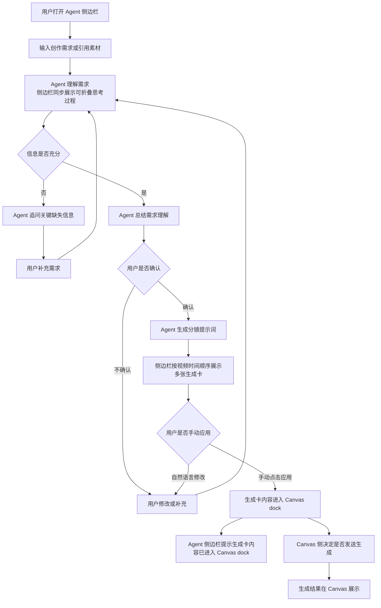

# Agent 实现 v0 PRD

> 文档版本：v0
> 状态：待评审
> 优先级：P0
> 负责人：徐雯倩
> 日期：2026-08-17

## 1. 概要

本文定义 Blue Whale 独立 Agent 的 v0 版本产品需求。v0 的目标不是一次性完成完整 Agent 编排系统，而是先让用户在 Agent 侧边栏完成一条完整、可确认、可追踪的需求理解与分镜提示词生成卡流程。

v0 必须守住一个核心边界：Agent 先总结需求理解并等待用户确认。用户确认后，Agent 直接生成分镜提示词，并按视频时间顺序在侧边栏展示多张生成卡。生成卡保留手动应用按钮，用户手动应用后内容进入 Canvas 的 dock 栏；是否发送生成由 Canvas 侧决定，不属于 Agent 端范围。

详细 Agent 执行链路、对象关系及编排流程见《独立 Agent 工作流程说明》。PRD 只描述用户体验、产品规则和验收口径。Agent 侧边栏里的生成卡内容形态和交互动作，单独见《Agent 侧边栏内容形态与交互规范》。

## 2. 相关负责人

| 角色 | 负责人 | 说明 |
| --- | --- | --- |
| 产品负责人 | 徐雯倩 | 负责确认 v0 范围、验收标准和后续版本优先级。 |
| 前端负责人 | 穆文晴 | 负责 Agent 侧边栏、生成卡展示、手动应用到 Canvas dock 和 Canvas 结果承接。 |
| 后端负责人 | 李述 | 负责按《独立 Agent 工作流程说明》实现服务接口、状态流转和 Canvas dock 承接；Canvas 结果展示由 Canvas 侧接口承接，不回传 Agent 侧边栏。 |
| Agent / 模型负责人 | 李述 | 负责模型追问、总结、分镜提示词生成和工具调用边界。 |
| 设计负责人 | 穆文晴/徐雯倩 | 负责 Agent 侧边栏交互、生成卡样式和手动应用流程。 |

## 3. 背景

### 3.1 背景

Blue Whale 当前需要把“自然语言创作需求”变成可执行、可确认、可追踪的创作流程。用户在 Agent 侧边栏输入需求时，系统不能把这条消息直接等同于一次最终生成任务。

从用户视角看，正确体验应该是：用户先表达创作需求，Agent 在信息不足时追问，在信息充分时总结需求理解并让用户确认。用户确认后，Agent 直接生成分镜提示词，并按视频时间顺序在侧边栏展示多张生成卡。用户可以用自然语言修改生成卡，也可以手动应用到 Canvas dock；进入 Canvas dock 后，是否发送生成由 Canvas 侧决定。

### 3.2 为什么现在做

如果没有清楚的 Agent v0 边界，后续很容易出现三个问题：

| 问题 | 后果 |
| --- | --- |
| 把用户输入直接当作最终生成指令 | 用户还没确认需求，就可能进入错误方向。 |
| 把生成卡当作最终生成结果 | 用户会误以为生成卡就是图片或视频产物。 |
| Agent 自动调用生成工具 | 可能造成误生成、误扣费、素材使用不清楚，并越过 Canvas 侧确认。 |

v0 要先建立一条稳定主链路，让团队能在真实产品里验证：用户是否愿意通过 Agent 侧边栏完成需求表达、追问确认、需求理解确认、分镜提示词生成卡展示和手动应用。

## 4. 目标

### 4.1 产品目标

v0 要让用户可以在 Agent 侧边栏完成一次完整的“需求理解确认与分镜提示词生成卡生成”流程：

1. 用户输入创作需求，可以包含文本、图片、视频或画布引用。
2. Agent 根据用户输入和授权素材理解需求，并在侧边栏同步展示可折叠的思考过程。
3. 信息不足时，Agent 返回具体追问。
4. 信息充分时，Agent 总结理解并等待用户确认。
5. 用户确认需求理解后，Agent 直接生成分镜提示词。
6. Agent 按视频时间顺序在侧边栏展示多张生成卡。
7. 用户可以继续用自然语言修改生成卡，也可以手动点击应用。
8. 手动应用后，生成卡内容进入 Canvas dock。
9. Agent 侧边栏告知生成卡内容已进入 Canvas dock；生成结果后续只在 Canvas 展示，Canvas 生成状态不回传 Agent 侧边栏。

### 4.2 不做什么

v0 明确不做以下事项：

| 不做 | 原因 |
| --- | --- |
| 不自动生成图片或视频 | Agent 端只到生成卡和手动应用为止，不自动触发生成任务。 |
| 不在 PRD 中定义完整扣费规则 | Agent 对话过程需要扣费；具体扣费逻辑由赵鑫宇提供。 |
| 不扫描整个项目画布 | 只读取最小必要上下文。 |
| 不开放未授权素材读取 | 只能读取当前会话明确引用或授权的素材。 |
| 不把生成卡当作最终媒体 | 生成卡是带分镜提示词的 Agent 卡片，不是图片、视频或生成任务。 |
| 不一次性完成所有复杂编排工作流 | v0 先验证主链路，再拆分后续阶段。 |
| 不完整支持短剧剧本拆解到视频制作 | 短剧创作者 / 短剧工作者是重点目标用户，但剧本拆场、角色一致性、多镜头连续剧情和批量场次管理复杂度较高。v0 先跑通需求理解确认、分镜提示词生成卡和手动应用主链路，短剧专项流程作为下一版本优先安排。 |

### 4.3 关键结果（工程验收指标）

v0 关键结果只用于验收工程链路是否正确闭合，不把模型质量问题作为上线硬门槛。

| KR | 衡量方式 |
| --- | --- |
| KR1：确认需求理解后，系统能生成分镜提示词生成卡 | 生成卡必须包含分镜提示词，并能按照视频时间顺序展示多张卡片。 |
| KR2：生成卡保留手动应用按钮，且不会自动触发生成任务 | 100% 生成卡只能由用户手动应用到 Canvas dock，Agent 端不创建或触发生成任务。 |
| KR3：手动应用后，生成卡内容能进入 Canvas dock | 用户点击手动应用后，Canvas dock 能承接对应生成卡内容。 |
| KR4：手动应用后，Agent 侧边栏只显示生成卡进入 Canvas dock 的提示 | Agent 侧边栏只提示“生成卡内容已进入 Canvas dock”，不接收 Canvas 生成状态，也不展示最终结果正文。 |
| KR5：侧边栏稳定展示 Agent 主流程内容 | 覆盖用户输入、Agent 回复、可折叠思考过程、需求理解、生成卡和应用状态提示。 |

建议同步观察以下产品和模型指标：追问命中率、需求理解确认率、分镜提示词生成卡生成成功率、生成卡手动应用率、Canvas 侧发送生成率、结果继续调整率。这些指标不作为 v0 工程验收硬门槛，但需要帮助 PM 判断用户是否真的走完 Agent 侧边栏主链路。

## 5. 目标用户与使用场景

### 5.1 目标用户

v0 面向 Blue Whale 内的创作型用户，尤其是需要从素材和自然语言需求快速得到分镜提示词生成卡的人。

| 用户类型 | 主要任务 | v0 解决的问题 |
| --- | --- | --- |
| 内容运营 | 需要快速生成图片或视频分镜提示词 | 把模糊需求变成可手动应用的生成卡。 |
| 短剧创作者 / 短剧工作者 | 需要把已有剧本、分场、台词或剧情片段拆解成可生成的视频分镜提示词 | v0 先验证“需求理解确认 → 分镜提示词生成卡 → 手动应用到 Canvas dock”的基础链路；完整剧本拆解、按场次生成、多角色一致性和连续剧情生产作为下一版本优先能力。 |
| 电商创作者 | 需要围绕商品素材生成图文或视频方向 | 帮助确认卖点、素材和生成参数。 |
| 设计 / 创意协作人员 | 需要把画布素材转成下一步分镜提示词 | Agent 能读取授权素材和最小画布上下文。 |
| 内部产品 / 测试人员 | 需要验证独立 Agent 主链路 | 用 v0 验证对话、追问、需求理解、分镜提示词生成卡和手动应用边界。 |

### 5.2 约束

| 约束 | 说明 |
| --- | --- |
| 权限约束 | Agent对话时确保用户已登陆状态且用户余额充足。 |
| 素材约束 | Agent 只能读取当前会话明确引用或授权的素材。 |
| 成本约束 | Agent 对话过程需要扣费；具体扣费逻辑由赵鑫宇提供。Agent 端不自动触发生成工具。 |
| 体验约束 | Agent 对话、追问、需求总结和生成卡都在侧边栏，不放到 Canvas 主画布。 |
| 追踪约束 | Agent 端必须能追踪需求理解确认、分镜提示词生成卡版本和手动应用动作；Canvas dock 之后的发送生成不由本 PRD 定义。 |

## 6. 价值主张

### 6.1 用户价值

| 用户需要完成的事 | v0 提供的价值 |
| --- | --- |
| 把一句模糊创作需求讲清楚 | Agent 能追问缺失信息，降低用户一次写完整提示词的压力。 |
| 基于已有素材形成创作方向 | Agent 能读取授权素材和最小画布上下文，减少手动描述。 |
| 在生成前确认需求理解并查看生成卡 | 生成卡让用户查看和修改分镜提示词内容，再手动应用到 Canvas dock。 |
| 避免 Agent 端误触发生成 | Agent 只生成并应用生成卡，不自动触发生成任务。 |
| 复盘一次生成来源 | 系统保留用户确认的需求理解、生成卡版本和手动应用动作，方便追踪。 |

### 6.2 公司价值

| 公司需要 | v0 带来的结果 |
| --- | --- |
| 可控地落地 Agent 能力 | 先跑通主链路，避免一开始做过大范围。 |
| 降低生成成本浪费 | 通过需求理解确认、生成卡手动应用和 Canvas 侧发送生成减少无效生成。 |
| 提高后续扩展能力 | 需求理解确认、分镜提示词生成卡、Canvas dock 和 Canvas 结果展示边界清晰，便于后续扩展。 |
| 支持真实产品验证 | 能观察用户是否愿意确认需求理解、查看分镜提示词生成卡并手动应用到 Canvas dock。 |

## 7. 方案设计

### 7.1 用户流程

v0 的用户流程如下：

说明：本用户流程图只表达用户可感知的产品体验，不展开内部工程对象和调度链路。消息接纳、AgentRun 创建、模型调用、工具调用、GenerationCardRevision 产出、Canvas dock 承接等工程流程，以《 Agent 流程图及说明》为准。

### 7.2 核心功能

#### 7.2.1 Agent 侧边栏输入

用户可以在 Agent 侧边栏输入创作需求。输入可以包含文本，也可以引用图片、视频或 Canvas 上的素材。

验收标准：

| 编号 | 标准 |
| --- | --- |
| AC-1 | 用户输入后，消息不会直接触发生成工具。 |
| AC-2 | 用户能在同一侧边栏会话里继续补充需求。 |
| AC-3 | 如果输入包含素材引用，系统能记录引用关系。 |

#### 7.2.2 Agent 侧边栏展示内容

Agent 侧边栏是 v0 的主要交互容器，负责承载用户与 Agent 的完整对话过程。用户输入需求后，侧边栏需要展示用户输入、Agent 处理过程、追问、回答内容、需求总结、分镜提示词生成卡和应用状态。

Agent 的处理过程以可折叠的小字区域展示，默认可以收起或弱化展示。该区域用于让用户理解 Agent 当前在做什么，例如：正在理解需求、正在判断信息是否充分、正在读取授权素材、正在整理分镜、正在生成提示词。

这里的“思考过程”保留作为产品名称，指用户可见、可折叠的小字过程信息，例如正在理解需求、正在读取授权素材、正在整理分镜、正在生成提示词。它不等于模型原始内部推理，也不等于生成卡正文。侧边栏不展示模型原始内部推理，只展示用户可理解、可解释、可检查的过程说明。

Agent 流程中只保留一种卡片形态：生成卡。生成卡是带分镜提示词的卡片，视频场景下需要按视频时间顺序展示多张。用户对生成卡的修改以自然语言方式完成，生成卡保留手动应用按钮。具体字段、按钮和状态流转，以《Agent 侧边栏内容形态与交互规范》为准。

验收标准：

| 编号 | 标准 |
| --- | --- |
| AC-4 | 侧边栏能展示用户输入的需求、补充内容和确认动作。 |
| AC-5 | 侧边栏能展示可折叠的“思考过程”区域，用小字呈现 Agent 当前步骤。 |
| AC-6 | “思考过程”至少能表达理解需求、判断信息、读取授权素材、整理分镜、生成提示词等关键状态。 |
| AC-7 | 侧边栏能展示 Agent 的追问、回答内容和需求总结。 |
| AC-8 | 侧边栏能按视频时间顺序展示多张生成卡，并支持用户自然语言修改或手动应用生成卡。 |
| AC-9 | 侧边栏能展示带分镜提示词的生成卡。 |
| AC-10 | 用户手动应用后，侧边栏能展示生成卡内容已进入 Canvas dock 的状态提示。 |
| AC-11 | 侧边栏不展示模型原始内部推理，只展示用户可理解的思考过程。 |

#### 7.2.3 多轮追问与补充

当用户需求不完整时，Agent 应返回具体、可回答的追问，而不是直接生成方案。

验收标准：

| 编号 | 标准 |
| --- | --- |
| AC-12 | 信息不足时，Agent 返回具体追问。 |
| AC-13 | 用户补充后，Agent 能继续基于上下文理解需求。 |
| AC-14 | Agent 不应连续提出低价值、重复或与创作无关的问题。 |

#### 7.2.4 需求总结与用户确认

当 Agent 判断信息足够时，应先总结对需求的理解，并等待用户明确确认。

验收标准：

| 编号 | 标准 |
| --- | --- |
| AC-15 | Agent 能用用户可理解的方式总结创作目标、素材使用和方向。 |
| AC-16 | 用户明确确认需求理解前，Agent 不生成分镜提示词生成卡。 |
| AC-17 | 用户不确认时，可以修改或补充需求。 |

#### 7.2.5 生成卡展示与修改

用户确认需求理解后，Agent 先用自然语言给出整组分镜总览，说明整体方向、节奏、镜头数量和素材使用。总览说明不是生成卡，不进入 Canvas dock。

随后 Agent 按视频时间顺序展示多张单镜头分镜提示词生成卡。每张生成卡对应一个镜头，包含画面描述、分镜提示词、素材引用和手动应用按钮。用户可以用自然语言指定修改某一张分镜提示词卡，也可以手动点击应用某一张卡；点击后，该卡内容进入 Canvas dock。进入 Canvas dock 之后，是否发送生成由用户在 dock 栏确认，不属于 Agent 端范围。

验收标准：

| 编号 | 标准 |
| --- | --- |
| AC-18 | Agent 先用自然语言展示整组分镜总览，随后展示多张单镜头分镜提示词生成卡。 |
| AC-19 | 单张生成卡必须包含对应镜头的画面描述、分镜提示词和素材引用。 |
| AC-20 | 用户可以用自然语言指定修改某一张分镜提示词卡，也可以手动点击应用单张生成卡。 |
| AC-21 | 用户手动点击应用后，生成卡内容进入 Canvas dock，由用户在 dock 栏确认后续生成。 |
| AC-21A | 生成卡的字段、按钮和可进入的下一状态，需要符合《Agent 侧边栏内容形态与交互规范》。 |

#### 7.2.6 手动应用生成卡

用户确认需求理解后，Agent 先给出自然语言总览，再展示单镜头分镜提示词生成卡。用户可以继续用自然语言修改某一张卡，也可以点击手动应用。手动应用后，该卡内容自动带到 Canvas 的 dock 栏中。Canvas dock 之后的发送生成、参数确认和任务创建不属于 Agent 端范围。

验收标准：

| 编号 | 标准 |
| --- | --- |
| AC-22 | 用户确认需求理解后，Agent 只生成分镜提示词生成卡，不会创建或触发生成任务。 |
| AC-23 | 生成卡保留手动应用按钮，用户需要手动点击应用。 |
| AC-24 | 手动应用生成卡不能自动触发生成任务。 |
| AC-25 | 用户可以用自然语言继续修改某一张生成卡或补充素材，Agent 重新整理后仍按视频时间顺序展示多张单镜头生成卡。 |

#### 7.2.7 结果展示边界

生成结果只在 Canvas 展示。Agent 侧边栏在用户手动应用后只告知生成卡内容已进入 Canvas dock；Canvas dock 之后的发送生成、生成状态、任务执行、失败处理和结果展示由 Canvas 侧流程承接，不回传 Agent 侧边栏。侧边栏不展示图片、视频或文本结果正文。

验收标准：

| 编号 | 标准 |
| --- | --- |
| AC-26 | Agent 端不自动调用生成工具。 |
| AC-27 | 生成卡已应用状态能在 Agent 侧边栏显示。 |
| AC-28 | 生成结果能回到 Canvas 展示；这是 Canvas 侧承接验收，不代表 Agent 侧边栏接收生成状态或展示结果。 |
| AC-29 | Canvas dock 之后的生成状态不回传 Agent 侧边栏。 |
| AC-30 | Agent 端能追踪用户确认的需求理解、生成卡版本和手动应用动作。 |
| AC-31 | Canvas 侧生成失败处理不属于 Agent 端范围；Agent 侧边栏只保留与生成卡应用相关的状态提示。 |
| AC-32 | 生成成功后，结果内容只在 Canvas 展示，Agent 侧边栏不展示结果正文、缩略图或生成完成状态。 |

### 7.3 产品与技术边界

v0 技术边界只描述产品需要的能力，不在 PRD 中重复定义内部对象字段和后端编排细节。

| 边界 | v0 规则 |
| --- | --- |
| Agent 侧边栏 | 承载用户输入、可折叠思考过程、Agent 追问、需求总结、分镜提示词生成卡、自然语言修改和应用状态提示。 |
| Canvas | 承载用户素材、Canvas dock 和最终生成结果，不承载 Agent 对话、追问、总结或生成卡正文；最终图片、视频或文本结果只在 Canvas 展示。 |
| 素材读取 | 只读取当前会话中用户明确引用或授权的素材，并遵循最小必要原则。 |
| 生成卡 | 是带分镜提示词的 Agent 卡片，不是最终媒体，也不等于生成任务。 |
| 手动应用 | 用户点击生成卡手动应用后，内容进入 Canvas dock。Canvas dock 后续流程不属于 Agent 端范围。 |
| 生成任务 | 不由 Agent 端自动创建；是否发送生成由 Canvas 侧决定。 |
| 状态回传 | 侧边栏需要展示 Agent 执行状态、可折叠的思考过程和生成卡已应用；Canvas dock 之后的生成状态不回传 Agent 侧边栏。 |
| Agent 侧边栏内容形态 | Agent 流程中只保留生成卡一种卡片形态；用户确认需求理解后，侧边栏按视频时间顺序展示多张生成卡，具体以《Agent 侧边栏内容形态与交互规范》为准。 |
| 生成结果展示边界 | 侧边栏不展示最终生成出的图片、视频缩略图、文本正文或 Canvas 生成完成状态；手动应用后只提示生成卡内容已进入 Canvas dock。 |
| 工程实现 | 详细 Agent 执行链路、对象关系及编排流程见《独立 Agent 工作流程说明》。 |

### 7.4 数据与状态要求

PRD 不维护字段级数据结构，字段定义以后端工程文档或 API Spec 为准。v0 只要求满足以下产品可追踪性：

| 要求 | 说明 |
| --- | --- |
| 会话可追踪 | 能追踪用户在同一 Agent 侧边栏会话中的多轮输入、追问、补充和确认。 |
| 生成卡可追踪 | 能追踪生成卡来自哪次需求理解确认和哪组输入素材。 |
| 应用可追踪 | 能追踪用户手动应用了哪张生成卡；Canvas dock 之后的生成任务追踪不由本 PRD 定义。 |
| 状态可追踪 | 用户能看到处理中、等待补充、等待确认、生成卡已生成、生成卡已应用等 Agent 侧关键状态；Canvas dock 之后的生成状态不回传侧边栏。 |
| 思考过程可追踪 | 能记录并展示用户可理解的 Agent 思考过程，不记录或展示模型原始内部推理。 |
| Agent 端处理失败可解释 | Agent 端处理失败时，用户能看到可理解的原因和下一步动作；Canvas 侧生成失败不在本 PRD 中定义。 |

### 7.5 v0 状态流转

v0 至少需要统一以下用户可见状态。字段级状态名以后端 API Spec 为准，PRD 只定义产品口径：

| 状态 | 用户感知 | 下一步 |
| --- | --- | --- |
| 等待输入 | 侧边栏等待用户输入需求或引用素材 | 用户发送需求 |
| Agent 处理中 | Agent 正在理解需求、读取授权素材或整理内容 | 进入追问、需求理解确认或生成卡展示 |
| 等待用户补充 | 信息不足，Agent 返回追问 | 用户补充需求 |
| 等待用户确认理解 | Agent 已整理需求理解总结 | 用户确认或修改 |
| 生成卡已生成 | 带分镜提示词的生成卡已展示 | 用户自然语言修改或手动应用 |
| 生成卡已应用 | 用户点击手动应用后，生成卡内容进入 Canvas dock | Canvas 侧决定是否发送生成 |

### 7.6 假设

| 假设 | 验证方式 |
| --- | --- |
| 用户愿意先确认需求理解，再查看生成卡 | 观察需求理解确认率。 |
| 侧边栏是承载 Agent 对话、需求理解和生成卡的合适位置 | 做内部可用性测试。 |
| 生成卡能降低误生成 | 对比有无生成卡手动应用时的返工率。 |
| 最小画布上下文足够支持 v0 分镜提示词生成卡 | 收集 Agent 追问次数和失败原因。 |
| BFF 权限能力已经可用 | 与后端确认现有权限接口和素材授权边界。 |

## 8. 版本计划

### 8.1 v0 范围

v0 建议分为 4 个阶段交付：

| 阶段 | 内容 | 目标 |
| --- | --- | --- |
| 阶段 1 | 侧边栏输入、多轮对话、可折叠思考过程和基础状态回传 | 用户输入后能进入稳定 Agent 对话，并看到可理解的思考过程。 |
| 阶段 2 | Agent 追问、需求总结和用户确认 | Agent 能进行多轮澄清，不直接冒进。 |
| 阶段 3 | 需求理解确认和生成卡展示 | 用户确认需求理解后，Agent 直接生成带分镜提示词的多张生成卡。 |
| 阶段 4 | 生成卡手动应用和 Canvas dock 承接 | 用户手动应用生成卡后，内容进入 Canvas dock；Canvas 后续生成状态和结果展示不回传 Agent 侧边栏。 |

### 8.2 v0 之后

后续版本可以继续拆分以下工作流：

| 后续方向 | 说明 |
| --- | --- |
| 短剧剧本拆解与视频制作流程 | 下一版本优先方向。支持用户输入剧本、分场或台词片段，Agent 拆解剧情结构、角色、场景、镜头和台词，按场次生成多张分镜提示词生成卡，并支持连续剧情、多角色一致性和批量应用到 Canvas dock。 |
| 会话生命周期 | 创建、恢复、归档、删除。 |
| 更完整的执行调度 | 排队、取消、重试、超时恢复。 |
| 意图路由 | 区分轻量生成、完整创作、素材理解、视频拆解等。 |
| Creative Skill 选择 | 根据任务选择不同创作技能，并固化版本。 |
| 更强素材理解 | 图片理解、视频拆解、画布局部理解。 |
| 生成卡版本管理 | 多版本比较、回滚、复用。 |
| 状态恢复 | 页面刷新后恢复执行状态。 |
| 生成质量反馈 | 满意、不满意、继续调整、二次生成。 |

### 8.3 风险

| 风险 | 影响 | 应对 |
| --- | --- | --- |
| v0 范围继续扩大 | 交付变慢，主链路迟迟不可用 | 严格守住 v0 只跑通主链路。 |
| 用户误解生成卡已自动进入生成流程 | 可能以为点击应用会直接生成 | 通过“手动应用到 Canvas dock，再由用户在 dock 栏确认生成”的流程区分。 |
| 工具读取范围过大 | 造成权限和隐私风险 | 只读明确引用或授权素材，只读最小画布上下文。 |
| 确认链路不清楚 | 可能误生成或误扣费 | Agent 端必须保留需求理解确认、生成卡和手动应用边界；扣费逻辑由赵鑫宇提供。 |
| Agent 追问过多 | 用户觉得低效 | 追问只问关键缺失信息，并支持用户跳过或继续补充。 |
| 用户误解思考过程为完整模型推理 | 可能误解 Agent 能力或过程可信度 | 界面和 PRD 明确“思考过程”只是用户可见的过程信息，不展示模型原始内部推理。 |

## 9. 验收清单

| 编号 | 验收项 | 是否必须 |
| --- | --- | --- |
| V0-1 | 用户能在 Agent 侧边栏输入需求并引用素材 | 必须 |
| V0-2 | 侧边栏能展示用户输入、补充内容和确认动作 | 必须 |
| V0-3 | 侧边栏能展示可折叠的“思考过程”区域，用小字呈现 Agent 当前步骤 | 必须 |
| V0-4 | “思考过程”只展示用户可理解的思考过程，不展示模型原始内部推理 | 必须 |
| V0-5 | 信息不足时 Agent 返回追问 | 必须 |
| V0-6 | 信息充分但未确认时 Agent 总结理解并要求确认 | 必须 |
| V0-7 | 用户明确确认需求理解后生成对应的分镜提示词生成卡 | 必须 |
| V0-8 | 生成卡展示在 Agent 侧边栏 | 必须 |
| V0-9 | 生成卡必须包含分镜提示词内容，并支持按视频时间顺序展示多张卡片 | 必须 |
| V0-10 | 用户手动应用生成卡后，内容进入 Canvas dock，并由用户在 dock 栏确认后续生成 | 必须 |
| V0-11 | 用户可用自然语言继续修改需求理解或生成卡 | 必须 |
| V0-12 | 用户确认需求理解后生成分镜提示词生成卡，而不是直接生成 | 必须 |
| V0-13 | 侧边栏能展示带分镜提示词的生成卡 | 必须 |
| V0-14 | 生成卡保留手动应用按钮，不能自动触发生成任务 | 必须 |
| V0-15 | Agent 端能追踪需求理解确认、生成卡版本和手动应用动作 | 必须 |
| V0-16 | 用户手动应用后，生成卡内容进入 Canvas dock；Canvas 后续生成状态不回传 Agent 侧边栏 | 必须 |
| V0-17 | Canvas 侧生成失败处理不属于 Agent 端范围，Agent 侧边栏不展示最终结果正文 | 必须 |
| V0-18 | Agent 侧边栏中的思考过程、流式消息、需求理解、生成卡和应用状态提示符合《Agent 侧边栏内容形态与交互规范》 | 必须 |
| V0-19 | 视频流程中确认需求理解后，直接生成按视频时间顺序展示的多张分镜提示词生成卡 | 必须 |
| V0-20 | 图片流程中的生成卡只能手动应用到 Canvas dock，不能由 Agent 自动触发生成任务 | 必须 |
