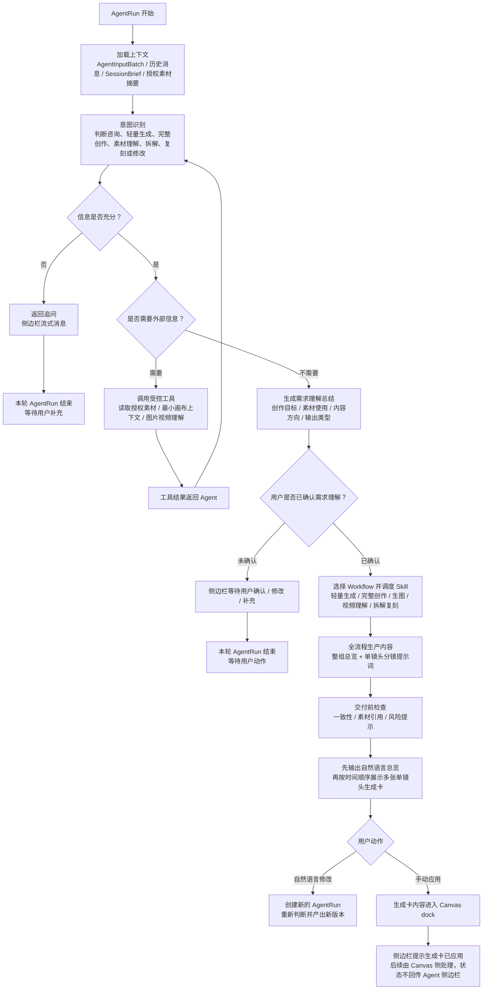

# Agent Workflow / Skill 编排说明

> 文档定位：Blue Whale Agent v0 下钻说明
> 适用范围：AgentRun 内部 Workflow 路由、Creative Skill 调度、需求理解确认、分镜提示词生成卡产出与 Canvas dock 衔接
> 日期：2026-08-17
> 状态：待评审

## 1. 文档目的

本文定义 Blue Whale Agent 在 `AgentRun` 内部如何根据用户意图选择 Workflow、调度 Creative Skill、读取授权素材、完成需求理解确认，并产出可手动应用到 Canvas dock 的分镜提示词生成卡。

本文不是总 PRD，也不是侧边栏 UI 规范。本文只回答一个问题：

> AgentRun 开始后，Agent 内部怎么判断该走哪条创作链路、调用哪些 Skill、什么时候追问、什么时候总结需求理解并等待确认、用户确认后如何先输出自然语言总览，再产出单镜头或单图生成卡。

v0 不把脚本卡、分镜卡、提示词卡拆成多个连续确认门。脚本意图、整体节奏和分镜结构是内部生产内容，由 Agent 在用户确认需求理解后一次性组织产出；用户可见输出是自然语言总览和单镜头或单图生成卡。用户可以继续用自然语言修改某张生成卡，也可以手动应用到 Canvas dock。

## 2. 与现有文档的关系

| 文档 | 负责回答 | 本文关系 |
| --- | --- | --- |
| `PRD-agent-v0.md` | v0 做什么、为什么做、怎么验收 | 本文不重复产品背景和总验收，只承接其中的 Agent 编排需求 |
| `Agent 流程图及说明.md` | 用户输入、BFF、AgentSession、AgentInputBatch、AgentRun、生成卡、Canvas dock 的系统链路 | 本文只展开 `AgentRun` 内部发生的 Workflow / Skill 编排 |
| `Agent 侧边栏内容形态与交互规范.md` | 侧边栏展示什么内容、生成卡字段、用户能点什么 | 本文只定义生成卡从哪个 Workflow / Skill 产出，以及用户动作如何回到 AgentRun |
| 本文 | AgentRun 内部意图路由、Workflow 阶段、Skill 输入输出、确认门、异常返回 | 是前三份文档的下钻编排说明 |

## 3. 核心原则

| 原则 | 说明 |
| --- | --- |
| AgentRun 是编排开始边界 | 用户输入、消息保存和输入冻结之后，创建 `AgentRun`，Agent 才开始进行 Workflow / Skill 编排。 |
| 模型负责理解和判断 | 模型判断当前信息是否足够、是否需要工具、是否需要追问、应该进入哪个 Workflow。 |
| Workflow 负责生产顺序 | Workflow 决定从需求理解到生成卡产出的阶段顺序。v0 的终点是生成卡，不是生成任务。 |
| Skill 负责专业产物 | Skill 负责某个专业环节的输出，例如需求整理、创作套路选择、脚本分镜组织、提示词适配、交付前检查。 |
| 工具负责真实信息和受控读取 | 工具只负责读取授权素材、读取最小画布上下文、理解图片 / 视频等受控动作。 |
| 需求理解确认是核心确认门 | 信息充分时，Agent 必须先总结需求理解并等待用户明确确认；未确认前不生成分镜提示词生成卡。 |
| 分镜总览不是生成卡 | 用户确认需求理解后，Agent 先用自然语言说明整组视频方向、节奏、镜头数量和素材使用。 |
| 生成卡是 v0 最终可应用卡片 | 生成卡承载单个镜头的画面描述、分镜提示词、素材引用和手动应用动作，按视频时间顺序展示多张。 |
| 脚本 / 分镜 / 提示词不拆多确认门 | v0 不要求用户先确认脚本、再确认分镜、再确认提示词；用户确认需求理解后，Agent 直接产出自然语言总览和单镜头/单图生成卡。 |
| 用户修改生成卡会创建新版本 | 用户用自然语言修改生成卡时，进入新的 `AgentRun`，重新判断后产出新的生成卡版本。 |
| 手动应用才进入 Canvas dock | 用户点击应用后，生成卡内容进入 Canvas dock；点击前不进入 Canvas dock。 |
| Agent 端不触发生成 | Agent 端 v0 不创建生成任务、不调用生成工具、不自动扣费。Canvas dock 后续是否发送生成由 Canvas 侧决定。 |
| 最终结果只回 Canvas | 图片、视频或文本最终结果只在 Canvas 展示，Agent 侧边栏只做文字状态提示。 |
| Skill 决定创意，模型规则决定语法 | Creative Skill 决定内容结构和表现方式；生成模型规则只做提示词语法和稳定性适配。 |

## 4. AgentRun 内部编排总览

说明：

- 同一次 `AgentRun` 可以完成意图识别、素材读取、需求理解总结；一旦需要用户补充或确认，本轮 `AgentRun` 应结束并等待用户动作。
- 用户补充、修改、确认或手动应用，会形成新的用户动作，再进入新的 `AgentInputBatch` 和新的 `AgentRun`。
- 用户确认需求理解后，Agent 才进入全流程生产内容。
- 全流程生产内容不是三个用户确认门，而是 Agent 内部连续完成整组总览、分镜和分镜提示词组织；总览用自然语言展示，单镜头分镜提示词用生成卡展示。
- Workflow / Skill 的内部判断可以产生用户可见的思考过程事件，但不能暴露模型原始内部推理。

## 5. Workflow 路由表

| 用户意图 | 典型输入 | 进入 Workflow | 主要 Skill / 工具 | 主要输出 | 确认门 |
| --- | --- | --- | --- | --- | --- |
| 纯咨询 | “这个视频怎么做更好？” | 不进入创作 Workflow | 模型直接回答 | 流式消息 / 轻建议 | 通常不需要 |
| 轻量生成 | “生成一个小猫跑步视频”“让这张图动起来” | 轻量生成 Workflow | image-understanding、image-prompt、prompt-optimizer、review | 单镜头或单图生成卡 | 需求理解确认 |
| 完整视频创作 | “给这个保温杯做 30 秒 UGC 广告” | 完整创作 Workflow | brief、skill-selector、storyboard、prompt-optimizer、review | 自然语言总览 + 多张单镜头生成卡 | 需求理解确认 |
| 生图 / 关键帧 | “先做一张产品图”“生成第 3 镜关键帧” | 生图 Workflow | image-understanding、image-prompt、prompt-optimizer、review | 单图生成卡或关键帧生成卡 | 需求理解确认 |
| 视频理解 | “分析这个视频为什么好” | 视频理解 Workflow | video-understanding 工具 / 模型总结 | 拆解报告 / 结构理解 | 需要用户检查，不进入生成卡则不要求应用 |
| 爆款拆解 | “拆解这个爆款” | 视频拆解 Workflow | video-understanding、structure-recipe 推断 | 拆解报告 / 结构配方 | 用户检查拆解 |
| 视频复刻 | “照着这个视频给我的产品复刻一个” | 拆解复刻 Workflow | video-understanding、brief、skill-selector、storyboard、prompt-optimizer、review | 复刻总览 + 多张单镜头生成卡 | 拆解检查 + 需求理解确认 |
| 局部修改 | “第 2 镜换成室内”“提示词再高级一点” | 回到当前 Workflow 对应阶段 | storyboard 或 prompt-optimizer | 更新后的单镜头生成卡版本 | 视影响范围决定是否重新确认需求理解 |
| 手动应用 | “应用这组生成卡”或点击应用按钮 | 生成卡应用链路 | BFF / Canvas dock 接口 | 生成卡内容进入 Canvas dock | 用户手动应用即确认应用 |

## 6. Workflow 详细链路

### 6.1 轻量生成 Workflow

适用场景：

- 用户要单张图、单镜头视频、图转视频，目标清楚，不需要完整营销策略。
- 用户没有要求多版本脚本、完整广告结构或复杂分镜。

流程：

| 阶段 | 执行者 | 输入 | 输出 | 用户可见内容 | 下一步 |
| --- | --- | --- | --- | --- | --- |
| 识别生成意图 | Agent / 模型 | 用户输入、素材引用 | generation_intent | 思考过程 / 轻告知 | 判断是否需要补问 |
| 轻量补全 | Agent / brief 轻量模式 | generation_intent | minimal_brief | 追问或默认补全说明 | 信息足够后形成需求理解 |
| 图片理解 | image-understanding / 工具 | 用户图片、Canvas 引用 | asset_understanding | 图片理解摘要 | 有图生图 / 图转视频时必需 |
| 需求理解总结 | Agent / 模型 | minimal_brief、asset_understanding | understanding_summary | 需求理解总结 | 等待用户确认 |
| 生成卡生产 | image-prompt、prompt-optimizer、review | confirmed_understanding、素材约束、目标模型 | generation_card_revision | 单镜头或单图生成卡 | 用户修改或手动应用 |
| 手动应用 | BFF / Canvas dock | generation_card_revision | dock_payload | 应用状态提示 | Canvas dock 后续处理 |

关键规则：

- 描述足够时，Agent 可以默认补全风格、画幅、时长等低风险细节，但必须在需求理解总结里让用户看到。
- 静态图片任务不能混入视频参数，例如时长、帧率、运镜。
- 依赖图片的任务必须先有图片理解结果，不能只根据文件名或素材名生成。
- 用户确认需求理解后，轻量任务可以直接产出一张或少量生成卡。
- 轻量生成也不能直接调用生成工具，必须由用户手动应用到 Canvas dock。

异常返回：

| 异常 | 返回方式 |
| --- | --- |
| 主体不清楚 | 侧边栏追问最关键问题 |
| 多张图指代不清 | 询问用户要处理哪张图或分别用于哪里 |
| 图片不可读 | 告知无法识别，请用户重新上传或补充描述 |
| 用户要求直接出片 | 告知 Agent 端先生成可应用卡片，应用后由 Canvas 侧继续处理 |

### 6.2 完整创作 Workflow

适用场景：

- UGC 广告、短剧、品牌片、产品视频等需要脚本、分镜和提示词的任务。
- 用户需要完整创意方案，而不是一次性简单提示词。

流程：

| 阶段 | 执行者 | 输入 | 输出 | 用户可见内容 | 确认门 |
| --- | --- | --- | --- | --- | --- |
| Brief 收集 | brief | 用户需求、素材摘要、会话上下文 | brief_candidate | 思考过程 / 必要追问 | 信息不足时追问 |
| Skill 匹配 | skill-selector | Brief、素材理解、用户指定风格 | selected_skill、selection_reason | 轻告知或思考过程 | 通常不单独确认 |
| 需求理解总结 | Agent / 模型 | brief_candidate、selected_skill、素材理解 | understanding_summary | 需求理解总结 | 用户确认 / 修改 / 补充 |
| 全流程生产内容 | storyboard + prompt-optimizer | confirmed_understanding、selected_skill、素材引用、目标模型 | script_intent、storyboard、storyboard_prompts | 不拆卡，可显示处理过程 | 无新增确认门 |
| 交付前检查 | review | Brief、Skill、脚本意图、分镜、提示词、素材引用 | review_summary、risk_note | 必要风险提示 | 无新增确认门 |
| 总览说明 | Agent / Workflow | script_intent、storyboard、素材引用 | overview_message | 自然语言总览 | 用户可直接提出修改 |
| 生成卡产出 | Agent / Workflow | storyboard_prompts、单镜头画面、素材引用 | generation_card_revision | 单镜头分镜提示词生成卡 | 用户自然语言修改或手动应用 |
| 手动应用 | BFF / Canvas dock | generation_card_revision | dock_payload | 应用状态提示 | Canvas dock 后续处理 |

Agent 输出分为自然语言总览和单镜头生成卡：

| 内容 | 说明 |
| --- | --- |
| 自然语言总览 | 整组视频的内容节奏、核心钩子、情绪或转化路径，不作为生成卡内容。 |
| 单镜头画面描述 | 每张生成卡对应一个镜头，包含时长、画面内容、口播 / 字幕、关键视觉。 |
| 分镜提示词 | 每个镜头对应的可生成提示词，包含主体、动作、场景、运镜、素材引用和稳定性约束。 |
| 素材引用 | 明确哪些卡使用了哪些用户授权素材或 Canvas 引用。 |
| 应用动作 | 用户可以对单张或整组生成卡手动应用到 Canvas dock。 |

关键规则：

- 不从原始输入直接跳到生成卡；必须先完成需求理解总结并等待用户确认。
- 脚本意图和整体节奏用自然语言总览说明；单镜头画面和分镜提示词进入生成卡，不作为多个独立确认门阻断用户。
- Skill 匹配通常是告知型，不强制用户每次确认；但当用户指定 Skill 与需求方向明显冲突时，需要先追问。
- prompt-optimizer 只能做模型语法和稳定性优化，不能重做已确认的创意方向。
- 用户对生成卡局部修改时，优先只更新对应卡片或对应镜头；结构变化较大时，说明影响范围并重新生成一组生成卡版本。
- 用户手动应用后，只把生成卡内容带入 Canvas dock，不直接创建生成任务。

异常返回：

| 异常 | 返回方式 |
| --- | --- |
| Brief 关键信息不足 | 流式消息中追问最关键缺失信息 |
| Skill 与用户目标冲突 | 陈述冲突点，追问用户真正目标 |
| 用户只想改某个镜头 | 只更新对应生成卡或镜头，不重写全组 |
| 用户要求改结构 | 说明会影响整组生成卡，确认后再重排 |
| 提示词优化需要改变已确认创意 | 返回用户确认，不自动覆盖 |

### 6.3 生图 / 关键帧 Workflow

适用场景：

- 产品图、商品图、海报图、风格图、关键帧。
- 视频分镜中需要先生成关键帧或产品图，再用于后续视频生成。

流程：

| 阶段 | 执行者 | 输入 | 输出 | 用户可见内容 |
| --- | --- | --- | --- | --- |
| 判断图片任务类型 | Agent / 模型 | 用户输入、当前 Workflow 阶段 | image_task_type | 思考过程 / 轻告知 |
| 资产理解 | image-understanding / 工具 | 用户图片、Canvas 引用 | asset_understanding | 图片理解摘要 |
| 需求理解总结 | Agent / 模型 | image_task_type、素材理解、用户目标 | understanding_summary | 需求理解总结 |
| 生图内容生产 | image-prompt + prompt-optimizer + review | confirmed_understanding、素材理解、目标模型 | image_generation_card_revision | 单图生成卡 |
| 手动应用 | BFF / Canvas dock | image_generation_card_revision | dock_payload | 应用状态提示 |

关键规则：

- 生图生成卡是 v0 单图生成卡的一种，不再进入 Agent 端生成准备卡。
- 如果生图结果要用于视频分镜，卡片需要标注“将用于哪个镜头”。
- 分镜发生增删或顺序调整后，已产出的关键帧用途标注需要同步更新。
- 生图结果最终回到 Canvas；如果后续视频生成引用该图，引用关系需要可追踪。

异常返回：

| 异常 | 返回方式 |
| --- | --- |
| 图生图但没有可用图片 | 要求用户上传或选择素材 |
| 用户提供多图但指代不清 | 询问每张图用途 |
| 产品外观不清 | 要求用户补充必须保留的外观特征 |
| Canvas 侧结果不满意 | 用户可回到 Agent 侧边栏修改生成卡或重新产出生成卡版本 |

### 6.4 视频理解 Workflow

适用场景：

- 用户希望分析一个视频、图片或案例为什么有效。
- 用户上传参考视频，希望提炼结构、节奏、卖点、可复用方法。

流程：

| 阶段 | 执行者 | 输入 | 输出 | 用户可见内容 |
| --- | --- | --- | --- | --- |
| 素材读取 | 工具 / BFF | 用户授权视频或 Canvas 引用 | readable_video_asset | 思考过程 |
| 视频理解 | video-understanding | readable_video_asset | video_understanding | 过程摘要 |
| 结构提炼 | Agent / 模型 | video_understanding | structure_recipe_candidate | 拆解报告 |
| 用户检查 | Agent 侧边栏 | 拆解报告 | confirmed_recipe 或 revision_request | 确认 / 修改 |

视频理解输出至少包含：

- 关键画面或关键段落
- 开头钩子
- 叙事节拍
- 卖点呈现
- 节奏判断
- CTA 或转化点
- 置信度和不确定点

关键规则：

- 视频上传不等于视频已理解，必须有可用的视频理解结果。
- 识别失败或置信度不足时，不得输出确定性拆解。
- 拆解报告是用户可检查的内容，不是最终生成结果。
- 如果用户后续选择复刻，拆解报告需要转成结构配方并进入复刻决策。

异常返回：

| 异常 | 返回方式 |
| --- | --- |
| 视频不可读 | 告知无法读取，要求重新上传或换格式 |
| 视频过长或理解不完整 | 说明只能基于片段或关键帧分析 |
| 置信度不足 | 在拆解报告中列出不确定点，请用户确认 |
| 用户不同意拆解 | 接受修正，重新生成结构配方 |

### 6.5 视频拆解复刻 Workflow

适用场景：

- 用户说“拆解这个爆款”“照着这个视频给我的产品复刻一个”“用我的产品做同款结构”。
- 用户直接给视频并提出复刻意图时，系统应先拆解，再进入复刻。

流程：

| 阶段 | 执行者 | 输入 | 输出 | 用户可见内容 | 确认门 |
| --- | --- | --- | --- | --- | --- |
| 视频理解 | video-understanding | 源视频 | video_understanding | 思考过程 / 摘要 | 否 |
| 结构配方 | Agent / 模型 | video_understanding | structure_recipe | 拆解报告 | 用户检查拆解 |
| 复刻决策 | Agent | structure_recipe、用户目标 | replicate_mode | 复刻方式说明 | 用户选择复刻方式 |
| 产品理解 | image-understanding | 新产品图片 / 描述 | product_understanding | 图片理解摘要 | 必要时追问 |
| 需求理解总结 | brief replicate 模式 + Agent | structure_recipe、product_understanding、replicate_mode | understanding_summary | 需求理解总结 | 用户确认 / 修改 |
| 全流程生产内容 | storyboard replicate 模式 + prompt-optimizer + review | confirmed_understanding、recipe、selected_skill、素材 | script_intent、storyboard、storyboard_prompts | 思考过程 / 风险提示 | 无新增确认门 |
| 复刻总览说明 | Agent / Workflow | script_intent、storyboard、recipe、素材 | overview_message | 自然语言复刻总览 | 用户可直接提出修改 |
| 生成卡产出 | Agent / Workflow | storyboard_prompts、单镜头画面、素材引用 | generation_card_revision | 复刻版单镜头生成卡 | 用户修改或手动应用 |
| 手动应用 | BFF / Canvas dock | generation_card_revision | dock_payload | 应用状态提示 | Canvas dock 后续处理 |

复刻方式：

| 模式 | 含义 | 编排规则 |
| --- | --- | --- |
| 照搬结构换素材 | 保留源视频的节拍顺序、时长、意图，只替换成新产品和新素材 | 需要提示原创度风险；用户确认复刻方式后按结构配方推进 |
| 提取方法论差异化 | 保留强钩子、证据支撑、节奏服务叙事等方法，不照搬镜头结构 | 可以重组脚本和分镜，但要说明保留了哪些方法 |

关键规则：

- 不跳过拆解报告和复刻决策直接复刻。
- 照搬结构模式需要清楚提示原创度风险。
- 用户选择照搬后，Agent 不得擅自改变结构；如需改变，应切换到差异化模式并让用户确认。
- 复刻链路中的需求理解总结必须对用户可见，让用户知道这是按原片配方预填和重组。
- 复刻链路同样先用自然语言说明整组复刻总览，再按镜头产出单镜头分镜提示词生成卡。
- 最终生成仍由用户手动应用到 Canvas dock 后，在 Canvas 侧继续处理。

异常返回：

| 异常 | 返回方式 |
| --- | --- |
| 源视频理解失败 | 停在拆解阶段，要求用户补充视频或描述 |
| 用户不认可配方 | 支持修正拆解后再进入复刻 |
| 用户未提供新产品 | 追问产品素材或产品描述 |
| 照搬风险较高 | 在复刻方式说明中提示风险，不替用户做法律判断 |
| 用户中途改产品或目标 | 视为新任务或重新进入需求理解 |

## 7. Skill 职责与输入输出

| Skill | 职责 | 主要输入 | 主要输出 | 不负责 |
| --- | --- | --- | --- | --- |
| brief | 收集和整理创作需求，形成需求理解候选 | 用户需求、素材摘要、结构配方、产品理解 | brief_candidate、understanding_inputs | 不选择 Skill、不直接生成最终生成卡 |
| skill-selector | 从 Creative Skill 库选择创作套路 | Brief、用户指定风格、结构配方、素材理解 | selected_skill、selection_reason、risk_note | 不写完整提示词、不判断生成模型能力 |
| image-understanding | 理解图片或视觉素材 | 用户图片、Canvas 素材引用、当前任务目标 | asset_understanding / product_understanding | 不生成图片、不选择 Skill、不写提示词 |
| image-prompt | 生成图片提示词草案 | 图片任务类型、需求理解、Skill、素材理解 | image_prompt_draft | 不识别图片、不做最终模型语法、不写视频时间线 |
| video-understanding | 理解参考视频并提取结构信号 | 用户视频、授权素材、必要时关键帧 | video_understanding | 不假装看懂、不直接复刻、不创建生成任务 |
| storyboard | 组织内部脚本意图和分镜 | confirmed_understanding、selected_skill、结构配方、素材理解 | script_intent、storyboard | 不作为独立脚本卡 / 分镜卡要求用户逐门确认，也不直接作为生成卡字段输出 |
| prompt-optimizer | 把分镜或草案转成目标模型可执行提示词 | prompt_draft、storyboard、目标模型、素材引用 | storyboard_prompts、optimized_prompt | 不改变已确认创意、不选择 Skill、不调用生成 API；输出进入单镜头/单图生成卡 |
| review | 交付前检查 | 需求理解、Skill、脚本意图、分镜、提示词、结构配方 | 审核摘要、风险提示、修改建议 | 不替用户做最终决定、不直接创建生成任务 |
| generation-card-assembler | 组装自然语言总览和单镜头/单图生成卡 | script_intent、storyboard、storyboard_prompts、素材引用、review_summary | overview_message、generation_card_revision | 不调用生成工具、不写入 Canvas 结果 |

## 8. 内容产出与确认门

### 8.1 v0 用户确认门

| 阶段 | 用户可见内容 | 来源 | 用户动作 | 确认后进入 |
| --- | --- | --- | --- | --- |
| 信息不足 | 追问 | Agent / 模型 | 补充需求或素材 | 新 AgentRun 继续理解 |
| 需求理解 | 需求理解总结 | brief + Agent / 模型 | 确认 / 修改 / 补充 | 确认后生产自然语言总览和单镜头/单图生成卡 |
| 生成卡展示 | 自然语言总览 + 单镜头/单图生成卡 | storyboard + prompt-optimizer + review + assembler | 自然语言修改 / 手动应用 | 修改进入新 AgentRun；应用进入 Canvas dock |
| 生成卡已应用 | 应用状态提示 | BFF / Canvas dock 回执 | 到 Canvas dock 继续处理 | Canvas 侧决定是否发送生成；后续生成状态不回传 Agent 侧边栏 |

### 8.2 总览说明与生成卡内容

| 内容模块 | 来源 | 说明 |
| --- | --- | --- |
| 自然语言总览 | storyboard | 用自然语言说明整组内容节奏、核心钩子、情绪或转化路径，不作为生成卡内容。 |
| 单镜头画面描述 | storyboard | 每张生成卡展示一个镜头的时长、画面内容、口播 / 字幕、关键视觉。 |
| 分镜提示词 | prompt-optimizer | 每个镜头一条可用于后续生成的提示词，包含素材引用和稳定性约束。 |
| 素材引用 | image-understanding / BFF | 标明使用了哪些授权素材或 Canvas 引用。 |
| 风险提示 | review | 只展示用户需要知道的风险，例如素材不确定、复刻原创度风险。 |
| 手动应用动作 | 前端 / BFF | 用户点击后把生成卡内容带入 Canvas dock。 |

确认门规则：

- 用户没有明确确认需求理解前，不生成分镜提示词生成卡。
- “继续”“下一步”“好了”等弱继续表达，可以作为低风险继续整理，但不能替代“确认需求理解”。
- 脚本意图和整体节奏不做独立确认门，也不放进生成卡字段；Agent 用自然语言说明总览，单镜头分镜提示词用生成卡给用户检查和修改。
- 用户修改当前生成卡时，系统应记录新版本，不覆盖已确认来源。
- 用户手动应用生成卡，不代表 Agent 创建生成任务；只是把生成卡内容送入 Canvas dock。
- Canvas dock 之后是否发送生成、参数确认、扣费、生成状态、生成失败处理和结果展示，由 Canvas 侧流程定义，不回传 Agent 侧边栏。

## 9. 异常返回与降级

| 异常类型 | 触发场景 | 用户可见返回 | 系统处理 |
| --- | --- | --- | --- |
| 信息不足 | 目标、主体、素材、平台、规格不清 | 追问最关键缺失信息 | 本轮 AgentRun 结束，等待用户补充 |
| 素材未授权 | 用户提到素材但没有授权或引用 | 要求用户选择或授权素材 | 不读取素材，不继续相关工具调用 |
| 素材不可读 | 图片 / 视频损坏、格式不支持、过大 | 告知无法读取，要求重传或补充描述 | 标记失败原因 |
| 多素材指代不清 | 用户说“这张图”，但上下文有多张图 | 询问用户具体指哪张或分别用途 | 暂停依赖素材的步骤 |
| 视频理解置信度低 | 工具无法稳定识别内容 | 展示不确定点，请用户确认或补充 | 不产出确定性配方 |
| Skill 匹配冲突 | 用户指定 Skill 与目标明显不一致 | 说明冲突点，追问真实目标 | 不自动覆盖用户选择 |
| 需求理解未确认 | 用户未明确确认需求理解 | 等待确认或要求用户补充修改 | 不生成分镜提示词生成卡 |
| 已确认内容将被覆盖 | 用户要求重排脚本意图、分镜或提示词 | 说明影响范围，等待明确确认 | 确认后创建新的生成卡版本 |
| 生成卡应用失败 | Canvas dock 接口失败、卡片内容不合法 | 展示可理解失败原因和重试入口 | 保留生成卡版本，可重试应用 |
| Canvas 侧生成失败 | Canvas dock 后续生成失败、超时、内容不合规 | 不回传 Agent 侧边栏，由 Canvas 侧展示和处理 | 不在 Agent 端重建生成任务 |
| 用户取消 | 用户取消当前流程 | 告知已取消 | 保留历史，不继续调用工具 |

## 10. v0 后端拆分建议

本文不定义字段级 API，但为了让 v0 可落地，后端至少需要支持以下能力：

| 能力 | 说明 |
| --- | --- |
| Workflow 路由记录 | 每次 AgentRun 能记录进入了哪个 Workflow、为什么进入。 |
| Skill 调度记录 | 能记录每个阶段调用了哪个 Skill、版本、输入摘要和输出摘要。 |
| 需求理解确认追踪 | 能记录需求理解总结、用户确认、修改和补充动作。 |
| 生成卡版本追踪 | 能追踪生成卡来自哪次 AgentRun、哪次需求理解确认、哪组素材引用和哪组 Skill 输出。 |
| 用户动作追踪 | 确认、修改、手动应用、返回、取消等动作需要与生成卡或需求理解总结关联。 |
| 素材引用追踪 | 每次 Skill 或生成卡使用的素材来源、授权关系和 Canvas 引用需要可追踪。 |
| Canvas dock 应用 | 用户手动应用后，把生成卡内容带入 Canvas dock，不自动触发生成任务。 |
| 状态事件回传 | 支持 Agent 处理中、等待补充、等待确认、生成卡生成中、生成卡已生成、生成卡已应用等 Agent 侧状态；Canvas dock 之后的生成状态不回传 Agent 侧边栏。 |
| 异常恢复 | 支持失败原因、重试入口、返回修改和取消。 |

v0 不要求一次性交付完整通用编排平台，但需要先跑通以下闭环：

1. 用户输入视频或图片创作需求。
2. AgentRun 根据意图进入正确 Workflow。
3. 信息不足时，Agent 返回关键追问。
4. 信息充分时，Agent 总结需求理解并等待用户确认。
5. 用户确认需求理解后，Agent 全流程生产内部脚本意图、分镜和分镜提示词。
6. Agent 用自然语言输出整组分镜总览，并将每个镜头的画面描述和分镜提示词产出为单镜头生成卡。
7. 用户可以自然语言修改生成卡，修改会产生新的生成卡版本。
8. 用户手动应用生成卡后，内容进入 Canvas dock。
9. Canvas dock 后续是否发送生成由 Canvas 侧决定。
10. 生成结果只在 Canvas 展示，Canvas 生成状态不回传 Agent 侧边栏。

## 11. 后续版本建议

| 方向 | 说明 |
| --- | --- |
| 短剧剧本拆解与视频制作 Workflow | 下一版本优先方向，对齐 PRD 中重点目标用户“短剧创作者 / 短剧工作者”。支持用户输入剧本、分场、台词或剧情片段，Agent 拆解剧情结构、角色、场景、镜头和台词，先输出场次总览，再按场次组织多张单镜头分镜提示词生成卡，并为连续剧情、多角色一致性和批量应用到 Canvas dock 预留编排能力。 |
| Workflow 配置化 | 将路由规则、阶段顺序、确认门、卡片类型配置化，减少硬编码。 |
| Skill 版本固化 | 每次调用 Creative Skill 时固化版本，保证复盘和回放。 |
| 多方案对比 | 支持同一需求理解下生成多个生成卡方向，由用户选择。 |
| 更完整的视频理解 | 支持长视频分段、字幕提取、关键帧抽取、镜头结构识别。 |
| 复刻风险策略 | 针对不同复刻方式增加更明确的原创度提示和差异化建议。 |
| 生成质量反馈闭环 | 用户满意、不满意、继续调整、重新生成等反馈回流到 Workflow。 |
| 运行恢复 | 页面刷新、网络中断、任务超时后恢复 AgentRun、生成卡状态和 Canvas dock 应用状态。 |
