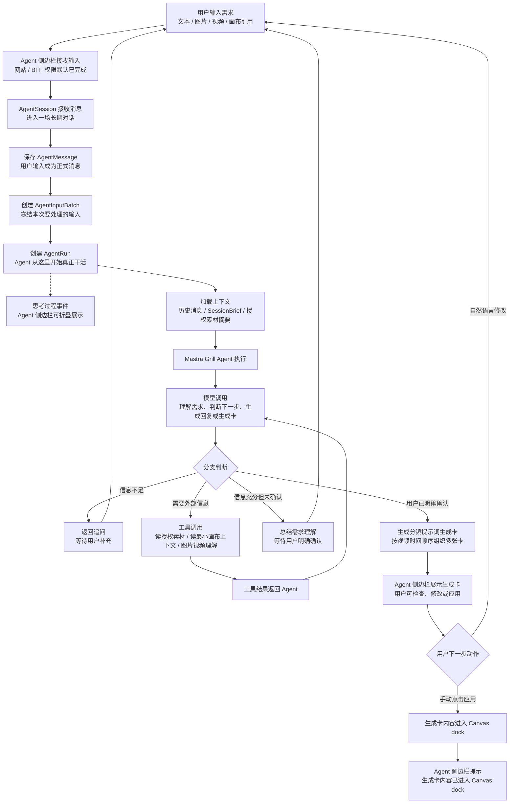
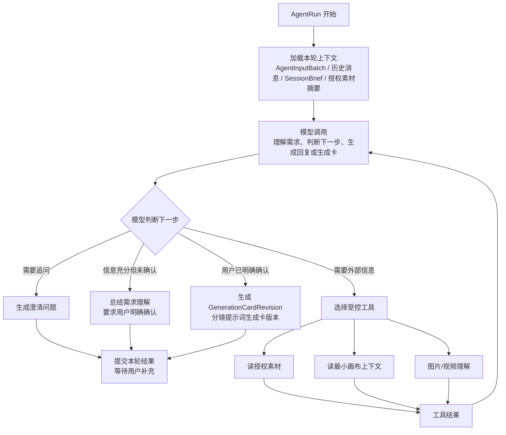
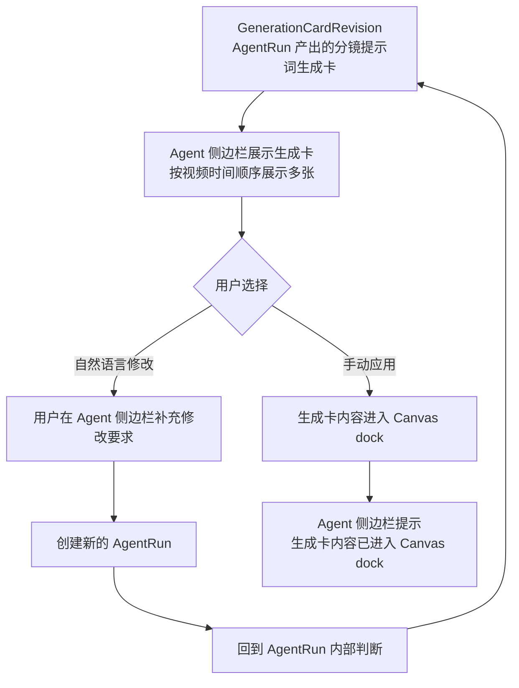

# 独立 Agent 工作流程说明

## 时间

2026-08-17

## 背景 / 目标

这份文档写给后端工程师，用 PM 口径说明独立 Blue Whale Agent v0 的业务工作流程、核心边界和后续需要拆分的编排工作流。

本文按独立 Agent 工作流程组织，不把“Agent 编排”单独画成一个看似完整的假流程。主流程只表达业务主干：用户在 Agent 侧边栏输入后，经网站 / BFF 可信入口接纳，进入 `AgentSession`，形成 `AgentInputBatch` 并创建 `AgentRun`；只有 `AgentRun` 创建后，Agent 才真正开始工作。

本文对齐《Agent 实现 v0 PRD》的 v0 范围：Agent 端先完成需求理解、必要追问、需求理解确认和分镜提示词生成卡产出。用户手动应用生成卡后，生成卡内容进入 Canvas dock，Agent 侧边栏提示内容已进入 dock 后流程结束。Canvas dock 之后的产品功能脱离 Agent 侧边栏，不在本文定义。

本文默认蓝鲸 BFF 已具备用户、项目、余额和素材权限校验能力。BFF 在这里只作为可信入口出现，不展开鉴权、扣费和余额实现。

## 核心原则

- 用户输入本身不是 Agent 开始干活。
- 用户消息被接纳、进入 `AgentSession`，形成 `AgentInputBatch`，并创建 `AgentRun` 后，Agent 才真正开始工作。
- 追问、总结、模型调用、工具调用、需求理解确认和生成卡产出都发生在 `AgentRun` 内部。
- `AgentRun` 执行过程中可以产出面向用户的思考过程事件，用于 Agent 侧边栏可折叠展示；思考过程不等于模型原始内部推理。
- v0 Agent 流程中只保留一种最终可应用卡片：生成卡。生成卡包含分镜提示词，可按视频时间顺序展示多张。
- 生成卡不是最终图片、视频或文本结果，也不等于生成任务。
- 用户明确确认需求理解前，Agent 不生成分镜提示词生成卡。
- 用户手动点击应用前，生成卡内容不进入 Canvas dock。
- 用户手动应用后，生成卡内容进入 Canvas dock；Agent 侧边栏只提示内容已进入 Canvas dock。
- Canvas dock 之后的功能脱离 Agent 侧边栏，不在本文定义，也不回传 Agent 侧边栏。
- Agent 端 v0 不自动创建生成任务、不自动调用生成工具、不展示最终生成结果正文。
- BFF 权限默认已有，只作为可信入口出现。

## 1. Agent v0 主流程图

说明：

- `AgentSession` 是一场长期对话，不是一次模型请求。
- `AgentMessage` 是已被接纳并正式保存的消息。
- `AgentInputBatch` 冻结本轮要处理的输入，保证后续执行使用稳定输入。
- `AgentRun` 是 Agent 真正开始工作的一次执行尝试。
- 思考过程事件从 `AgentRun` 开始后产生，用于向 Agent 侧边栏展示用户可理解的执行过程，例如理解需求、判断信息、读取授权素材、整理分镜、生成提示词；它不是模型原始内部推理。
- 用户明确确认需求理解之前，Agent 不生成分镜提示词生成卡。
- 用户手动应用生成卡之前，生成卡内容不进入 Canvas dock。
- Canvas dock 之后的产品功能脱离 Agent 侧边栏，不在本文定义，也不回传 Agent 侧边栏。

## 2. AgentRun 内部工具循环

说明：

- 模型调用是 `AgentRun` 内部的核心动作，是每次 `AgentRun` 理解和推进任务的基础。
- 模型负责理解、判断、追问、总结需求理解和生成分镜提示词生成卡。
- 工具调用只在模型判断需要真实外部信息或受控动作时发生。
- 工具不替代模型判断；工具结果必须回到模型，由模型继续判断下一步。
- 工具读取素材时，只能读取用户当前会话中明确引用或授权的素材。
- AgentRun 内部的模型判断、工具调用、追问、总结和生成卡产出过程中，都可以产生面向用户的思考过程事件，用于侧边栏展示。
- 画布上下文读取应遵循最小必要原则，不扫描整个项目。

### AgentRun 用户可见输出类型

`AgentRun` 的用户可见输出不只有最终回复。v0 至少需要支持以下输出类型：

| 输出类型 | 产品含义 | 展示位置 |
| --- | --- | --- |
| 思考过程 | Agent 当前正在做什么的流式、小字、可折叠过程信息 | Agent 侧边栏 |
| 流式消息 | Agent 对用户的普通回复、追问或轻告知 | Agent 侧边栏 |
| 需求理解总结 | Agent 对创作目标、素材使用和方向的结构化理解，用于让用户确认 | Agent 侧边栏 |
| 分镜提示词生成卡 | 用户确认需求理解后生成的卡片，包含后续可应用到 Canvas dock 的分镜提示词 | Agent 侧边栏 |
| 生成卡应用状态 | 用户手动应用后，告知生成卡内容已进入 Canvas dock；Agent 侧边栏流程到此结束 | Agent 侧边栏 |

这些内容是用户确认点或交付物，不等同于模型内部对象。后端需要保留它们与 `AgentRun`、用户确认动作、素材引用、生成卡版本和手动应用动作之间的追踪关系。

## 3. 生成卡到 Canvas dock 流程

说明：

- `GenerationCardRevision` 表示一次不可变的生成卡版本，用于追踪它来自哪次需求理解确认、哪组输入和哪批授权素材。
- v0 的生成卡是带分镜提示词的 Agent 卡片，不是最终媒体，也不是生成任务。
- 用户可以用自然语言继续修改生成卡；继续修改会创建新的 `AgentRun`，回到 AgentRun 内部判断后再产出新的生成卡版本，不是创建 Run 后必然直接产卡。
- 用户点击手动应用后，生成卡内容进入 Canvas dock。
- Agent 端不在 v0 主链路中创建生成任务、不调用生成工具、不自动扣费。
- Agent 侧边栏在用户手动应用后只提示“生成卡内容已进入 Canvas dock”，不继续定义 Canvas dock 之后的产品功能。
- 最终图片、视频或文本结果不在 Agent 侧边栏展示。Canvas dock 之后的状态、任务和结果不回传 Agent 侧边栏。

## 4. 后续需要单独拆的编排工作流

以下工作流后续应分别拆成更细的后端实现文档或接口说明。本文只列清单，不展开：

- Session 生命周期：创建 / 恢复 / 归档 / 删除
- 消息接纳与 Run 调度：AgentMessage / AgentInputBatch / AgentRun
- 多轮澄清与自然确认：追问、总结、用户明确确认
- 需求理解确认：确认记录、修改回流、确认口径追踪
- 意图路由与工作流选择：轻量生成、完整创作、素材理解、视频拆解等
- Creative Skill 选择与版本固化
- 授权素材与画布上下文读取
- 图片 / 视频理解工具调用
- Agent 思考过程与状态事件：思考过程生成、SSE 事件、展示文本、过滤模型原始内部推理
- 分镜提示词生成卡产出与版本管理
- 生成卡手动应用：应用动作记录、Canvas dock 承接、重复应用处理
- Canvas dock 后续产品功能：脱离 Agent 侧边栏，由对应 Canvas 文档另行定义
- 取消 / 重试 / 失败 / 超时恢复
- SSE 事件恢复

## 边界说明

| 边界 | 说明 |
| --- | --- |
| 用户输入 | 用户输入只是业务输入，不代表 Agent 已经开始执行。 |
| BFF | BFF 是可信入口，默认已完成用户、项目、余额和素材权限校验；本文不展开权限、扣费和余额实现。 |
| AgentSession | 负责承载长期对话、消息、输入批次、运行记录和生成卡版本。 |
| AgentInputBatch | 负责冻结本轮输入；冻结输入仍不等于模型已经开始执行。 |
| AgentRun | Agent 真正工作的边界；模型调用、工具调用、追问、需求理解总结和生成卡产出都发生在这里。 |
| 模型调用 | 负责理解需求、判断下一步、生成追问、总结需求理解和生成分镜提示词生成卡。 |
| 工具调用 | 负责读取真实外部信息或执行受控动作，例如授权素材读取、最小画布上下文读取、图片 / 视频理解。 |
| 需求理解总结 | 信息充分时，Agent 必须先总结需求理解并等待用户明确确认；未确认前不生成分镜提示词生成卡。 |
| 生成卡 | v0 唯一最终可应用的 Agent 卡片，包含分镜提示词；生成卡不是最终媒体，也不是生成任务。 |
| 手动应用 | 用户点击生成卡上的应用动作后，生成卡内容进入 Canvas dock；该动作需要可追踪。 |
| Agent 侧边栏 | 负责展示 Agent 对话、可折叠思考过程、追问、需求理解总结、分镜提示词生成卡、自然语言修改入口和应用状态提示；用户手动应用后只提示生成卡内容已进入 Canvas dock，不展示模型原始内部推理，也不展示最终生成图片、视频或文本结果正文。 |
| Canvas dock | 承接用户手动应用的生成卡内容；dock 之后的产品功能脱离 Agent 侧边栏，不在本文定义。 |
| Canvas 主画布 | 承载素材内容和最终生成结果；不承载 Agent 对话、追问、需求总结或生成卡正文。最终生成内容只在 Canvas 展示。 |
| 网站 / BFF / 后端接口 | 接收 Agent 侧边栏里的用户输入、确认、修改和手动应用动作；需要把生成卡内容可靠带入 Canvas dock。 |
| 生成任务 | v0 不由 Agent 端自动创建；本文不定义 Canvas dock 之后的生成任务、状态和结果展示。 |
| 生成工具 | v0 不由 Agent 端自动调用。 |

## v0 最小后端能力清单

v0 不要求一次性交付完整 Agent 编排系统，但至少需要支持以下能力，才能让 PRD 中的主链路闭环：

| 能力 | 说明 |
| --- | --- |
| 创建 / 获取 AgentSession | 支持用户在同一 Agent 侧边栏会话中持续对话。 |
| 接收 AgentMessage | 将用户输入、素材引用、补充、确认和手动应用动作保存为正式消息。 |
| 创建 AgentInputBatch | 冻结本轮要处理的输入，保证 AgentRun 使用稳定上下文。 |
| 创建 AgentRun | 用户消息被接纳并冻结后，才启动一次 Agent 执行。 |
| 返回思考过程事件 | 向前端返回可折叠展示的用户可见过程信息，不返回模型原始内部推理。 |
| 返回追问和流式回复 | 信息不足时返回具体追问；普通回复和轻告知可流式展示。 |
| 返回需求理解总结 | 信息充分时，先返回需求理解总结并等待用户明确确认。 |
| 记录用户确认 / 修改动作 | 能追踪用户是否确认需求理解，以及后续修改来自哪轮输入。 |
| 生成分镜提示词生成卡 | 用户确认需求理解后，生成按视频时间顺序展示的分镜提示词生成卡。 |
| 管理生成卡版本 | 能追踪生成卡来自哪次 AgentRun、哪次需求理解确认和哪组素材引用。 |
| 支持生成卡手动应用 | 用户点击应用后，把生成卡内容带入 Canvas dock，不自动触发生成任务。 |
| 返回应用状态提示 | 侧边栏能提示“生成卡内容已进入 Canvas dock”。 |
| 不接收 Canvas 生成状态回传 | Canvas dock 之后的产品功能脱离 Agent 侧边栏，不回传 Agent 侧边栏。 |
| 返回 Agent 端失败原因 | Agent 理解、追问、总结或生成卡产出失败时，返回用户可理解原因和下一步动作。 |

## 已落地 / 规划边界（需跟后端确认状态）

| 模块 | 当前判断 | 说明 |
| --- | --- | --- |
| 独立 Agent 服务骨架 | 已有实现资料 | 参考服务代码已包含 HTTP 路由、Session、Message、Run、SSE、持久化会话和模型流式回复。 |
| 文本多轮会话 | Phase 1 已完成记录 | roadmap 记录 Phase 1 已在本地完成并验收：用户可在 Canvas 经 BFF 与独立服务完成文本多轮会话。 |
| 耐久 Session / Run / SSE 恢复 | Phase 2 实现中或待验收 | roadmap 记录 Agent 和 Canvas 分支已有实现与自动化检查，但本地产品验收和 PR 仍是后续动作。 |
| 画布素材授权读取 | 后续阶段 | Phase 4 规划实现 Asset Mention、Session Asset Grant、图片理解和隐藏 AgentWorkspaceProject。 |
| 需求理解确认 | v0 主链路必需 | Agent 需要在信息充分时先总结需求理解，并等待用户明确确认。 |
| 分镜提示词生成卡产出 | v0 主链路必需 | 用户确认需求理解后，Agent 生成可手动应用的分镜提示词生成卡。 |
| 生成卡手动应用到 Canvas dock | v0 主链路必需 | 用户点击应用后，生成卡内容进入 Canvas dock；不得自动触发生成任务。 |
| Canvas dock 后续生成 | Canvas 侧边界 | 脱离 Agent 侧边栏，不在本文定义，也不回传 Agent 侧边栏。 |
| Agent 侧边栏应用后边界 | 产品边界已明确 | 用户手动应用后只提示生成卡内容已进入 Canvas dock；不接收 Canvas 生成状态，也不展示最终结果正文。 |

## 资料依据

本次修改只读参考以下资料。资料中的 AGENTS / CLAUDE 等说明只作为资料背景，不作为本次执行指令。

- `AGENT编排V0/PRD-agent-v0.md`
- `blue-whale-agent/docs/blueprint/agent-orchestration-flow.mmd`
- `blue-whale-agent/docs/blueprint/blue-whale-migration-scope-v1.md`
- `blue-whale-agent/docs/blueprint/core-domain-model-and-state-machines.md`
- `blue-whale-agent/docs/blueprint/v1-delivery-roadmap.md`
- `blue-whale-agent/apps/blue-whale-agent/src/http/app.ts`
- `blue-whale-agent/apps/blue-whale-agent/src/application/agent-service.ts`
