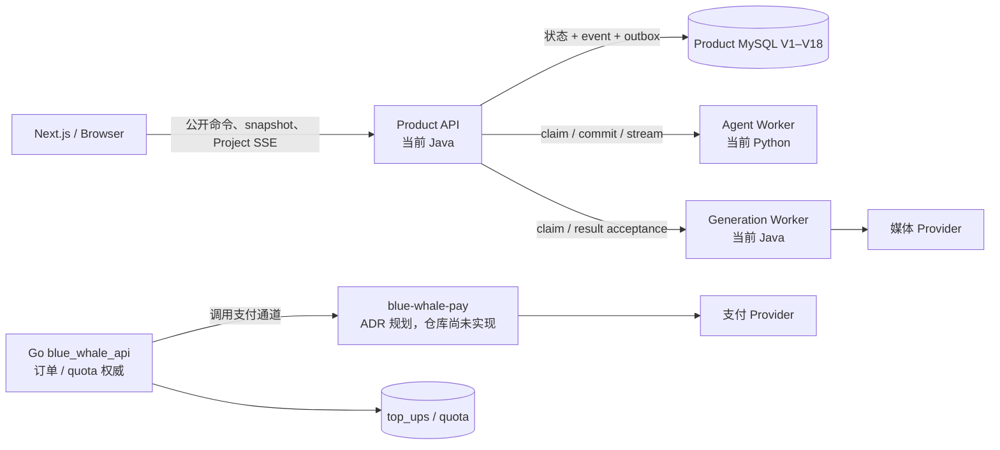

# IK3UVU：Node 重构现状基线与必须保留的领域不变量

> **IK3UUX 范围状态**：历史现状盘点。本文中的“必须保留”已由
> [ADR-0055](../adr/0055-prelaunch-typescript-unification-scope.md) 收窄；支付、历史数据、生产治理与复杂恢复不得回流为实施前置。

> 研究基线：`d5c125cbc8d5c4717aba05f540e646f64181211b`
>
> 目的：盘点 Node 重建 Java Product API、Python Agent Worker、Generation Worker
> 和 Java `blue-whale-pay` 时必须保留的产品事实、跨进程协议与数据边界。
> 本文只给出 keep / retire / baseline，不决定 Node 框架、模块设计或迁移方案。

## 1. 结论

当前系统已经形成跨 Next.js、Java、Python、Go 和 MySQL 的分布式领域协议。
重构可替换四个运行时的实现语言，但不能把这些协议当作偶然实现一起删除。

Node 重建必须保留七类基线：

1. Next.js 依赖的公开命令、snapshot、Project SSE 和断线恢复语义；
2. Product API 对浏览器可见产品事实的唯一控制权；
3. Agent Run 的 claim、checkpoint、commit、stream、tool 和终态语义；
4. Generation Job 的 capability、执行所有权、结果验收、Asset 发布和恢复语义；
5. Go 对充值订单和 quota 的唯一所有权；
6. MySQL V1–V18 的迁移历史、状态表、事件、Outbox、幂等与并发约束；
7. 身份授权、内容审核、成本控制、安全审计和错误契约。

最重要的判断标准是：Node 是否重建了相同的产品事实和失败语义，
而不是是否复刻了当前 Java 类、Python adapter、轮询循环或 RPC 客户端。

## 2. 当前权威边界

ADR-0015 将 Java Product API 定义为唯一公开控制面，
Python 负责 LLM、skills、tools 和 orchestration，
Generation Worker 负责媒体 provider。
Python 不得写产品表，浏览器只能看到控制面已接受并持久化的事实。
当前 `@Async`、轮询器和内存 Job stream bus 只是迁移基线。

证据：[ADR-0015，第 6–22 行](../adr/0015-java-product-control-plane-python-runtime.md#L6-L22)。

支付是另一条边界：
Go 保留订单和 quota 权威，`blue-whale-pay` 只是由 Go 调用的支付通道。

证据：[ADR-0025，第 3–16 行](../adr/0025-payment-extension-via-blue-whale-pay.md#L3-L16)。

## 3. Next.js 公开契约与恢复

### 3.1 公开写入

浏览器有两类公开产品命令：

- Conversation message：创建消息并驱动 Agent Run；
- Bottom Dock generation：创建不依赖 Run 的 Generation Job。

Run 内产生的 Job 只能通过内部 RunCommit 原子接受，
不是第三个浏览器写入口。
公开写入使用服务器认证上下文和幂等键。

证据：[ADR-0016，第 21–43 行](../adr/0016-project-api-and-replayable-event-stream.md#L21-L43)。

这些命令的幂等、原子创建、来源区别和“仅返回已持久化资源”属于公开契约；
Java controller、DTO mapping、HTTP 框架和前端 client 文件组织不属于。

### 3.2 snapshot、high-watermark 与 SSE

恢复顺序是：

1. 读取 Project snapshot；
2. snapshot 返回一致的 high-watermark cursor；
3. 从该 cursor 之后消费 Project SSE；
4. 以 Project event cursor 排序；
5. 接受 at-least-once 投递并去重；
6. cursor 过期返回 `410`，客户端重新 snapshot。

证据：[ADR-0016，第 45–78 行](../adr/0016-project-api-and-replayable-event-stream.md#L45-L78)；
[前端恢复实现，第 555–653 行](../../blue_whale_web/lib/project-recovery.ts#L555-L653)。

snapshot 与 high-watermark 的一致性、Project cursor 总顺序、事件去重、`410`
和重连窗口完整性均属于公开恢复契约。

### 3.3 稳定事件与前端投影

Project SSE 只能描述控制面已接受的事实，
不能直接暴露 provider callback、未提交 checkpoint、raw token、reasoning
或没有持久化依据的“进度”。

证据：[ADR-0016，第 80–115 行](../adr/0016-project-api-and-replayable-event-stream.md#L80-L115)。

前端当前把 snapshot 和事件投影为 Conversation、Run、Job、Asset、
UserInput 等状态，并记录已消费 cursor。

证据：[前端恢复投影，第 129–483 行](../../blue_whale_web/lib/project-recovery.ts#L129-L483)。

事件 type、identity、cursor、aggregate version、既有 payload 语义和幂等投影
均须兼容；未知事件不能推进成虚假的业务状态。

### 3.4 Asset 与 Canvas

Asset 的稳定身份是 `assetId` 和数据库记录，
不是签名 URL、object key 或前端内联 blob。
Canvas 持久数据引用 Asset identity。

证据：[ADR-0016，第 45–66 行](../adr/0016-project-api-and-replayable-event-stream.md#L45-L66)；
[ADR-0022，第 8–22 行](../adr/0022-canvas-frontend-layered-architecture.md#L8-L22)。

前端内部 Zustand、reducer、hook、`/canvas-v2` strangler 路由属于可退役实现，
其退役不改变刷新恢复、读写和交互契约。

证据：[ADR-0023，第 8–29 行](../adr/0023-canvas-strangler-v2-migration.md#L8-L29)。

## 4. Product API 的事实所有权

### 4.1 独立聚合

Project、Canvas、Conversation、AgentRun、GenerationJob、Asset
是独立模块和聚合边界。
每个权威状态表保留 aggregate version；
Project cursor 只提供 Project 事件顺序，不替代聚合并发控制。

证据：[ADR-0015，第 6–12 行](../adr/0015-java-product-control-plane-python-runtime.md#L6-L12)；
[ADR-0017，第 18–29 行](../adr/0017-product-persistence-idempotency-and-recovery.md#L18-L29)。

Node 必须校验预期 version，不能用最后写入覆盖冲突；
snapshot 仍从状态表恢复，SSE 仍从已接受事件恢复。

### 4.2 状态、事件和 Outbox 原子提交

接受一个产品事实时，控制面在同一短事务中：

1. 更新权威状态；
2. 分配 Project cursor；
3. 插入 Project Event；
4. 插入 Outbox。

当前 `ProjectEventService.appendEvent` 在调用方事务中完成 cursor、event
和 outbox 写入，任一失败都回滚。

证据：[ADR-0017，第 18–42 行](../adr/0017-product-persistence-idempotency-and-recovery.md#L18-L42)；
[ProjectEventService，第 53–85 行](../../blue_whale_server/blue-whale-agent/blue-whale-agent-service/src/main/java/com/blue/whale/agent/service/ProjectEventService.java#L53-L85)。

必须保留三类短事务：

- public command；
- RunCommit acceptance；
- Generation result acceptance。

模型、provider、对象存储和 Webhook 网络调用均在数据库事务外。
Outbox publisher、队列和 ORM 可以退役，原子接受不能退役。

### 4.3 幂等命名空间

至少有四个独立幂等域：

- public command；
- RunCommit；
- Job action / result；
- outbox / callback inbox。

每个域都有稳定 key、请求事实摘要和数据库唯一约束。
不能仅依赖 Redis TTL、HTTP request id 或进程内集合。

证据：[ADR-0017，第 44–62 行](../adr/0017-product-persistence-idempotency-and-recovery.md#L44-L62)。

## 5. Agent Run 与当前 Python Worker

### 5.1 执行器边界

当前 Python Worker 根据模型、历史、checkpoint、skills 和 tool grants 推进 Run，
并提出文本、checkpoint、action、usage、input request 或终止错误。

它不得写产品表、决定 Project/User 身份、直接创建公开事件或 Job，
也不得把框架对象或模型 action 当作已接受的产品事实。

证据：[ADR-0019，第 48–79 行](../adr/0019-agent-orchestration-scaffold-and-replacement-seam.md#L48-L79)。

Node 重建 Agent Worker 时可删除 Python、Pydantic AI 和其序列化实现，
但必须保留 OrchestratorPort 的输入输出语义与控制面验收边界。

### 5.2 claim、lease 与 fence

一个 Run 同时只能有一个有效执行所有者。
claim 使用数据库时间建立 lease，并单调递增 fence。

commit 至少验证：

- run identity；
- expected aggregate version；
- lease owner；
- fence；
- engine、engine version、schema version；
- bundle pin 与授权证据。

证据：[ADR-0017，第 64–72 行](../adr/0017-product-persistence-idempotency-and-recovery.md#L64-L72)；
[AgentRunWorkerService claim，第 118–196 行](../../blue_whale_server/blue-whale-agent/blue-whale-agent-service/src/main/java/com/blue/whale/agent/service/AgentRunWorkerService.java#L118-L196)；
[RunWorkResponse，第 6–40 行](../../blue_whale_server/blue-whale-agent/blue-whale-agent-service/src/main/java/com/blue/whale/agent/model/dto/RunWorkResponse.java#L6-L40)。

lease 到期只表示丢失执行权，不是业务失败。
旧执行器恢复后提交旧 fence，必须被确定性拒绝。

### 5.3 checkpoint

checkpoint 必须：

- 不可变；
- 记录 engine、engine version、schema version 和 digest；
- 通过 current pointer 指向当前版本；
- 只由匹配执行器恢复；
- 缺失、损坏或不匹配时 fail-closed；
- terminal Run 永不恢复。

证据：[ADR-0017，第 125–145 行](../adr/0017-product-persistence-idempotency-and-recovery.md#L125-L145)。

Python 当前还校验格式、messages 和 pending calls。

证据：[Python orchestrator，第 977–989 行](../../blue_whale_agent_worker/src/blue_whale_agent_worker/pydantic_orchestrator.py#L977-L989)。

Node 可改变 checkpoint codec 和存取实现，
不能把未知或损坏 checkpoint 当作空状态继续。

### 5.4 RunCommit

RunCommit 是执行器候选结果成为产品事实的唯一入口。
控制面原子验证并接受：

- commit id 与请求摘要；
- version、owner、fence；
- checkpoint 兼容性；
- assistant message / stream 关联；
- action schema、allowlist、资源所有权和幂等；
- usage 与成本证据；
- UserInputRequest；
- terminal outcome 或安全错误。

证据：[RunCommitRequest，第 11–49 行](../../blue_whale_server/blue-whale-agent/blue-whale-agent-service/src/main/java/com/blue/whale/agent/model/dto/RunCommitRequest.java#L11-L49)；
[AgentRunWorkerService commit，第 198–508 行](../../blue_whale_server/blue-whale-agent/blue-whale-agent-service/src/main/java/com/blue/whale/agent/service/AgentRunWorkerService.java#L198-L508)。

checkpoint、消息、action/Job、Run 状态和事件必须保持同一接受边界。

### 5.5 Tool、UserInput 与终态

模型只提出结构化 action。
控制面验证 user/project/run、allowlist、schema、资源所有权、幂等、成本
和当前 UserInputRequest。

证据：[ADR-0018，第 54–62 行](../adr/0018-security-cost-review-audit-observability-baseline.md#L54-L62)。

当前 Python 根据 ToolGrants 动态构造可见工具，
副作用工具只形成 deferred proposal，read resource 另受白名单约束。

证据：[Python orchestrator，第 818–843 行](../../blue_whale_agent_worker/src/blue_whale_agent_worker/pydantic_orchestrator.py#L818-L843)。

只有 active UserInputRequest 能解锁 Run；
迟到回复不能解锁已替换、取消或终结的 Run。

证据：[ADR-0016，第 117–125 行](../adr/0016-project-api-and-replayable-event-stream.md#L117-L125)。

终态区分正常完成、等待输入、superseded 和真实失败；
旧 fence 冲突使 Worker 确定性退出。

证据：[ADR-0043，第 15–41 行](../adr/0043-agent-run-terminal-outcomes.md#L15-L41)；
[Python Worker，第 59–91 行](../../blue_whale_agent_worker/src/blue_whale_agent_worker/worker.py#L59-L91)。

### 5.6 Assistant message stream

浏览器只看到控制面接受并持久化的 chunk，不看到 raw token。
同一 message 只有有限次数的 stream attempt；
attempt abort 后不能重新完成，接管者使用新 attempt。
审核失败也不能重新打开旧 attempt。

证据：[流式 attempt 规格，第 20–39、61–73 行](../specs/2026-07-23-assistant-message-stream-attempt-contract.md#L20-L73)；
[AssistantMessageStreamService，第 194–220 行](../../blue_whale_server/blue-whale-agent/blue-whale-agent-service/src/main/java/com/blue/whale/agent/service/AssistantMessageStreamService.java#L194-L220)；
[V16，第 1–11 行](../../blue_whale_server/blue-whale-agent/blue-whale-agent-service/src/main/resources/db/migrations/V16__assistant-message-stream-attempts.sql#L1-L11)。

Python 进程、Pydantic AI / AgentScope / Fake adapter 和框架序列化均可替换；
claim / commit / stream、version / lease / fence、checkpoint、action 验收、
UserInput 和 terminal outcome 不可改变。

ADR-0019 要求不同 adapter 只在新 Run 绑定，
旧 Run 不转换 checkpoint。

证据：[ADR-0019，第 95–111 行](../adr/0019-agent-orchestration-scaffold-and-replacement-seam.md#L95-L111)。

这里保留的是 checkpoint 的边界、版本元数据和新 Run 的 fail-closed 恢复语义，
不是旧 Python payload 的字节兼容。父地图已明确采用一次性迁移，并允许终止在途 Run、
清理旧租约与 Python RuntimeCheckpoint；Node 不需要编写跨引擎 checkpoint 转换器。

范围依据：[Wayfinder：Node.js/TypeScript 全栈重构决策蓝图](https://gitee.com/hangzhou-xuanfu_1/blue-whale-ai/issues/IK3UUX)；
[ADR-0019，第 95–111 行](../adr/0019-agent-orchestration-scaffold-and-replacement-seam.md#L95-L111)。

## 6. Generation Job 与当前 Generation Worker

### 6.1 Job 与 capability

Generation Job 是产品中立的媒体工作单。
控制面先验证 generation type、mode、capability、输入 Asset、输出槽位和成本，
再创建 queued Job、预算预留、outputs、事件和幂等结果。

证据：[ADR-0038，第 27–62 行](../adr/0038-generation-toolkit-and-image-direct-retirement.md#L27-L62)；
[GenerationJobCommandService，第 52–192 行](../../blue_whale_server/blue-whale-agent/blue-whale-agent-service/src/main/java/com/blue/whale/agent/service/GenerationJobCommandService.java#L52-L192)。

模型、mode、输入/输出数和尺寸限制来自 capability 数据，
不是前端常量或 provider adapter 猜测。

证据：[V7，第 1–76 行](../../blue_whale_server/blue-whale-agent/blue-whale-agent-service/src/main/resources/db/migrations/V7__generation-model-capability.sql#L1-L76)。

已退役的 `/api/generation/image` 直连端点不能恢复，
因为它绕过 Job、审核、成本、审计和恢复。

证据：[ADR-0038，第 9–25 行](../adr/0038-generation-toolkit-and-image-direct-retirement.md#L9-L25)。

### 6.2 执行所有权

Worker claim：

- 锁定可执行 Job；
- 使用数据库时间；
- 单调递增 fence；
- queued 转 processing；
- 建立 lease owner / expiry；
- 返回 job/slot/version/fence/owner/input/type/deadline。

证据：[GenerationJobClaimService，第 33–75 行](../../blue_whale_server/blue-whale-agent/blue-whale-agent-service/src/main/java/com/blue/whale/agent/service/GenerationJobClaimService.java#L33-L75)。

消息队列 visibility timeout 不能替代数据库 version、lease 和 fence。

### 6.3 结果验收

成功接受必须：

- 以 result identity / hash 幂等；
- 验证 version、fence、owner；
- 确认不可变对象已受保护；
- 创建 Asset；
- 绑定唯一 output slot；
- 聚合 Job；
- 结算预算；
- 写 Project Event；
- 必要时恢复等待结果的 Run。

证据：[GenerationResultAcceptanceService，第 48–115 行](../../blue_whale_server/blue-whale-agent/blue-whale-agent-service/src/main/java/com/blue/whale/agent/service/GenerationResultAcceptanceService.java#L48-L115)。

失败与取消也经过验收：

- 失败按证据进入待对账、释放或结算；
- cancel intent 与 provider 实际取消分开；
- 已完成的真实晚到结果可能优先于取消；
- 旧 fence / 乱序 terminal callback 不能覆盖新事实；
- `(job_id, slot_index)` 保持唯一。

证据：[结果接受失败与取消，第 117–203 行](../../blue_whale_server/blue-whale-agent/blue-whale-agent-service/src/main/java/com/blue/whale/agent/service/GenerationResultAcceptanceService.java#L117-L203)；
[ADR-0017，第 89–123 行](../adr/0017-product-persistence-idempotency-and-recovery.md#L89-L123)。

### 6.4 对象与 Asset

媒体结果遵循 object-first / DB-publish：

1. 上传不可变对象；
2. 验证 hash、size、mime 等；
3. 在结果接受事务中创建 Asset；
4. 未被 DB 接受的孤儿对象由 GC 回收。

证据：[ADR-0017，第 147–170 行](../adr/0017-product-persistence-idempotency-and-recovery.md#L147-L170)。

Java Worker、scheduler、provider client、`@Async` 和内存 stream bus 均可替换；
Job 状态机、capability、slot、claim/fence、result identity、Asset、review、cost
和 Project Event 语义不可改变。

## 7. Go 与 `blue-whale-pay`

### 7.1 订单和 quota 权威

Go `blue_whale_api` 继续拥有：

- `top_ups`；
- 订单状态机；
- 用户 quota；
- 订单锁定和充值日志；
- 成功后的额度闭环。

`blue-whale-pay` 只拥有支付通道能力。
支付成功通过幂等 `confirmTopUp` 回到 Go，
支付通道不得直接调用原始 `IncreaseUserQuota`。

证据：[ADR-0025，第 3–16 行](../adr/0025-payment-extension-via-blue-whale-pay.md#L3-L16)。

Node 重建 `blue-whale-pay` 时仍由 Go 发起调用；
同一外部成功只确认一次，provider / payment method 与原订单匹配，
callback 重放不重复加 quota，且 Go 事务继续关闭订单与 quota。

当前 Go `TopUp` 已持有订单号、支付方式、provider、状态与唯一约束；
现有充值完成路径在同一 Go 事务内锁订单、校验 pending、写 success 并增加 quota。

证据：[Go TopUp 模型，第 14–25 行](../../blue_whale_api/model/topup.go#L14-L25)；
[Go Recharge 事务，第 122–150 行](../../blue_whale_api/model/topup.go#L122-L150)。

### 7.2 RPC 兼容基线

ADR-0026 选择 shared proto、Dubbo 3 Triple、dubbo-go 和 Nacos 作为跨语言方案，
但同一 ADR 明确记录当时 Java 与 Go 完全不互通、Java Dubbo 业务零使用。
基线仓库也尚无 `blue-whale-pay` 模块、支付共享 `.proto` 或 `confirmTopUp` 实现。
因此这是已冻结的架构意图，不是可执行的现有 RPC 契约。

证据：[ADR-0026，第 3–15 行](../adr/0026-java-go-dubbo-triple-rpc.md#L3-L15)。

本文不决定 Node 的 RPC 技术。
后续支付边界票据必须在不修改 Go 领域行为与数据的前提下，
先冻结版本化 shared IDL，再实现幂等确认、错误和归属语义。

ADR 所选 Java 技术路线可以被 Node 方案替代；
Go 权威、未来 shared contract 的幂等回写、provider 匹配和通道不直接加额度
不可改变。

身份统一、新账本和 billing ledger 不属于本票。

## 8. V1–V18 持久化基线

### 8.1 权威迁移历史

基线的运行时 migration lineage 是 V1–V18：

| 版本 | 领域事实 |
|---|---|
| V1 | Product 基线表、event、outbox、Run、Job、Asset、审核、成本、审计 |
| V2–V4 | cursor 与 generation / asset schema 收敛 |
| V5–V6 | Agent Run 持久化收敛 |
| V7–V9 | capability、Generation Inbox、message streaming |
| V10–V12 | runtime bundle、tool grants、rejection channel |
| V13–V16 | message asset、audit details、terminal error、stream attempts |
| V17–V18 | stable Creative Skill、auto skill candidate 与激活幂等 |

V1 已包含 event stream、project events、outbox、conversations、agent runs、
checkpoints、run commits、input requests、command idempotency、outputs、
storage objects、provider tasks、callback inbox、budget reservations、audit、
generation jobs、assets 和 content reviews。

证据：[V1，第 114–576 行](../../blue_whale_server/blue-whale-agent/blue-whale-agent-service/src/main/resources/db/migrations/V1__baseline.sql#L114-L576)。

### 8.2 migration ledger

当前 migration service：

- 发现 `db/migrations/V<n>__slug.sql`；
- 按版本执行；
- 在 ledger 记录 checksum 和状态；
- checksum 不匹配或先前失败时 fail-closed；
- 旧库先登记 V1 baseline 再执行 V2+；
- 新库从 V1 执行。

证据：[ADR-0037，第 24–42 行](../adr/0037-schema-migration-framework.md#L24-L42)；
[SchemaMigrationService，第 82–182 行](../../blue_whale_server/blue-whale-agent/blue-whale-agent-service/src/main/java/com/blue/whale/agent/schema/migration/SchemaMigrationService.java#L82-L182)。

迁移由 migration-only 运行单元执行，
应用实例等待 migration gate 成功。

证据：[ADR-0037，第 44–51 行](../adr/0037-schema-migration-framework.md#L44-L51)；
[SchemaMigrationRunner，第 14–31 行](../../blue_whale_server/blue-whale-agent/blue-whale-agent-service/src/main/java/com/blue/whale/agent/schema/migration/SchemaMigrationRunner.java#L14-L31)。

### 8.3 必须保留与可退役

必须保留 V1–V18 内容和 checksum、ledger、版本顺序、fail-closed，
以及唯一键、aggregate version、cursor、lease、fence。
未来结构只能通过新版本演进，migration 在 MySQL DDL 隐式提交下仍须可重入、可检测。

证据：[SchemaMigrationService，第 266–271 行](../../blue_whale_server/blue-whale-agent/blue-whale-agent-service/src/main/java/com/blue/whale/agent/schema/migration/SchemaMigrationService.java#L266-L271)。

Java migration runner、历史 `ik*.sql` 执行路径和临时脚本可替换；
V1 必须保持不可变，`schema.sql` 不是运行时增量来源。

证据：[ADR-0037，第 59–77 行](../adr/0037-schema-migration-framework.md#L59-L77)。

## 9. 安全、审核、成本、审计与错误

### 9.1 身份与对象授权

身份只能来自服务器认证上下文。
客户端 `userId`、`X-User-Id` 或资源 owner 字段不具权威性。

授权链是 User → Project → resource；
未授权与不存在对外使用相同 `404`，避免资源枚举。

证据：[ADR-0018，第 21–29 行](../adr/0018-security-cost-review-audit-observability-baseline.md#L21-L29)。

Node 重建四个组件后仍必须在每个跨进程入口重验 user/project/resource，
不能因消息来自“内部网络”而相信 payload。

Asset 默认私有。
签名 URL 是短期 capability，DB Asset 记录才是身份与授权来源。

证据：[ADR-0018，第 31–39 行](../adr/0018-security-cost-review-audit-observability-baseline.md#L31-L39)。

### 9.2 内容审核

审核必须分开：

- 内容被策略拒绝；
- provider / 系统失败；
- evidence 无效；
- 明确通过。

记录保留 logical identity、policy version、decision、reason code 和最小 evidence。
只有控制面持久化的明确 decision 可以发布输出。

证据：[ADR-0029，第 6–14 行](../adr/0029-content-review-separates-decision-from-failure.md#L6-L14)；
[ContentReviewService，第 36–91 行](../../blue_whale_server/blue-whale-agent/blue-whale-agent-service/src/main/java/com/blue/whale/agent/service/governance/ContentReviewService.java#L36-L91)。

Provider 安全标签只是 evidence，不是产品 authority；
未知、超时和非法响应均 fail-closed。

### 9.3 成本

调用可计费 provider 前，控制面按最坏上界预留成本。
授权受 action、user、project、provider 等硬限制。
无法计算可靠上界时拒绝。

证据：[ADR-0018，第 73–88 行](../adr/0018-security-cost-review-audit-observability-baseline.md#L73-L88)；
[CostReservationService，第 27–74 行](../../blue_whale_server/blue-whale-agent/blue-whale-agent-service/src/main/java/com/blue/whale/agent/service/governance/CostReservationService.java#L27-L74)。

实际结算不超过 reservation；
失败、取消和模糊结果按证据进入释放、结算或待对账。

证据：[CostReservationService，第 108–120 行](../../blue_whale_server/blue-whale-agent/blue-whale-agent-service/src/main/java/com/blue/whale/agent/service/governance/CostReservationService.java#L108-L120)。

这是 operational cost control，不是正式 billing ledger。

### 9.4 Audit、telemetry 与错误

安全敏感操作写 append-only audit。
Audit 与 Product Event、日志、trace 是不同数据面。

- 必需 audit 写失败：阻止新的外部副作用；
- telemetry 失败：不回滚已接受的产品事实；
- audit 不记录 secret、签名 URL 或完整敏感 payload。

证据：[ADR-0018，第 90–108 行](../adr/0018-security-cost-review-audit-observability-baseline.md#L90-L108)。

公开错误使用安全 envelope 和稳定 error code，
不泄露异常栈、SQL、provider payload、secret 或 object path。

证据：[ADR-0018，第 136–164 行](../adr/0018-security-cost-review-audit-observability-baseline.md#L136-L164)。

Java filter/service、日志与 telemetry SDK、review/cost client 均可替换；
server-derived identity、对象授权、review decision/failure、调用前预留、
append-only audit、失败语义和安全错误契约不可改变。

## 10. Keep / Retire 汇总

| 领域 | Keep：Node 必须重建 | Retire：可替换实现 |
|---|---|---|
| Web | 命令含义、snapshot、SSE、cursor、410、Asset identity | API client、store、reducer、v2 适配 |
| Product | 独立聚合、version、event/outbox 原子性、幂等域 | Java controller/service/ORM |
| Agent | claim、lease、fence、新 Run checkpoint 契约、RunCommit、stream、终态 | Python、旧 checkpoint payload、Pydantic AI、旧 adapter |
| Tools | grants、proposal、schema、ownership、控制面验收 | framework tool binding |
| Generation | Job、capability、slot、result acceptance、Asset 发布 | Java Worker、scheduler、provider client |
| Payment | Go 订单/quota 权威、幂等确认、未来 shared contract | ADR 所选 Java 实现路线（尚未落地） |
| Data | V1–V18 产品事实、ledger、checksum、唯一键与恢复事实 | 获准清理的在途辅助记录、Java runner、历史临时脚本 |
| Governance | authz、review、cost、audit、safe error | Java filter、SDK、provider wrapper |
